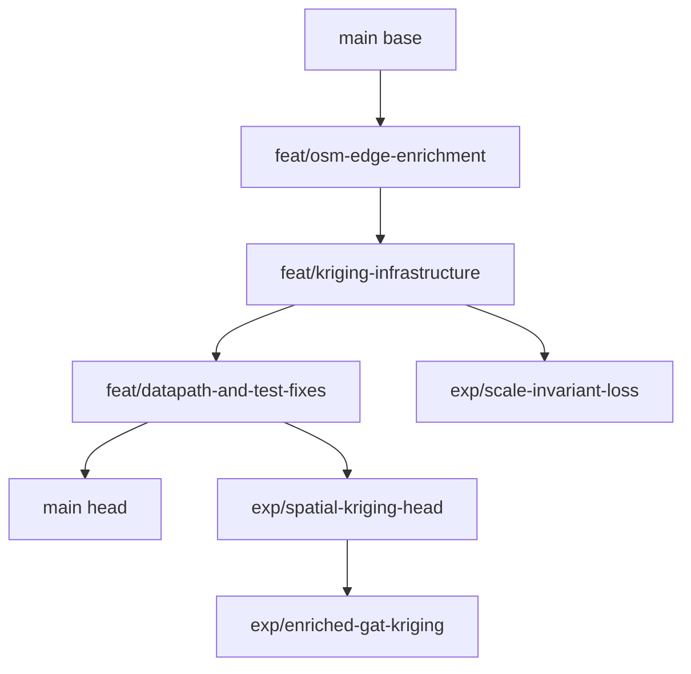

# Context for Architect: Experimental Branches Integration

This document contains compiled context, ancestry analysis, and design details for the two high-performing experimental branches that need to be reimplemented and merged into `main`:
1. `exp/scale-invariant-loss` (Phase 3: Scale-invariant MSLE loss on traffic counts)
2. `exp/enriched-gat-kriging` (Phase 4 & 5: Spatial holdout kriging head + GATv2 edge features enrichment)

---

## 1. Branch Ancestry & Codebase Dependencies

A Git merge-base audit confirms that all baseline feature branches are already fully integrated into `main`:
* `feat/osm-edge-enrichment` (Head: `d1a8e7b`) $\rightarrow$ **Merged**
* `feat/kriging-infrastructure` (Head: `fbbfd31`) $\rightarrow$ **Merged**
* `feat/datapath-and-test-fixes` (Head: `6890a04`) $\rightarrow$ **Merged**

### Branch Ancestry Graph:

### Implications for Reimplementation:
* **No Unmerged Dependencies:** Neither experimental branch depends on unmerged code. All base infrastructure is already present in `main`.
* **Direct Rebase/Reimplementation:** Both branches can be cleanly re-based or reimplemented directly on top of `main`.

---

## 2. Component Analysis & Changes

### A. Scale-Invariant Imputation Loss (`exp/scale-invariant-loss`)
* **Objective:** Replace standard scaled MSE on the traffic channel with Mean Squared Logarithmic Error (MSLE) on raw count values.
* **Mechanism:**
  * Sourced traffic channel mean and std dev stats from `StandardScaler` in `RealIoTDataset` during training initialization.
  * Registered `traffic_mean` and `traffic_std` as buffers in `ResilientIoTPipeline`.
  * In `compute_loss`, inverse-transforms the traffic channel from StandardScaler space back to raw counts before computing scale-invariant MSLE. Weather channels remain in scaled space and use standard MSE.
* **Key Files to Modify:**
  * [src/decoders.py](file:///Users/administrator/Code/ml-agent-workspace/src/decoders.py): Modify `compute_loss` and implement the `scale_invariant_mse` helper.
  * [src/pipeline.py](file:///Users/administrator/Code/ml-agent-workspace/src/pipeline.py): Register scaler buffers and forward them.
  * [src/train.py](file:///Users/administrator/Code/ml-agent-workspace/src/train.py): Read dataset scaler parameters and pass to pipeline.

### B. Spatial Holdout & Enriched GAT (`exp/enriched-gat-kriging`)
* **Objective:** Enable spatial holdout masking (IGNNK-style) for kriging reconstruction, and enrich the spatial GATv2 layer using precomputed physical edge features.
* **Mechanism:**
  * **Kriging (Phase 4):** Creates a random boolean mask per batch during training (and a fixed seeded validation mask). The pipeline zeroes held-out nodes' dynamic features, drops them as graph attention sources, and computes a separate kriging reconstruction loss on them.
  * **GAT Enrichment (Phase 5):** Loads `edge_features_cache.json`, normalizes the physical walking distances (Min-Max scaling to `[0,1]` using the global maximum distance), and constructs a `[E, 10]` `edge_attr` tensor combining 9 physical features and 1 learned similarity.
  * **Fail-Fast Hardening:** Replaced defensive zero-fills for missing edge features with strict `ValueError` assertions to guarantee cache integrity.
* **Key Files to Modify:**
  * [src/dataset.py](file:///Users/administrator/Code/ml-agent-workspace/src/dataset.py): Implement `make_spatial_holdout_mask` and `apply_spatial_holdout`.
  * [src/decoders.py](file:///Users/administrator/Code/ml-agent-workspace/src/decoders.py): Implement `compute_kriging_loss` and wire into `compute_loss`.
  * [src/encoder.py](file:///Users/administrator/Code/ml-agent-workspace/src/encoder.py): Lift GATv2Conv to consume `edge_dim=10`.
  * [src/graph_learner.py](file:///Users/administrator/Code/ml-agent-workspace/src/graph_learner.py): Load cache, normalize distance, and build `edge_attr`.
  * [src/pipeline.py](file:///Users/administrator/Code/ml-agent-workspace/src/pipeline.py): Thread holdout masks and edge attributes through the forward pass.
  * [src/train.py](file:///Users/administrator/Code/ml-agent-workspace/src/train.py): Wire training/validation holdouts and dataset naming.

---

## 3. Design Synergy & Open Architectural Question

* **The Pseudo-MSLE issue:** In `exp/enriched-gat-kriging`, the spatial-kriging loss computes a "pseudo-MSLE" on the *scaled* features because the model didn't have access to the scaler statistics. This results in negative values being clamped to `0.0`, discarding valuable distribution variance below the mean.
* **The Synergy:** By combining the scale-invariant loss buffers with the kriging decoder, the Architect should design the unified pipeline to compute **full MSLE on raw traffic counts for both the Imputation and Kriging heads**, resolving the pseudo-MSLE technical debt.