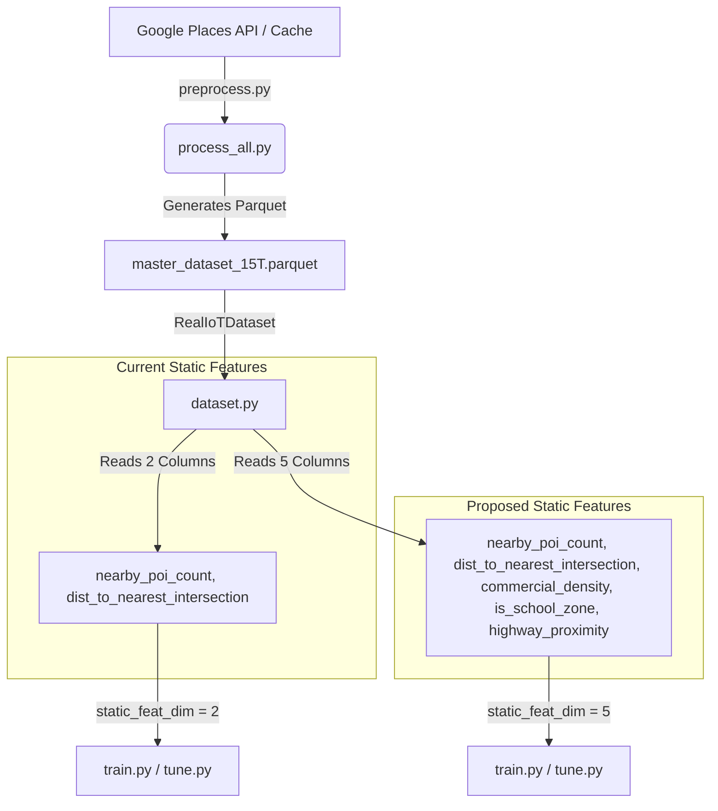

# Architectural Implementation Plan: Google Places API Data Integration for Training & Tuning

This document outlines the end-to-end plan to integrate all live and cached Google Places API features into the static feature embeddings of the `ResilientIoTPipeline`. Doing so will expand the static feature representation from 2 variables to 5 variables, improving the node similarity graph learned by the `DynamicGraphLearner`.

---

## 1. System Topology & Current State



Currently, `src/features.py` successfully fetches and caches live Google Places data (`commercial_density`, `is_school_zone`, `highway_proximity`) into `data/external/places_cache.json` and joins it into the processed Parquet file. However, `src/dataset.py` filters out these columns during loading. 

This plan details how to unlock these variables for model training and tuning.

---

## 2. Step-by-Step Execution Plan

### Step 1: Parquet Column Retrieval Verification
Before loading the data into PyTorch, we must ensure the source processed parquet file contains the required columns.

> [!NOTE]
> The preprocessing pipeline (`process_all.py`) already merges the static feature cache. We just need to verify that `data/processed/master_dataset_15T.parquet` contains:
> *   `commercial_density` (float/int)
> *   `is_school_zone` (boolean/int)
> *   `highway_proximity` (float/int)

If not present, the preprocessing script should be re-run:
```bash
docker compose run --rm gpu-runner python3 src/process_all.py
```

---

### Step 2: Update `src/dataset.py` (PyTorch Dataset)
We will modify the `RealIoTDataset` class to fetch and scale all 5 variables:

1.  **Modify Read Columns:**
    Update `pd.read_parquet` inside `RealIoTDataset.__init__` to load the 3 additional columns:
    ```python
    df = pd.read_parquet(
        parquet_path,
        filters=[
            ('dt', '>=', start_dt), 
            ('dt', '<', end_dt)
        ],
        columns=[
            'dt', 'location', 'value', 'Humidity', 'Solar Radiation', 
            'nearby_poi_count', 'dist_to_nearest_intersection', 
            'commercial_density', 'is_school_zone', 'highway_proximity', # <-- Added
            'veh_class', 'dir'
        ]
    )
    ```

2.  **Cast and Aggregate Features:**
    *   Cast boolean fields (`is_school_zone`) explicitly to `float` (0.0 or 1.0) so they can be processed numerically.
    *   Update `agg_funcs` inside `groupby(['dt', 'location'])` to aggregate the new features:
    ```python
    agg_funcs = {
        'value': 'sum',
        'Humidity': 'first',
        'Solar Radiation': 'first',
        'nearby_poi_count': 'first',
        'dist_to_nearest_intersection': 'first',
        'commercial_density': 'first',
        'is_school_zone': 'first',
        'highway_proximity': 'first'
    }
    ```

3.  **Group & Normalize Static Embeddings:**
    Extract all 5 columns into `stat_df` to construct the static features matrix:
    ```python
    stat_cols = [
        'nearby_poi_count', 
        'dist_to_nearest_intersection', 
        'commercial_density', 
        'is_school_zone', 
        'highway_proximity'
    ]
    stat_df = df[stat_cols].groupby('location').first()
    stat_df['is_school_zone'] = stat_df['is_school_zone'].astype(float).fillna(0.0)
    stat_df = stat_df.reindex(locations_idx).fillna(0.0)
    ```

4.  **Scaling Protocol:**
    Ensure `StandardScaler` fits on this 5-dimensional feature matrix. The global `StandardScaler` will normalize each of the 5 channels to $\mu \approx 0$ and $\sigma \approx 1$ across all nodes. This ensures that features of differing magnitudes (e.g. distance in meters vs count of commercial POIs) do not destabilize graph learning.

---

### Step 3: Update YAML Model Configurations
We must align the configuration files to expect a 5-dimensional static feature dimension.

1.  **Update `configs/train/train.yaml`:**
    Modify the model hyperparameter block:
    ```yaml
    model:
      num_nodes: 81
      static_feat_dim: 5  # <-- Changed from 2 to 5
      time_series_dim: 3
      ...
    ```

---

### Step 4: Ensure Compatibility with Hyperparameter Tuning (`src/tune.py`)
`src/tune.py` uses `train.py`'s core execution loop. Because `RealIoTDataset` determines the feature dimensions at runtime and sets `static_feat_dim` dynamically on the model:
*   Real dataset tuning trials will **automatically adapt** to the 5-dimensional static features.
*   For mock-data integration tests (using `--use-mock-data`), the model reads from `model_cfg["static_feat_dim"]`. Updating `train.yaml` ensures the mock dataloader generates `static_features` of shape `[num_nodes, 5]`, maintaining seamless test execution.

---

### Step 5: Update the Digital Twin UI Export Tool (`src/export_ui_payload.py`)
The digital twin exporter needs minor alignments to avoid state-dict dimension mismatches during forward passes:
1.  **Assertion Alignment:**
    Update `combined_static` assertions to verify a shape of `(num_nodes_total, 5)`:
    ```python
    assert combined_static.shape == (num_nodes_total, 5), \
        f"Static features shape mismatch: {combined_static.shape}"
    ```
2.  **Simulated Embeddings (`build_simulated_static`):**
    The generator for simulated nodes uses the mean static embedding of real nodes:
    ```python
    mean_static = real_static.mean(dim=0, keepdim=True) # [1, 5]
    return mean_static.expand(n, -1)                    # [n, 5]
    ```
    This functions out-of-the-box as it dynamically reads `static_feat_dim` from the real static features tensor.

> [!WARNING]
> **State Dict Shape Mismatch Risk:** 
> Pre-existing checkpoints (such as `models/best_pipeline.pt`) were trained with `static_feat_dim: 2`. Loading these weights using a config with `static_feat_dim: 5` will crash on `nn.Linear(5, embedding_dim)` weight mismatch. 
> 
> **Resolution:** A fresh training run must be performed to save a new `best_model.pt` before running the UI exporter.

---

## 3. Smoke Testing & Verification Suite

To verify the correct execution of these changes, we will write a dedicated verification script **`tests/test_places_dataset.py`**.

```python
import os
import torch
import pandas as pd
from src.dataset import RealIoTDataset

def test_dataset_places_enrichment():
    parquet_path = "data/processed/master_dataset_15T.parquet"
    
    # 1. Instantiate dataset with real parquet file
    dataset = RealIoTDataset(
        parquet_path=parquet_path,
        start_date="2024-04-02",
        end_date="2024-04-10",
        seq_len=12,
        mask_prob=0.15,
        target_veh_class="person",
        target_dir="all"
    )
    
    # 2. Assert correct static feature dimensionality
    print(f"Loaded Static Feature Shape: {dataset.static_features.shape}")
    assert dataset.static_feat_dim == 5, f"Expected 5 features, got {dataset.static_feat_dim}"
    assert dataset.static_features.shape == (dataset.num_nodes, 5), "Static features shape mismatch!"
    
    # 3. Assert correct normalization (mean close to 0, std close to 1)
    mean = dataset.static_features.mean(dim=0)
    std = dataset.static_features.std(dim=0)
    print(f"Static Feature Means: {mean.tolist()}")
    print(f"Static Feature StdDevs: {std.tolist()}")
    
    assert torch.allclose(mean, torch.zeros_like(mean), atol=1e-1), "Static features mean is not normalized!"
    
    # 4. Assert absence of NaNs / Infs
    assert not torch.isnan(dataset.static_features).any(), "Found NaNs in static features!"
    assert not torch.isinf(dataset.static_features).any(), "Found Infs in static features!"
    
    print("✓ Dataset Smoke Test Passed Successfully!")

if __name__ == "__main__":
    test_dataset_places_enrichment()
```

### Execution Protocol
1.  Run the dataset smoke test in the Docker environment:
    ```bash
    docker compose run --rm gpu-runner python3 tests/test_places_dataset.py
    ```
2.  Perform a **Model Burn Test** (1 epoch of local CPU training with `--use_mock_data`) to verify that backpropagation and graph learning work without mismatch:
    ```bash
    docker compose run --rm cpu-runner python3 src/train.py --config configs/train/train.yaml --use_mock_data
    ```

---

## 4. Expected Impact on Model Metrics

1.  **Topological Learning:** By supplying the `DynamicGraphLearner` with a rich 5-variable static profile (commercial profile, transit access, school proximity, road intersection distance), the GAT-attention graph will be much better aligned to real-world structural similarities rather than just spatial proximity.
2.  **Imputation Reliability:** The spatial smoothing of the Graph Attention Network (GAT) will benefit from these new correlation channels, enhancing the reconstruction accuracy of structural zeros and traffic outliers.
