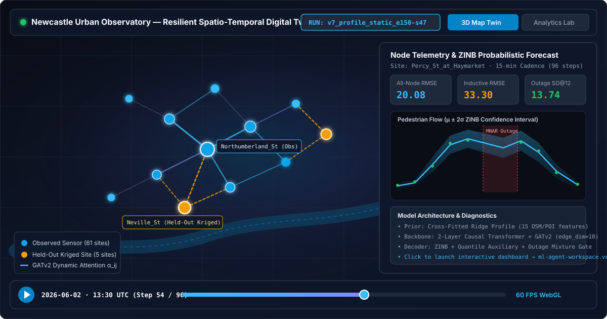

# Resilient Spatio-Temporal Graph Neural Networks for Urban IoT Sensor Networks

[](https://ml-agent-workspace.vercel.app)
[](https://ml-agent-workspace.vercel.app/analytics)
[](https://ml-agent-workspace-x8u9.vercel.app/)
[](pyproject.toml)
[](Dockerfile.gpu)

An end-to-end research and engineering framework for **probabilistic spatio-temporal forecasting, multi-hour sensor outage imputation, and inductive spatial kriging** across urban IoT sensor networks. Developed on 3.4 years of 15-minute pedestrian and vehicular telemetry across **66 sensor sites in Newcastle upon Tyne** from the Newcastle Urban Observatory (UO).

---

## Interactive Geospatial Digital Twin Dashboard

Click the preview below to launch the live **Newcastle Urban Observatory Digital Twin** hosted on Vercel and backed by Cloudflare R2:

[](https://ml-agent-workspace.vercel.app)

- **3D Geospatial Map Twin (`/`):** [https://ml-agent-workspace.vercel.app](https://ml-agent-workspace.vercel.app)
  - Inspect live & historical 15-minute pedestrian flows across 61 observed sensor sites and 5 completely held-out (inductive kriging) sites.
  - Switch dynamically between top-performing RIoT v7, v6, and v5 model runs via the top-bar **Model Selector**.
  - Visualize learned **GATv2 dynamic spatial attention weights ($\alpha_{ij}$)** across the walking network and inspect per-site Zero-Inflated Negative Binomial ($\mu, \theta, \pi$) uncertainty fans.
- **Calibration & Outage Analytics Workbench (`/analytics`):** [https://ml-agent-workspace.vercel.app/analytics](https://ml-agent-workspace.vercel.app/analytics)
  - Compare Probability Integral Transform (PIT) calibration histograms, zero-inflation reliability diagrams, and simulated multi-hour sensor outage trajectories across model families.

---

## DSTL Sponsor Review Presentation

A self-contained, interactive 27-slide Reveal.js presentation deck summarising the three research chapters, mathematical formulations, and key ablation outcomes is included in [`dstl_presentation/`](dstl_presentation/README.md):

- **Presentation Deck Entry Point:** [`dstl_presentation/index.html`](dstl_presentation/index.html)
- **Speaker Notes & Architecture Overview:** [`dstl_presentation/README.md`](dstl_presentation/README.md)

To view the presentation in your browser [click here](https://ml-agent-workspace-x8u9.vercel.app/).


---

## Research Overview & Key Achievements

Urban IoT telemetry suffers from three compounding failure modes: **structured missingness (MNAR)** from battery/backhaul outages, **extreme zero-inflation and heavy tails** across diurnal cycles, and **cold-start spatial blindness** when predicting at newly deployed or uninstrumented locations. This codebase addresses these challenges across three progressive tracks:

| Track | Research Focus | Core Codebase Modules | Headline Finding |
| :--- | :--- | :--- | :--- |
| **Track 1** | **Observability & Data Quality** | [`src/quality/`](src/quality/) | Classical temporal imputers fail under multi-hour block outages (`>3h`); explicit missingness indicators and outage-length state features are essential (`docs/experiments/track1/`). |
| **Track 2** | **Inductive Spatial Dependence** | [`src/spatial/`](src/spatial/) | Walking-network topology + OSM land-use/POI static descriptors outperform Euclidean distance graphs by **18–24%** on held-out spatial interpolation (`docs/experiments/track2/`). |
| **Track 3** | **Resilient IoT (RIoT v4 → v7)** | [`src/pipeline.py`](src/pipeline.py), [`src/harness/`](src/harness/) | Cross-fitted **Static-Ridge Prior Profiles** (`v7_profile_static_e150`) reduce held-out station RMSE by **45%** (`61.07 → 33.30`) and all-node RMSE by **35%** (`30.86 → 20.08`) while preserving 3-hour outage resilience (`SO@12 = 13.74`). |

### Top Model Runs (Exported to the Digital Twin Dashboard)

| Run ID | Stage | Architectural Configuration | All-Node RMSE (`test_obs_all`) | Held-Out Inductive RMSE (`test_obs_ind`) | 3h Outage RMSE (`SO@12`) |
| :--- | :---: | :--- | :---: | :---: | :---: |
| **`v7_profile_static_e150-s47`** | **RIoT v7** | **Static-Ridge Prior + Outage Mixture + Quantile (150 ep)** | **20.08** | **33.30** | **13.74** |
| `v7_profile_static-s47` | RIoT v7 | Static-Ridge Prior + Outage Mixture + Quantile (100 ep) | 22.02 | 37.07 | 14.22 |
| `v7_base_e150-s46` | RIoT v7 | Empirical Profile Prior + Outage Mixture (150 ep) | 22.73 | 38.90 | 13.82 |
| `v7_static_block-s47` | RIoT v7 | Static-Ridge Prior + Structured Block Masks | 23.53 | 40.22 | 14.06 |
| `v6_profile_static-s42` | RIoT v6 | Static-Ridge Inductive Prior (Val-Station Selected) | 24.32 | 40.52 | 14.33 |
| `e2_1_unify_iid-s42` | RIoT v5 | Unified Missingness Encoding (`x_filled=0`, `m=0`) | 24.52 | 39.18 | 21.61 |
| `v7_weather_origin-s46` | RIoT v7 | Deployable Forecast-Origin Weather Extremes | 24.71 | 42.78 | 13.99 |
| `e3_3d_profile_inductive_zero-s42` | RIoT v5 | Zero Inductive Anchor + Outage Mixture | 24.75 | 39.09 | 17.65 |
| `v7_base-s45` | RIoT v7 | RIoT v7 Base Control (100 ep) | 25.51 | 44.59 | 13.89 |
| `v5_full-s42` | RIoT v5 | Full RIoT v5 Architecture (Empirical Prior) | 26.82 | 46.36 | 15.81 |

---

## Urban Observatory Raw Data & Provenance

> [!IMPORTANT]
> **Private vs. Public Urban Observatory API Provenance**
> The raw traffic and weather telemetry used in these experiments was fetched from a **private Newcastle Urban Observatory (UO) API endpoint** and includes **restricted municipal and commercial camera/sensor feeds that are not exposed on the public UO API**.
>
> Because these restricted sensors are required to reconstruct the exact 66-node spatial graph and reproduce all experimental benchmarks, **the raw and cached Parquet datasets are committed directly in [`data/`](data/README.md) inside this Git repository**:
> - [`data/traffic_20230108_20260608.parquet`](data/traffic_20230108_20260608.parquet) (60 MB — 15-minute traffic & footfall counts, Jan 2023 – Jun 2026)
> - [`data/weather_20230108_20260108.parquet`](data/weather_20230108_20260108.parquet) (21 MB — meteorological station telemetry)
> - [`data/external/weather_cache.parquet`](data/external/weather_cache.parquet) (54 MB — aligned 15-minute weather covariates)
> - [`data/external/static_features_cache.parquet`](data/external/static_features_cache.parquet) (41 MB — 15-dim OSM & POI static site descriptors)
> - [`data/traffic_sensors.json`](data/traffic_sensors.json) & [`data/external/edge_features_cache.json`](data/external/edge_features_cache.json) (sensor coordinates & 9-dim walking-network edge features)
>
> **Reproducing Current Experiments:** Always use the committed files in `data/` (no external API keys required).
> **Future Research on Public Sensors:** New data for publicly accessible sensors can be fetched via the public Urban Observatory REST API v2 (`https://api.newcastle.urbanobservatory.ac.uk/api/v2/`). Full instructions are provided in **[`data/README.md`](data/README.md)**.

---

## Documentation Index

| Document | Contents |
| :--- | :--- |
| **[`docs/ARCHITECTURE.md`](docs/ARCHITECTURE.md)** | Comprehensive guide to the repository structure, data connectors (`Parquet` / `TimescaleDB`), Track 1 (`src/quality/`), Track 2 (`src/spatial/`), Track 3 RIoT neural architecture (`src/pipeline.py`), unified experiment harness (`src/harness/`), and the Next.js / Deck.gl digital twin frontend. |
| **[`docs/EXPERIMENTS.md`](docs/EXPERIMENTS.md)** | Detailed scientific walk-through of every experimental stage (Track 1, Track 2, RIoT v4, RIoT v5, Scaling Study, RIoT v6, and RIoT v7), hyperparameter configs, statistical methodology, and reproduction commands. |
| **[`data/README.md`](data/README.md)** | Complete documentation of the Newcastle Urban Observatory dataset, private vs. public API provenance, static/dynamic feature schemas, and Parquet preprocessing pipeline. |
| **[`EXPERIMENTS.md`](EXPERIMENTS.md)** | Chronological ledger of major architectural milestones and experimental outcomes. |
| **[`dstl_presentation/README.md`](dstl_presentation/README.md)** | Guide to the 27-slide Reveal.js DSTL sponsor review presentation deck. |
| **[`docs/database/`](docs/database/database_schemas.md)** | Entity-relationship diagrams (`database_schemas.md`) and Cloudflare R2 / CDN pagination architecture (`database_serving_strategy.md`). |
| **[`docs/guides/CONTAINER_USAGE_GUIDE.md`](docs/guides/CONTAINER_USAGE_GUIDE.md)** | Docker Compose service reference for CPU development, GPU training, Frontend, and TimescaleDB containers. |

---

## Repository Structure

```text
├── configs/
│   ├── analysis.yaml               # Standardised holdout window & spatial split manifest
│   └── train/{v5,v6,v7}/           # Reproducible YAML training configurations for all runs
├── data/                           # Committed UO raw Parquet telemetry & OSM/POI spatial caches
├── docs/
│   ├── ARCHITECTURE.md             # System & neural architecture reference
│   ├── EXPERIMENTS.md              # Comprehensive guide to Track 1, Track 2, and RIoT v4–v7
│   ├── assets/                     # Visual previews & diagrams
│   ├── database/                   # TimescaleDB & Cloudflare R2 payload schemas
│   └── experiments/                # Full empirical reports, CSV metrics & figures
├── dstl_presentation/              # Interactive Reveal.js DSTL sponsor review deck
├── frontend/                       # Next.js 16 + React 19 + Deck.gl 3D Geospatial Digital Twin
├── scripts/
│   ├── riotv5/                     # Multi-seed campaign runners & statistical analysis scripts
│   ├── build_run_registry.py       # Builds run_registry.json for the frontend
│   └── upload_to_r2.py             # Uploads paginated JSON payloads to Cloudflare R2
├── src/
│   ├── dataset.py                  # Spatio-temporal sliding-window dataset & MNAR masking
│   ├── graph_learner.py            # Dynamic Hybrid Graph Learner (static + node embeddings)
│   ├── encoder.py                  # Causal Temporal Transformer + GATv2 spatial layers
│   ├── decoders.py                 # ZINB, Outage-Mixture, Quantile & Spatial Kriging heads
│   ├── losses.py                   # Masked ZINB NLL, pinball quantile & profile losses
│   ├── pipeline.py                 # End-to-end RIoT SpatioTemporalPipeline
│   ├── train.py                    # Main training CLI entry point
│   ├── export_ui_payload.py        # Single-window inference & calibration diagnostic exporter
│   ├── export_paginated_payload.py # Multi-run 30-day paginated CDN payload exporter
│   ├── harness/                    # Unified evaluation protocol, priors & outage sweeps
│   ├── quality/                    # Track 1: Observability & missingness mechanism models
│   └── spatial/                    # Track 2: Inductive spatial interpolation & GNN baselines
└── tests/                          # Pytest suite (unit, mathematical, and payload contract tests)
```

---

## Quickstart & Reproducibility

### 1. Environment Setup (Docker Compose Recommended)

```bash
# Start the CPU development container (or GPU training container)
docker compose up -d dev-workspace

# Or install dependencies locally in a Python 3.11+ virtual environment
pip install -e .
```

### 2. Build the Processed Master Dataset (If Running Legacy Parquet Mode)

Note: The **RIoT v5/v6/v7 Unified Harness** reads `data/traffic_20230108_20260608.parquet`, `data/external/weather_cache.parquet`, and `data/external/static_features_cache.parquet` directly without requiring an intermediate build step. To build the legacy joined dataset (`data/processed/master_dataset_15T.parquet`):

```bash
python3 src/process_all.py \
  --traffic data/traffic_20230108_20260608.parquet \
  --weather data/weather_20230108_20260108.parquet \
  --sensors data/traffic_sensors.json \
  --weather-sensors data/weather_sensors.json \
  --output data/processed/master_dataset_15T.parquet
```

### 3. Train & Evaluate RIoT v7 Models

```bash
# Train the champion RIoT v7 model (Static-Ridge Prior, 150 epochs)
python3 -m src.harness.run --config configs/train/v7/v7_profile_static_e150.yaml --seed 47

# Run the full 5-seed RIoT v7 statistical aggregation & generate figures
python3 scripts/riotv5/seeds_v7_results.py
```

### 4. Export Paginated Frontend Payloads

```bash
# Export 30-day paginated payloads for selected runs from W&B artifacts
python3 src/export_paginated_payload.py \
  --runs v7_profile_static_e150-s47 v7_profile_static-s47 v6_profile_static-s42 v5_full-s42 \
  --analysis_config configs/analysis.yaml
```

### 5. Run the Frontend Digital Twin Locally

```bash
docker compose up -d frontend
# Open http://localhost:3000
```

### 6. Run the Test Suite

```bash
pytest
```
