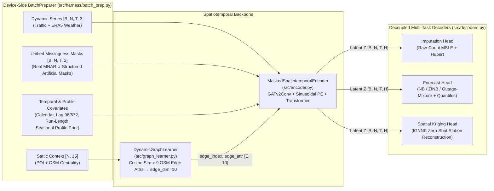

# System & Model Architecture Reference

This document explains the software architecture, data pipeline, and mathematical formulation of the models implemented in `src/`.

---

## 1. Repository Layout

```text
├── alembic/                  # Database schema migrations for TimescaleDB
├── configs/                  # Experiment & training YAML configurations
│   ├── analysis/             # UI payload export configuration (analysis.yaml)
│   ├── quality/              # Track 1: Sensor quality & observability configs
│   ├── spatial/              # Track 2: Spatial topology & GATv2 configs
│   ├── sweeps/               # Optuna hyperparameter search space definitions
│   └── train/                # Track 3: RIoT v4, v5, v5_scaling, v6, and v7 configs
├── data/                     # Committed UO raw datasets, ERA5 weather, and OSM/POI caches
├── docs/                     # Architecture, database, guides, and experiment reports
│   ├── database/             # TimescaleDB schema & Cloudflare R2 serving docs
│   ├── design_reports/       # RIoT v5 experimental design & zero-collapse analysis
│   ├── diagrams/             # Mermaid architecture diagrams
│   ├── experiments/          # Empirical reports, CSV summaries & figures (v5, scaling, v6, v7)
│   └── guides/               # Container, tuning, and runner setup guides
├── dstl_presentation/        # Standalone Reveal.js + D3 sponsor review presentation
├── frontend/                 # Next.js 16 + Deck.gl + MapLibre Geospatial Digital Twin UI
├── scripts/                  # Experiment runners, aggregators, ingestion & desk checks
├── src/                      # Core Python ML library
│   ├── harness/              # RIoT v5–v7 training/eval harness, masking, holdout & adapters
│   ├── quality/              # Track 1: Per-sensor quality metrics & baseline forecasters
│   └── spatial/              # Track 2: Graph topologies & paired spatiotemporal models
├── tests/                    # Pytest unit & contract test suite
└── workers/                  # Cloudflare Worker for R2 run registry management
```

---

## 2. Core Data Pipeline & Leak-Free Splitting

### 2.1 Unified DataConnector (`src/db_connector.py`)
`DataConnector` provides a strict, fail-fast interface with two concrete implementations:
- **`TimescaleConnector`**: Pooled PostgreSQL/TimescaleDB client (`traffic_readings`, `weather_readings`, `static_features`, `sensor_metadata`).
- **`ParquetConnector`**: Local file-backed reader using `data/processed/master_dataset_15T.parquet` (or raw parquets) and `data/external/weather_cache.parquet`.

### 2.2 Spatiotemporal Dataset (`src/dataset.py`)
`RealIoTDataset` aligns multi-sensor observations onto a regular 15-minute UTC grid across $N = 81$ active pedestrian sensor locations:
- **Dynamic Features**: Traffic counts (Channel 0) and meteorological covariates (`Humidity`, `Solar Radiation`, Channels 1–2), optionally transformed via $\log(1 + y)$ (`log1p_inputs: true`).
- **Explicit Missingness Masks**: Rather than silently filling gaps, `RealIoTDataset` tracks true sensor observation indicators (`observed`), gap run-lengths (`run_length`), and Missing-Not-At-Random (MNAR) structural masks (`total_mnar_mask`, `night_mnar_mask`).
- **Static Features**: 15 per-sensor urban context features (12 POI/land-use counts + 3 OSMnx road network centralities).
- **Purged Chronological Split (`src/train.py::chronological_purged_split`)**: Splits the 3-year timeline into **70% Train / 15% Validation / 15% Test** with a `seq_len + 1` purge buffer between partitions so look-back windows never overlap across split boundaries.
- **Train-Only Statistics**: All feature scalers (`StandardScaler`), per-sensor seasonal slot-of-week profiles ($7 \times 96 = 672$ slots), empirical gap-length banks, and node missingness rates are fitted **strictly on the training slice** `[0, train_t_end)`.

---

## 3. Track 1: Sensor Quality & Observability (`src/quality/`)

Located in `src/quality/`, Track 1 evaluates how sensor data completeness and fragmentation affect forecasting performance on individual directional streams:
- **`quality_metrics.py`**: Computes overall completeness, gap frequency, median/max gap duration, longest consecutive run, and usable window fraction; emits a reproducible sensor-selection manifest.
- **`per_sensor_dataset.py` & `interpolation.py`**: Builds per-sensor chronological 70/15/15 splits with boundary purging and whole-run assignment for fragmented sensors. Evaluates 5 gap-handling variants (`none`, `night_zero`, `linear`, `spline`, `knn`) while scoring metrics strictly on genuinely observed target slots.
- **`periodogram.py`**: Computes Lomb–Scargle periodograms on unevenly sampled/gapped raw series to quantify diurnal ($T = 24\text{h}$) and weekly ($T = 168\text{h}$) signal-to-noise ratios.
- **`forecasters.py` & `transformer_forecaster.py`**: Implements Persistence, Seasonal Naive (1-day / 7-day), SARIMAX with Kalman filtering walk-forward extension, Bidirectional Univariate/Multivariate LSTMs, and Transformer forecasters.
- **`stats.py`**: Implements Spearman rank correlations with Benjamini–Hochberg FDR control, partial Spearman correlations, segmented piece-wise threshold regression (with bootstrap breakpoint confidence intervals), and Diebold–Mariano (HAC + Harvey–Leybourne–Newbold) tests.

---

## 4. Track 2: Spatial Topology & GATv2 Message Passing (`src/spatial/`)

Located in `src/spatial/`, Track 2 isolates the contribution of spatial graph message passing under a strictly paired experimental contract:
- **`contract.py`**: Defines `GraphForecaster`, where every model ingests identical `[B, N, T, D]` graph batches and predicts multi-horizon targets ($h \in \{1, 4\}$ steps, i.e., 15 min and 60 min) under identical masked MSE loss.
- **`graphs.py`**: Constructs four spatial topologies from cached pairwise coordinates and OSM road-network distances (`data/external/edge_features_cache.json`):
  1. `identity`: Self-loops only ($N$ isolated edges). Serves as the **matched-capacity control** (identical parameter count and GATv2 architecture, zero cross-node information flow).
  2. `gabriel`: Planar proximity graph where an edge $(i, j)$ exists iff no third sensor $k$ lies within the diametral circle of $(i, j)$.
  3. `knn`: Directed $k$-nearest neighbour graph ($k \in \{4, 8\}$).
  4. `fc`: Fully connected graph with physical 9-dimensional road-network edge attributes.
- **`models/`**: Implements statistical baselines (`Persistence`, `SeasonalNaive`, `HistoricalAverage`), weight-shared per-node sequence encoders (`TemporalLSTM`, `TemporalGRU`, `TemporalTransformer`), static-topology `SpatialGATv2` (with configurable depth `gat_layers` and temporal backbones), and `LearnedGATv2` wrapping `DynamicGraphLearner`.
- **`attention.py` & `stats.py`**: Extracts per-head GATv2 attention weights $\alpha_{ij}$ to quantify attention entropy, physical distance decay, and cross-seed Spearman agreement, paired with per-node Diebold–Mariano tests.

---

## 5. Track 3: Resilient IoT (RIoT) Unified Pipeline (`src/pipeline.py`, `src/harness/`)



### 5.1 Dynamic Graph Learner (`src/graph_learner.py`)
Projects the 15 static urban features into a latent node embedding space ($d = 32$), computes pairwise cosine similarity, sparsifies edges above `sparsity_threshold` ($\tau = 0.5$), and concatenates the 9 physical OSM road-network features from `data/external/edge_features_cache.json` with the learned similarity weight to form a 10-dimensional edge attribute tensor (`edge_dim = 10`).

### 5.2 Masked Spatiotemporal Encoder (`src/encoder.py`)
1. **Input Concatenation & Unified Missingness (`src/harness/batch_prep.py`)**: Under `unify_missing_encoding: true`, artificially masked training slots and genuine sensor outages receive identical feature blanking (`0.0`), missingness indicator flags (`1.0`), and gap run-length counters. This prevents the encoder from distinguishing synthetic training masks from real-world sensor failures, eliminating representation collapse during extended outages.
2. **Spatial Message Passing (`GATv2Conv`)**: Multi-head Graph Attention Network v2 (`edge_dim=10`) aggregates neighbourhood context at each timestep.
3. **Temporal Transformer**: Adds sinusoidal positional encodings (`SinusoidalPositionalEncoding`) and applies multi-layer self-attention across the look-back sequence $T$ to produce latent representations $Z \in \mathbb{R}^{B \times N \times T \times H}$.

### 5.3 Seasonal Profile Priors for Unseen Stations (`src/harness/batch_prep.py`)
To support inductive forecasting at held-out stations (24 unseen sensors never observed during training), `CovariateBuilder` supports five `profile_prior` modes:
- `none`: No profile covariate.
- `inductive_zero`: Training stations receive their empirical train-slice slot-of-week profile; unseen stations receive zero.
- `inductive_neighbour`: Unseen stations receive the inverse-distance-weighted profile of the $k=5$ nearest active training stations.
- `inductive_static` (**RIoT v6/v7 Champion**): Fits a ridge regression model on the 57 training stations mapping the 15 static urban features to the station's mean traffic scale, combined with the network diurnal shape, providing an informative zero-shot prior for unseen locations.

### 5.4 Decoupled Multi-Task Decoders & Likelihoods (`src/decoders.py`, `src/likelihoods.py`, `src/losses.py`)
From the shared latent state $Z$, three task heads operate concurrently:
1. **Imputation Head**: Reconstructs masked historical slots using scale-invariant **True MSLE** on inverse-transformed raw counts (plus optional Huber loss mix) for traffic and MSE for weather.
2. **Probabilistic Forecast Head**: Predicts next-step count distribution parameters at $T + 1$:
   - **Negative Binomial (`nb`)**: Parameterized by mean $\mu > 0$ and dispersion $\theta > 0$.
   - **Zero-Inflated Negative Binomial (`zinb`)**: Adds structural zero probability $\pi \in (0, 1)$.
   - **Anchored Outage Mixture (`outage_mixture`)**: Separates genuine zero counts from sensor outages via a dedicated outage probability head $q = P(\text{sensor offline})$.
   - **Quantile Heads (`quantiles: [0.5, 0.9]`)**: Optional pinball-loss quantile regression heads.
3. **Spatial Kriging Head (`SpatialKrigingDecoder`)**: Reconstructs spatially held-out nodes (IGNNK random node holdout during training) via raw-count MSLE.

---

## 6. Interactive Geospatial Digital Twin (`frontend/`, `src/export_paginated_payload.py`)

The model pipeline is decoupled from the visualization layer through a versioned JSON contract (`schema_version: 5`):
- **Exporter (`src/export_paginated_payload.py`)**: Downloads trained checkpoints from W&B, rebuilds the exact training-slice scalers and profiles (enforced via strict floating-point tripwires), runs zero-shot inference over the out-of-sample May 2026 evaluation window (`2026-05-01` to `2026-06-01`), and emits:
  - `run_registry.json`: Global run leaderboard and metadata index.
  - `{run_id}/spatial.json`: Node coordinates, observed vs. zero-shot holdout roles, ghost-node tracking, semantic land-use tags, and learned graph topology.
  - `{run_id}/{YYYY-MM-DD}/page.json`: 96-step (15-min) point forecasts, 80% predictive intervals (`lo`/`hi`), ground truth, PIT histograms, reliability diagrams, and dynamic GATv2 edge attention weights.
  - `{run_id}/{YYYY-MM-DD}/nodes/node_{id}.json`: Per-node distributional parameters ($\mu, \theta, \pi, q$), self-healing imputation comparisons, and top-K ego-graph attention sequences.
- **Dashboard (`frontend/`)**: Next.js 16 application using MapLibre GL and Deck.gl (`ScatterplotLayer`, `ArcLayer`) to render real-time network forecasts, uncertainty bands, and attention topology, alongside a multi-tab Analytics suite (`RunLeaderboard`, `ForecastTab`, `CalibrationTab`, `NetworkTab`, `NodeGrid`).
