# Resilient IoT Architecture Diagrams

These Mermaid diagrams represent the 4 architectural figures you can use as a baseline for your `draw.io` methodology figures.

## Figure 1: Data Pipeline
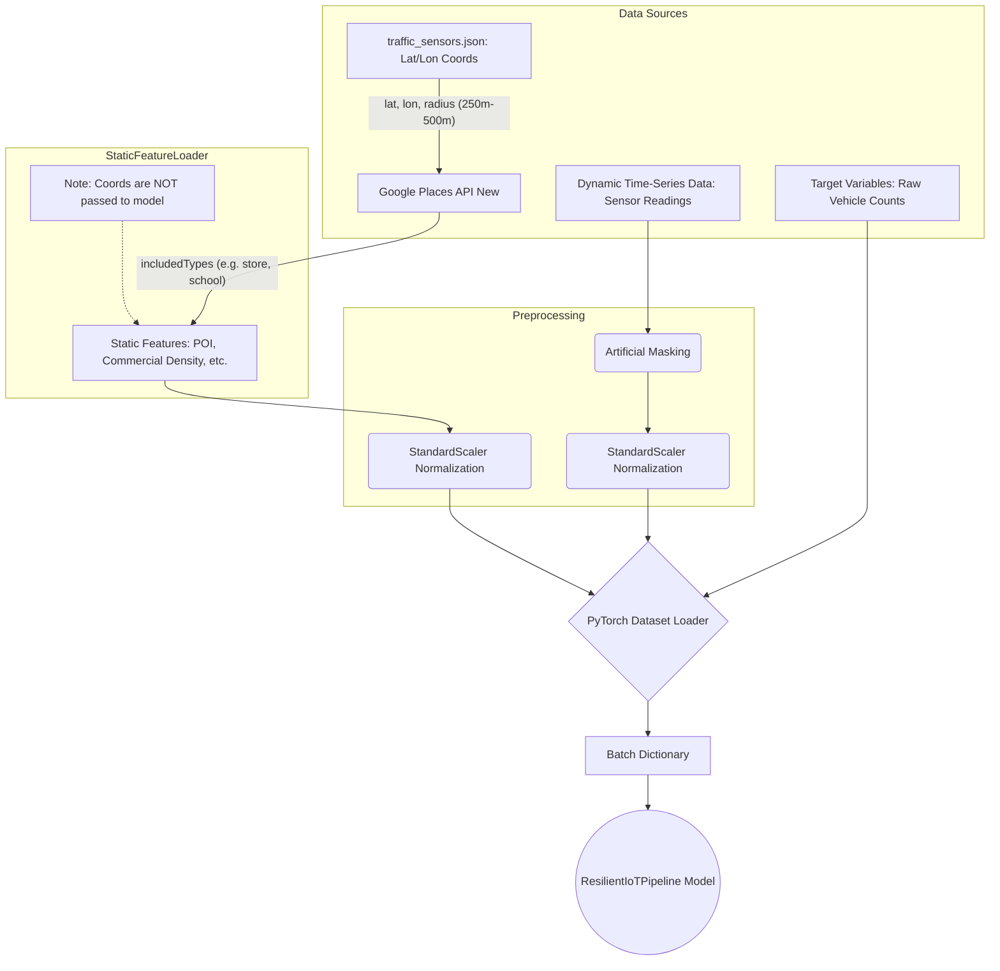

## Figure 2: Model Architecture
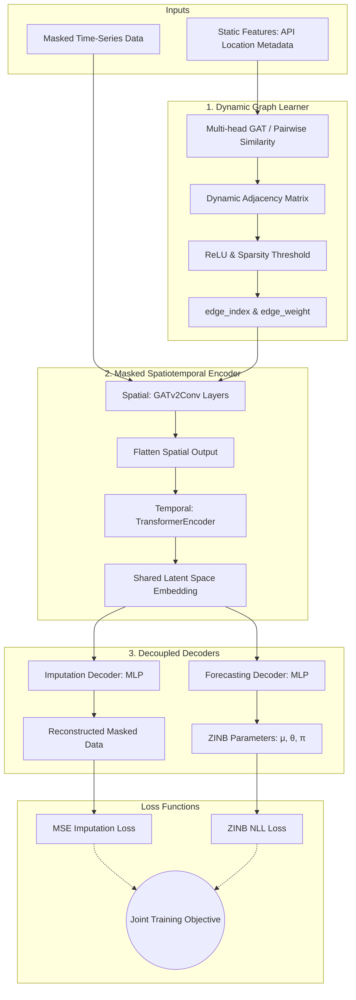

## Figure 3: MLOps Architecture
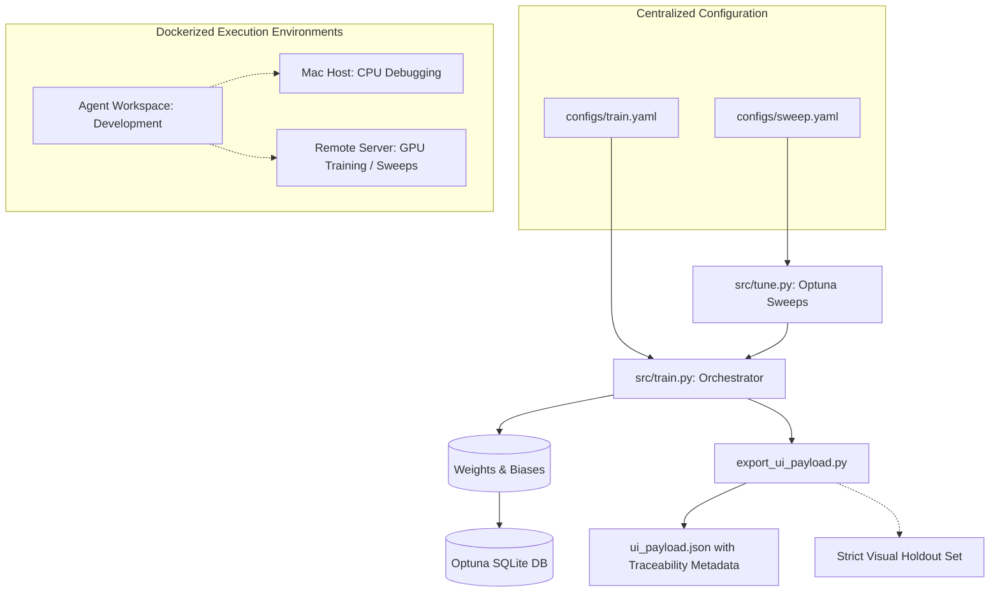

## Figure 4: Frontend & Database Architecture
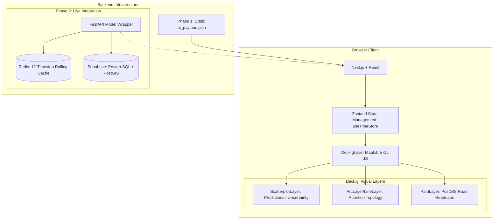

---

# Experimental Branch Architecture Diagrams

The following diagrams document the architectural changes on the three `exp/` branches.
Each builds incrementally on the previous (see [Branch Lineage](#branch-lineage)).

## Branch Lineage

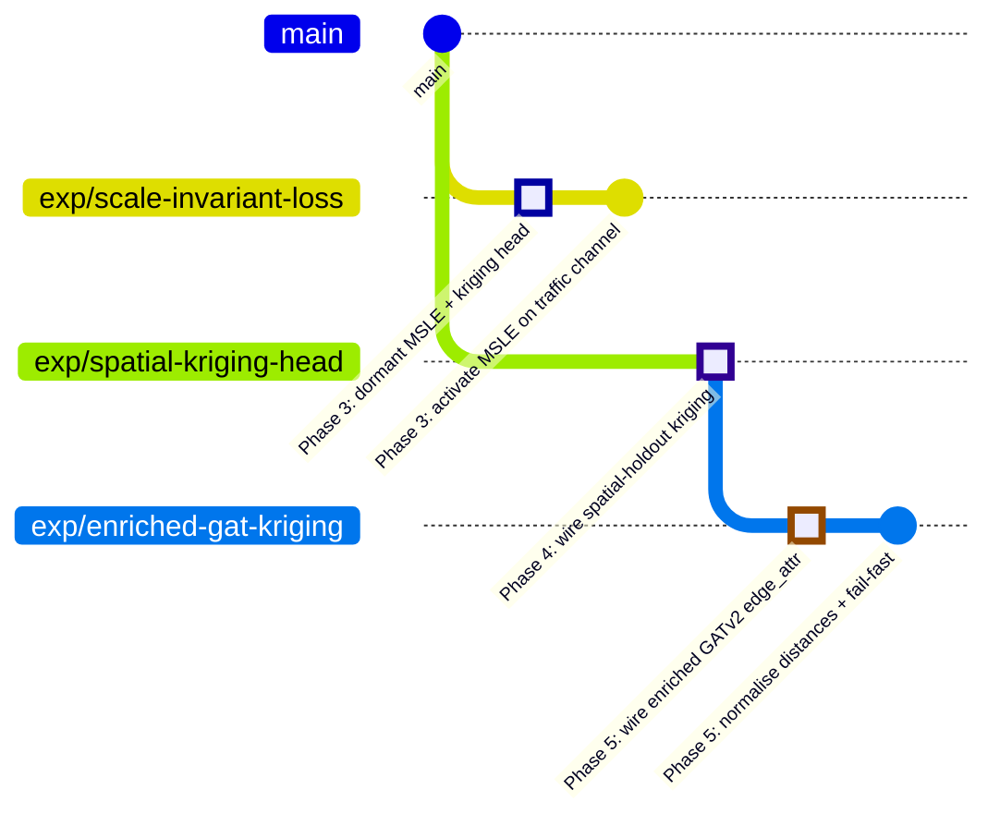

> **Note:** `exp/scale-invariant-loss` branches from a different common ancestor
> than the kriging branches. `exp/spatial-kriging-head` and
> `exp/enriched-gat-kriging` share a linear lineage — the latter contains all
> commits from the former plus the Phase 5 edge enrichment.

---

## Figure 5: `exp/scale-invariant-loss` — Channel-Split MSLE Imputation

**Branch:** `exp/scale-invariant-loss` (1 commit over main)
**Files:** `decoders.py`, `pipeline.py`, `train.py`, `train.yaml`

### What changed vs. main

| Area | Main (baseline) | exp/scale-invariant-loss |
|------|----------------|--------------------------|
| Imputation loss | Global MSE over all channels | Channel-split: **MSLE** on traffic (channel 0), MSE on weather channels |
| Domain for traffic loss | StandardScaler-normalised | Inverse-transformed to **raw count domain** via `x * std + mean` |
| Scaler stats | Not stored on model | Registered as `traffic_mean` / `traffic_std` buffers on `ResilientIoTPipeline` |
| `compute_loss` signature | `(imputed, target, mu, theta, pi, ...)` | + `traffic_mean`, `traffic_std`, `traffic_channel` args |
| `train.py` | No scaler extraction | Extracts `scaler.mean_[0]`, `scaler.scale_[0]` from dataset |
| `train.yaml` | `early_stop_patience: 10` | `early_stop_patience: 5` |

### Diagram — Model Architecture (Loss Detail)

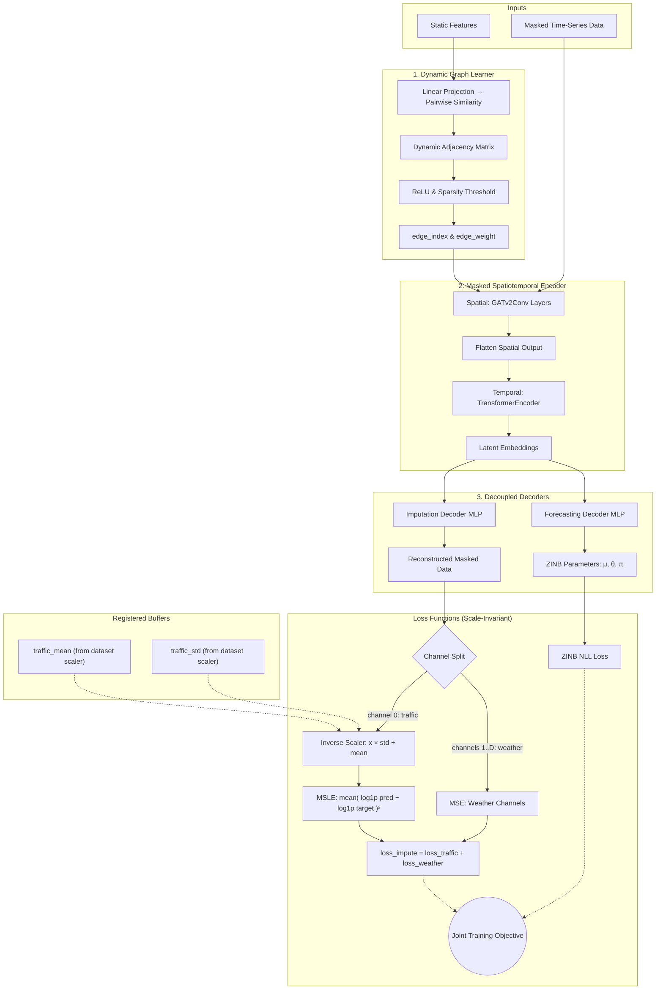

### Scale-Invariant MSLE — Data Flow

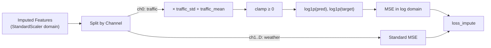

---

## Figure 6: `exp/spatial-kriging-head` — IGNNK-Style Spatial Kriging

**Branch:** `exp/spatial-kriging-head` (2 commits over main)
**Files:** `dataset.py`, `decoders.py`, `pipeline.py`, `train.py`, `train.yaml`, `test_spatial_holdout.py`

### What changed vs. main

| Area | Main (baseline) | exp/spatial-kriging-head |
|------|----------------|--------------------------|
| Dataset | No spatial holdout | + `make_spatial_holdout_mask(N, p)` and `apply_spatial_holdout(batch, mask)` |
| Holdout mechanism | N/A | ~15% of nodes' dynamic features zeroed; static features **preserved** |
| Topology masking | Only `simulated_nodes_mask` | **Union**: `simulated_nodes_mask ∪ spatial_holdout_mask` |
| Model components | 3 (graph_learner, encoder, decoders) | + **SpatialKrigingDecoder** (MLP: H→2H→GELU→D) |
| Forward return | 8-tuple | **9-tuple** (+ `loss_kriging`) |
| Loss function | 2-term: `w_imp * L_imp + w_fore * L_fore` | **3-term**: `+ w_krig * L_krig` |
| Kriging loss | N/A | Hybrid: MSLE on traffic channel, MSE on weather channels |
| `compute_loss` | Returns `(total, imp, fore)` | Returns `(total, imp, fore, krig)` |
| `train.yaml` | No kriging config | + `spatial_holdout_prob: 0.15`, `w_kriging: 0.5` |
| W&B logging | No kriging metrics | + `train_loss_kriging`, `val_kriging_loss` |
| Tests | N/A | + `test_spatial_holdout.py` (7 tests) |

### Diagram — Spatial Holdout & Kriging Path

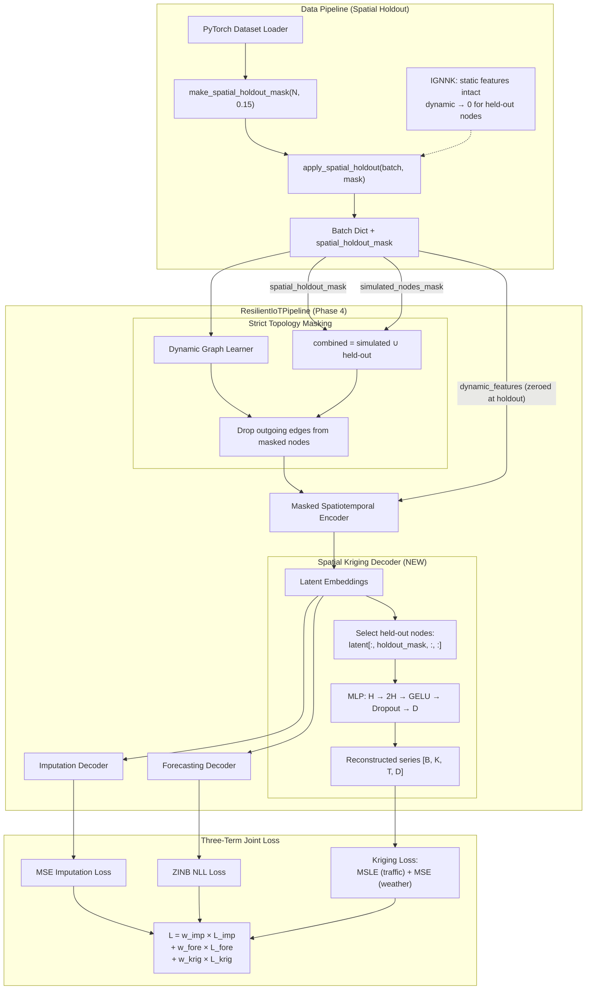

### Spatial Holdout — Information Flow

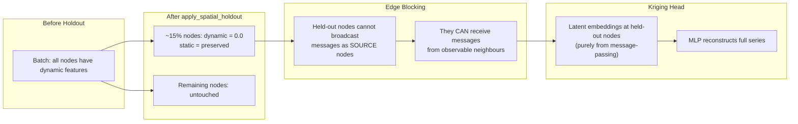

---

## Figure 7: `exp/enriched-gat-kriging` — OSM Edge Feature Enrichment + Kriging

**Branch:** `exp/enriched-gat-kriging` (5 commits over main, includes all Phase 4 commits)
**Files:** `graph_learner.py`, `encoder.py`, `decoders.py`, `pipeline.py`, `train.py`, `dataset.py`, `train.yaml`, `test_edge_enrichment.py`, `test_spatial_holdout.py`

### What changed vs. `exp/spatial-kriging-head`

| Area | exp/spatial-kriging-head | exp/enriched-gat-kriging |
|------|--------------------------|--------------------------|
| Graph Learner output | `(edge_index, edge_weight)` | `(edge_index, edge_weight, edge_attr [E,10])` |
| Edge features | Scalar learned similarity only | **9 pre-computed OSM features ⊕ 1 learned similarity** |
| Edge feature source | N/A | `edge_features_cache.json` (Phase 1 pre-computed) |
| Feature table | N/A | Registered buffer `edge_feature_table [N,N,9]` |
| Distance normalisation | N/A | Min-Max normalised `shortest_path` and `euclidean_distance` to [0,1] |
| Fail-fast enforcement | N/A | **Every** off-diagonal pair must exist in cache — no silent zero-fill |
| Encoder `edge_dim` | `1` (scalar weight) | `10` (enriched edge_attr) |
| GATv2Conv | `edge_dim=1` | `edge_dim=10` → learns Θ_e projection over all channels |
| Encoder forward arg | `edge_weight: [E]` | `edge_attr: [E, 10]` with backward-compat 1D→[E,1] promotion |
| Topology masking | Filters `edge_index`, `edge_weight` | Also filters `edge_attr` row-aligned |
| Pipeline constructor | No `node_names` / `edge_feature_cache_path` | + `node_names`, `edge_feature_cache_path` args |
| Analysis mode output | `edge_index`, `edge_weight`, `attention_weights` | + `edge_attr [E, 10]` |
| Tests | N/A | + `test_edge_enrichment.py` (enrichment + end-to-end gradient) |

### Diagram — Full Architecture (Enriched)

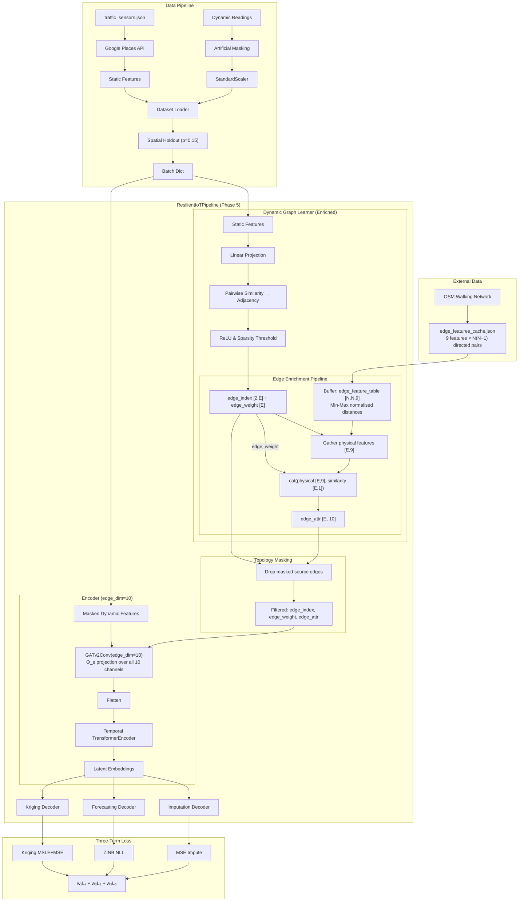

### Edge Feature Composition

The 10-dimensional `edge_attr` vector for each edge `(src → dst)`:

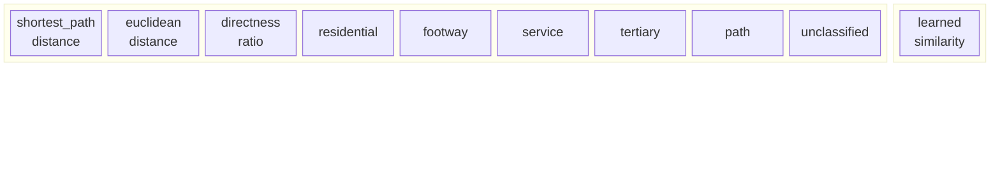

| Index | Feature | Domain | Normalisation |
|-------|---------|--------|---------------|
| 0 | `shortest_path_distance` | metres | Min-Max → [0, 1] |
| 1 | `euclidean_distance` | metres | Min-Max → [0, 1] |
| 2 | `directness` | ratio | Already [0, 1] |
| 3–8 | Road category fractions | fraction | Already [0, 1] |
| 9 | Learned similarity | dot product | ReLU-thresholded |
