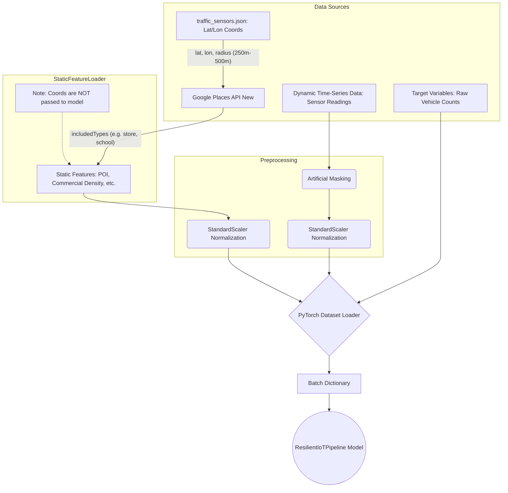
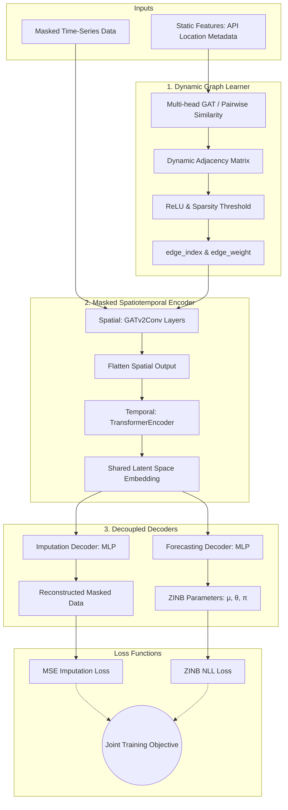
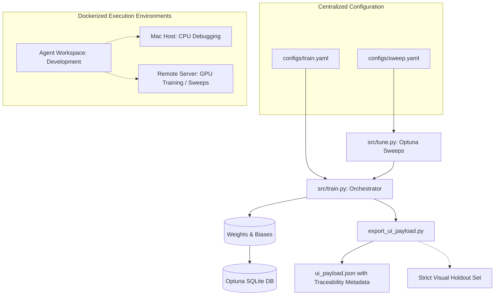
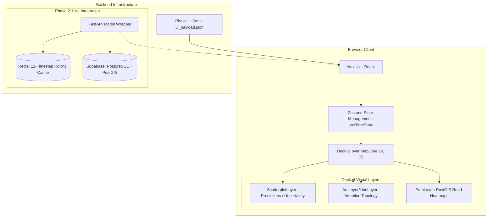

# Resilient IoT Architecture Diagrams

These Mermaid diagrams represent the 4 architectural figures you can use as a baseline for your `draw.io` methodology figures.

## Figure 1: Data Pipeline

## Figure 2: Model Architecture

## Figure 3: MLOps Architecture

## Figure 4: Frontend & Database Architecture

