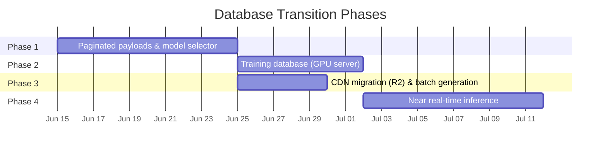
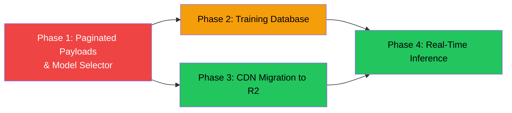

# Implementation Phases: Database Transition & Frontend Upgrades

> **Date**: 2026-06-12  
> **Strategy**: D — Hybrid CDN + Live API  
> **Companion docs**: [database_serving_strategy.md](database_serving_strategy.md) · [database_schemas.md](database_schemas.md)

---

## Overview

The transition from a single static `master_index.json` to a multi-run, paginated, real-time-ready architecture is split into four phases. Each phase delivers standalone value and can be shipped independently.



---

## Phase 1: Multi-Run Paginated Payloads & Model Selector

> **Priority**: 🔴 Highest — immediate user value  
> **Dependencies**: None (uses existing W&B artifacts + Vercel static hosting)  
> **Estimated effort**: 7–10 days

### Goal

Enable the digital twin to:
1. **Select from multiple model runs** via a dropdown/panel overlay
2. **Display model metadata** (architecture, training config, validation metrics) in a formatted info card
3. **Paginate through days** within a 30-day analysis window (forward/back buttons or date picker)
4. **Serve all data from CDN** (Vercel `/public` initially)

### Key Deliverables

| Deliverable | Description |
|---|---|
| `export_paginated_payload.py` | Refactored export script that emits `spatial.json` + per-day `page.json` + per-day `node_{id}.json` per run |
| `run_registry.json` | Registry file listing all available runs with metadata |
| `configs/analysis.yaml` | Standardised analysis period (June 2026, 30 days) |
| `ModelSelector` component | Dropdown or panel for switching runs |
| `ModelInfoOverlay` component | Formatted card displaying run config, metrics, W&B link |
| `DatePaginator` component | Day navigation (← prev / next → with date display) |
| Refactored `MapVisualizer.tsx` | Loads `spatial.json` once per run, fetches `page.json` per day |
| Refactored `NodeInspector.tsx` | Fetches day-scoped `node_{id}.json` |
| Updated `useTimeStore.ts` | Adds `activeRunId`, `activeDate`, `availableDates` state |

### What This Does NOT Include

- No database (Postgres/TimescaleDB) setup
- No Cloudflare R2 migration (still serves from Vercel `/public`)
- No real-time inference
- No API server

---

## Phase 2: Training Database (GPU Server)

> **Priority**: 🟡 Medium — enables reproducibility and future real-time  
> **Dependencies**: Phase 1 (for payload schema alignment)  
> **Estimated effort**: 5–7 days

### Goal

Stand up PostgreSQL + TimescaleDB on the GPU server inside Docker. Migrate raw data ingestion from Parquet files to database tables.

### Key Deliverables

| Deliverable | Description |
|---|---|
| `docker-compose.yml` update | Add `timescaledb` service with persistent volume |
| Alembic migration scripts | Schema for `traffic_readings`, `model_runs`, `dataset_versions` |
| `scripts/ingest_parquet.py` | One-time ingestion of `master_dataset_15T.parquet` into hypertables |
| `dataset.py` refactor | Optional database backend for `RealIoTDataset` (with Parquet fallback) |
| Version tagging system | Branch-aware dataset versioning for experimental branches |

### Schema Sketch

```sql
-- Core time-series hypertable
CREATE TABLE traffic_readings (
    dt          TIMESTAMPTZ NOT NULL,
    sensor_id   TEXT NOT NULL,
    veh_class   TEXT NOT NULL,
    direction   TEXT NOT NULL,
    count       REAL NOT NULL,
    PRIMARY KEY (dt, sensor_id, veh_class, direction)
);
SELECT create_hypertable('traffic_readings', 'dt');

-- Model run metadata (mirrors W&B but locally queryable)
CREATE TABLE model_runs (
    run_id          TEXT PRIMARY KEY,
    wandb_run_id    TEXT,
    git_commit      TEXT,
    config_yaml     JSONB NOT NULL,
    created_at      TIMESTAMPTZ DEFAULT NOW(),
    val_rmse        REAL,
    val_mae         REAL,
    val_zero_acc    REAL
);

-- Dataset version tracking (branch-aware)
CREATE TABLE dataset_versions (
    version_id      SERIAL PRIMARY KEY,
    git_branch      TEXT NOT NULL,
    created_at      TIMESTAMPTZ DEFAULT NOW(),
    description     TEXT,
    preprocessing   JSONB  -- scaling params, mask_prob, etc.
);
```

### Relationship to Phase 1

Phase 2 does **not** change the frontend. The database serves the training pipeline only. `export_paginated_payload.py` (Phase 1) continues to read from Parquet files and generates static JSON for the CDN.

In a future iteration, the export script could optionally source its data from the database rather than Parquet, but this is not required initially.

---

## Phase 3: CDN Migration (Cloudflare R2)

> **Priority**: 🟢 Low — only needed when data volume exceeds Vercel limits  
> **Dependencies**: Phase 1  
> **Estimated effort**: 3–5 days

### Goal

Migrate static payload storage from `frontend/public/data/runs/` to Cloudflare R2 with $0 egress costs. This becomes necessary when:

- Total payload size exceeds ~500 MB (approximately 7 runs × 30 days)
- Git repository bloat becomes a concern
- Deployment speed degrades from large static directories

### Key Deliverables

| Deliverable | Description |
|---|---|
| `scripts/upload_to_r2.py` | S3-compatible upload script using `boto3` |
| `next.config.ts` rewrite rules | Proxy `/data/runs/*` requests to R2 |
| Cache-Control headers | Immutable for historical, short-lived for run registry |
| CI/CD integration | GitHub Action to upload new payloads to R2 after generation |

### Trigger Criteria

| Metric | Threshold | Action |
|---|---|---|
| Total `/public/data/runs/` size | > 500 MB | Migrate to R2 |
| `vercel deploy` time | > 5 minutes | Migrate to R2 |
| Number of model runs | > 10 | Migrate to R2 |

---

## Phase 4: Near Real-Time Inference

> **Priority**: 🟢 Low — designed but deferred until model architecture is frozen  
> **Dependencies**: Phase 2 (database), Phase 3 (R2 for live page storage)  
> **Estimated effort**: 7–10 days

### Goal

Ingest live sensor data (15-minute cadence), run inference through the frozen model, and serve predictions to the frontend.

### Key Deliverables

| Deliverable | Description |
|---|---|
| Cloudflare Tunnel setup | Secure HTTPS exposure of GPU server without firewall changes |
| FastAPI inference server | Wraps frozen `best_pipeline.pt` with 12-step rolling window |
| Redis rolling window cache | Maintains 12-timestep buffer for instant tensor generation |
| CRON job (15-min) | Fetch → Infer → Upload `live/today/page.json` to R2 |
| Sensor webhook receiver | FastAPI endpoint to ingest raw sensor readings |
| Frontend `live` toggle | SWR polling (5-min), "LIVE" badge, "Last updated" timestamp |

### Architecture Alignment

Phase 4 maps to the Live Inference API & Spatial Integration stage — executed after the PyTorch architecture is frozen via rigorous ablation studies.

---

## Phase Dependencies & Critical Path



**Critical path**: Phase 1 → Phase 3 → Phase 4

Phase 2 (training database) is on a parallel track and can proceed independently once Phase 1 establishes the payload schema.

---

## W&B Model Cleanup (Cross-Cutting)

> **Can be done during any phase.**

| Task | Detail |
|---|---|
| Verify all W&B artifacts are complete | Each must have `best_model.pt` + `config.yaml` |
| Clean up `export_ui_payload.py` comments | Remove references to legacy checkpoint defaults |

---

## Success Criteria

| Phase | Success Metric |
|---|---|
| Phase 1 | User can select between 7 model runs, see formatted metadata, and paginate through 30 days. Slider remains 60fps. |
| Phase 2 | `dataset.py` can load training data from PostgreSQL. `model_runs` table populated from W&B metadata. |
| Phase 3 | All payloads served from R2. Vercel deploy time < 30 seconds. |
| Phase 4 | Live sensor readings appear in the digital twin within 20 minutes of collection. |
