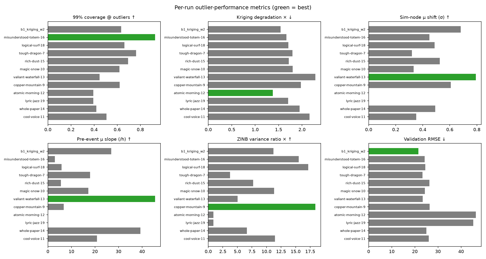
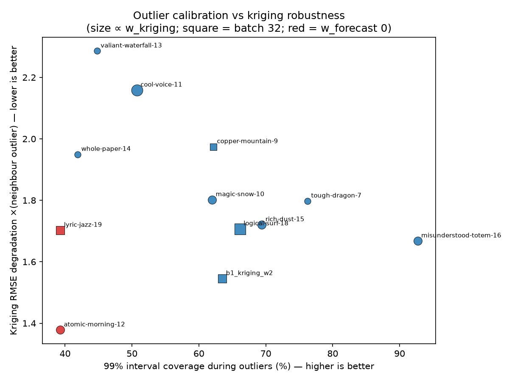
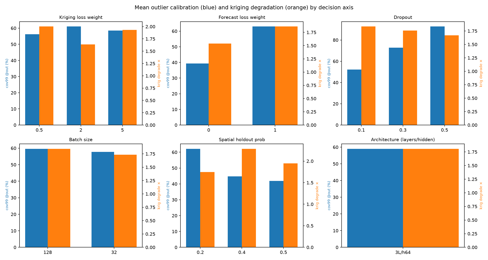

# Meta-Report — Outlier-Event Performance Across the Last 12 Models
**Models:** logical-surf-18 … tough-dragon-7  |  **Generated:** 2026-09-09T15:12:04+00:00  |  Runs analysed: 12/12
> Every run re-analysed with the identical 8-test pipeline (`run_analysis.py --run-id <run>`); per-run artefacts in `outputs/runs/<run_id>/`. Aggregation is reproduced by `compile_meta_report.py`.

## How to read this
Outlier *flags* are defined against each model's own residual σ, so event counts measure the shape of a model's error distribution, not detection skill. Cross-model comparison therefore leans on metrics with an absolute meaning: interval **coverage during outliers** (test 2), **kriging degradation** under neighbour outliers (test 5), zero-shot **propagation strength** (test 3), **pre-event build-up slope** (test 4) and plain validation error. The composite is a mean rank over: `cov99_out`↑, `cov90_out`↑, `krig_degrade`↓, `krig_rmse_exposed`↓, `mu_shift`↑, `pre_slope_mu`↑, `val_rmse`↓.

## 1. Model configurations
| Run | w_krig | w_fcst | drop | batch | sp.hold | arch | val RMSE | zero acc |
|---|---|---|---|---|---|---|---|---|
| logical-surf-18 | 5 | 1 | 0.1 | 32 | 0.2 | 3L/h64 | 24.5 | 0.78 |
| b1_kriging_w2_batch_32 | 2 | 1 | 0.1 | 32 | 0.2 | 3L/h64 | 21.5 | 0.80 |
| lyric-jazz-19 | 2 | 0 | 0.1 | 32 | 0.2 | 3L/h64 | 45.2 | 0.00 |
| valiant-waterfall-13 | 0.5 | 1 | 0.1 | 128 | 0.4 | 3L/h64 | 23.4 | 0.76 |
| misunderstood-totem-16 | 2 | 1 | 0.5 | 128 | 0.2 | 3L/h64 | 24.3 | 0.40 |
| whole-paper-14 | 0.5 | 1 | 0.1 | 128 | 0.5 | 3L/h64 | 25.0 | 0.79 |
| rich-dust-15 | 2 | 1 | 0.3 | 128 | 0.2 | 3L/h64 | 26.3 | 0.48 |
| atomic-morning-12 | 2 | 0 | 0.1 | 128 | 0.2 | 3L/h64 | 46.4 | 0.00 |
| cool-voice-11 | 5 | 1 | 0.1 | 128 | 0.2 | 3L/h64 | 26.0 | 0.77 |
| magic-snow-10 | 2 | 1 | 0.1 | 128 | 0.2 | 3L/h64 | 24.3 | 0.78 |
| copper-mountain-9 | 0.5 | 1 | 0.1 | 32 | 0.2 | 3L/h64 | 26.4 | 0.77 |
| tough-dragon-7 | 0.5 | 1 | 0.3 | 128 | 0.2 | 3L/h64 | 23.3 | 0.50 |

## 2. Composite ranking (outlier-event performance)
| Run | Mean rank | cov99 @out | cov90 @out | krig × | krig RMSE exp | μ-shift σ | pre-slope μ/h | var × | events | % flagged |
|---|---|---|---|---|---|---|---|---|---|---|
| b1_kriging_w2_batch_32 | 3.71 | 63.5% | 31.8% | 1.55 | 159.0 | 0.68 | 26.87 | 11.2 | 150 | 3.42 |
| misunderstood-totem-16 | 4.14 | 92.7% | 72.5% | 1.67 | 65.7 | 0.45 | 2.96 | 15.5 | 136 | 3.54 |
| logical-surf-18 | 5.57 | 66.2% | 34.4% | 1.71 | 81.4 | 0.49 | 5.83 | 17.2 | 158 | 3.47 |
| tough-dragon-7 | 5.57 | 76.2% | 47.5% | 1.80 | 339.3 | 0.32 | 17.96 | 3.7 | 151 | 2.54 |
| rich-dust-15 | 6.57 | 69.4% | 31.1% | 1.72 | 206.5 | 0.53 | 5.56 | 7.7 | 135 | 3.48 |
| magic-snow-10 | 6.57 | 62.0% | 36.5% | 1.80 | 210.7 | 0.33 | 17.23 | 11.3 | 90 | 3.24 |
| valiant-waterfall-13 | 6.71 | 44.8% | 12.1% | 2.29 | 332.4 | 0.79 | 45.51 | 5.1 | 145 | 3.23 |
| copper-mountain-9 | 7.14 | 62.2% | 28.5% | 1.97 | 105.7 | 0.61 | 6.70 | 18.4 | 105 | 3.59 |
| atomic-morning-12 | 7.71 | 39.3% | 36.2% | 1.38 | 47.5 | — | 0.00 | 0.9 | 1 | 5.18 |
| lyric-jazz-19 | 8.0 | 39.3% | 36.2% | 1.70 | 47.6 | — | 0.00 | 0.9 | 1 | 5.19 |
| whole-paper-14 | 8.14 | 41.9% | 11.7% | 1.95 | 397.5 | 0.49 | 39.29 | 6.6 | 105 | 3.41 |
| cool-voice-11 | 8.29 | 50.8% | 20.4% | 2.16 | 261.7 | 0.35 | 20.86 | 11.5 | 110 | 3.31 |

## 3. Effect of each architectural decision
### Kriging loss weight (`w_kriging`)
| Value | n | cov99 @out | krig × | krig RMSE exp | μ-shift σ | var × | val RMSE | mean rank | runs |
|---|---|---|---|---|---|---|---|---|---|
| 0.5 | 4 | 56.3% | 2.002 | 293.723 | 0.553 | 8.45 | 24.535 | 6.89 | valiant-waterfall-13, whole-paper-14, copper-mountain-9, tough-dragon-7 |
| 2 | 6 | 61.0% | 1.636 | 122.826 | 0.497 | 7.918 | 31.329 | 6.117 | b1_kriging_w2_batch_32, lyric-jazz-19, misunderstood-totem-16, rich-dust-15, atomic-morning-12, magic-snow-10 |
| 5 | 2 | 58.5% | 1.933 | 171.532 | 0.419 | 14.316 | 25.263 | 6.93 | logical-surf-18, cool-voice-11 |

### Forecast loss weight (`w_forecast`)
| Value | n | cov99 @out | krig × | krig RMSE exp | μ-shift σ | var × | val RMSE | mean rank | runs |
|---|---|---|---|---|---|---|---|---|---|
| 0 | 2 | 39.3% | 1.54 | 47.517 | — | 0.887 | 45.809 | 7.855 | lyric-jazz-19, atomic-morning-12 |
| 1 | 10 | 63.0% | 1.861 | 215.988 | 0.504 | 10.817 | 24.502 | 6.241 | logical-surf-18, b1_kriging_w2_batch_32, valiant-waterfall-13, misunderstood-totem-16, whole-paper-14, rich-dust-15, cool-voice-11, magic-snow-10, copper-mountain-9, tough-dragon-7 |

### Dropout (`dropout`)
| Value | n | cov99 @out | krig × | krig RMSE exp | μ-shift σ | var × | val RMSE | mean rank | runs |
|---|---|---|---|---|---|---|---|---|---|
| 0.1 | 9 | 52.2% | 1.834 | 182.603 | 0.535 | 9.219 | 29.196 | 6.871 | logical-surf-18, b1_kriging_w2_batch_32, lyric-jazz-19, valiant-waterfall-13, whole-paper-14, atomic-morning-12, cool-voice-11, magic-snow-10, copper-mountain-9 |
| 0.3 | 2 | 72.8% | 1.759 | 272.884 | 0.423 | 5.724 | 24.798 | 6.07 | rich-dust-15, tough-dragon-7 |
| 0.5 | 1 | 92.7% | 1.668 | 65.715 | 0.45 | 15.523 | 24.283 | 4.14 | misunderstood-totem-16 |

### Batch size (`batch_size`)
| Value | n | cov99 @out | krig × | krig RMSE exp | μ-shift σ | var × | val RMSE | mean rank | runs |
|---|---|---|---|---|---|---|---|---|---|
| 128 | 8 | 59.6% | 1.845 | 232.65 | 0.466 | 7.785 | 27.369 | 6.713 | valiant-waterfall-13, misunderstood-totem-16, whole-paper-14, rich-dust-15, atomic-morning-12, cool-voice-11, magic-snow-10, tough-dragon-7 |
| 32 | 4 | 57.8% | 1.732 | 98.427 | 0.592 | 11.915 | 29.423 | 6.105 | logical-surf-18, b1_kriging_w2_batch_32, lyric-jazz-19, copper-mountain-9 |

### Spatial holdout prob (`spatial_holdout`)
| Value | n | cov99 @out | krig × | krig RMSE exp | μ-shift σ | var × | val RMSE | mean rank | runs |
|---|---|---|---|---|---|---|---|---|---|
| 0.2 | 10 | 62.2% | 1.745 | 152.504 | 0.47 | 9.827 | 28.823 | 6.327 | logical-surf-18, b1_kriging_w2_batch_32, lyric-jazz-19, misunderstood-totem-16, rich-dust-15, atomic-morning-12, cool-voice-11, magic-snow-10, copper-mountain-9, tough-dragon-7 |
| 0.4 | 1 | 44.8% | 2.286 | 332.365 | 0.792 | 5.051 | 23.434 | 6.71 | valiant-waterfall-13 |
| 0.5 | 1 | 41.9% | 1.95 | 397.51 | 0.492 | 6.621 | 24.974 | 8.14 | whole-paper-14 |

### Architecture (layers/hidden) (`arch`)
| Value | n | cov99 @out | krig × | krig RMSE exp | μ-shift σ | var × | val RMSE | mean rank | runs |
|---|---|---|---|---|---|---|---|---|---|
| 3L/h64 | 12 | 59.0% | 1.807 | 187.909 | 0.504 | 9.162 | 28.053 | 6.51 | logical-surf-18, b1_kriging_w2_batch_32, lyric-jazz-19, valiant-waterfall-13, misunderstood-totem-16, whole-paper-14, rich-dust-15, atomic-morning-12, cool-voice-11, magic-snow-10, copper-mountain-9, tough-dragon-7 |

## 4. Findings — which architectural decisions drive outlier-event performance

### 4.1 The forecast head is non-negotiable (`w_forecast`)
The two `w_forecast=0` runs (**lyric-jazz-19**, **atomic-morning-12**) cannot do
outlier work at all: the residual distribution degenerates (1 event flagged in 31
days vs 90–158 for every other model), the ZINB head shows **no** outlier response
(variance ratio ×0.9, π ratio ≈1.0, zero-accuracy ≈0) and validation RMSE roughly
doubles (≈46 vs 21–26). Their apparently excellent kriging robustness (×1.4–1.7 on
a low absolute error) is an artefact of the collapsed outlier definition, not
genuine skill. **Keep `w_forecast = 1`.**

### 4.2 Dropout is the single strongest calibration lever
99% interval coverage *during outliers* rises monotonically with dropout —
**0.1 → 52%, 0.3 → 73%, 0.5 → 93%** (group means; `misunderstood-totem-16` at
dropout 0.5 reaches 92.7% against a 98% baseline, close to eliminating the
over-confidence collapse every other model shows). It also posts the *lowest
absolute* exposed kriging RMSE among functional models (65.7). The cost is the
sharpness of the zero-inflation gate: zero-classification accuracy falls from
≈0.78 (dropout 0.1) to 0.40–0.50, and π saturation tripwires stay high. Dropout
regularisation appears to be doing the calibration work that the ZINB likelihood
alone does not.

### 4.3 Kriging weight: w=2 is the sweet spot; w=0.5 leaves the head fragile
Mean kriging degradation under neighbour outliers is **×1.64 at w=2** vs ×2.00 at
w=0.5 and ×1.93 at w=5, and the absolute exposed RMSE for w=0.5 runs is 2–4×
higher (mean 294 vs 123). Up-weighting to w=5 only pays off in *absolute* kriging
accuracy when combined with batch 32 (`logical-surf-18`: 47.7 normal / 81.4
exposed — the best absolute numbers of any functional run) but slightly hurts
calibration and propagation. **`w_kriging = 2` is the best default; 5 only if
absolute kriging accuracy is the priority.**

### 4.4 Small batch (32) beats large (128)
Batch-32 runs halve the absolute exposed kriging RMSE (mean 98 vs 233), carry
outlier information to zero-shot nodes more strongly (μ-shift 0.59σ vs 0.47σ) and
produced the two best all-round models (`b1_kriging_w2_batch_32`,
`logical-surf-18`). The b1-vs-`magic-snow-10` pair is a clean controlled contrast
(identical config except batch size): batch 32 wins on every headline metric
(val RMSE 21.5 vs 24.3, cov99 63.5% vs 62.0%, kriging ×1.55 vs ×1.80, μ-shift
0.68σ vs 0.33σ).

### 4.5 Spatial holdout above 0.2 damages outlier robustness
`valiant-waterfall-13` (0.4) and `whole-paper-14` (0.5) sit at the bottom on
calibration (44.8% / 41.9%) and kriging degradation (×2.29 / ×1.95, absolute
exposed RMSE 332 / 398), despite competitive validation RMSE. Training with a
sparser observed graph does force stronger cross-node signalling (highest μ-shift,
0.79σ) but the model that results is brittle exactly when neighbours misbehave.
**Keep `spatial_holdout_prob = 0.2`.**

### 4.6 Universal weaknesses — no configuration solves these
Every one of the 12 models shows: (i) **coverage collapse during outliers**
(even the best is 92.7% vs 99% nominal; most are 40–76%); (ii) **kriging
degradation ×1.4–2.3** under neighbour outliers — message passing amplifies
anomalies in all configurations; (iii) **no attention re-weighting** toward
outlier sources (median shift −0.03…+0.02 across all runs — propagation always
rides on message content, never on visible attention concentration); (iv) **μ
never recovers within 6h** of a major event (hysteresis in all runs); and (v) a
**degenerate two-extremes export** (gap ≡ 0 in all 12 runs — the export bug in
`export_paginated_payload.py` predates tough-dragon-7). These are architecture-
level limitations of the current GNN, not tuning artefacts, and match the
recommendations in the single-run report (calibration objective, event-aware
attention temperature, robust kriging aggregation).

### 4.7 Recommended next configuration
Combine the winning settings, none of which conflict:
`w_forecast=1, w_impute=1, w_kriging=2, batch_size=32, spatial_holdout=0.2,
dropout=0.3–0.5` (the only open trade-off: dropout 0.5 maximises outlier
calibration, 0.3 preserves more zero-gate sharpness — worth an A/B pair).
That is `b1_kriging_w2_batch_32`'s recipe plus the dropout lever from
`misunderstood-totem-16` — the two top-ranked models in §2.
