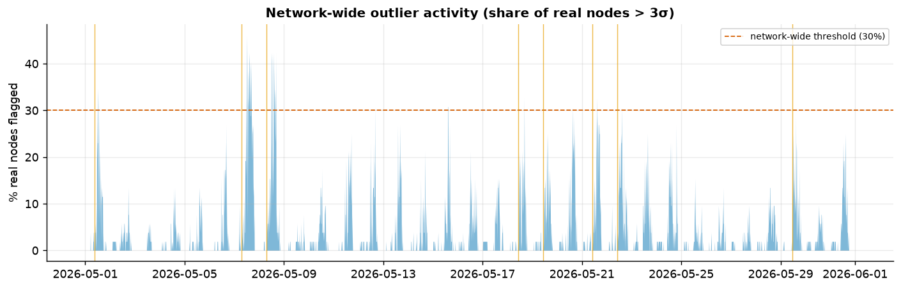
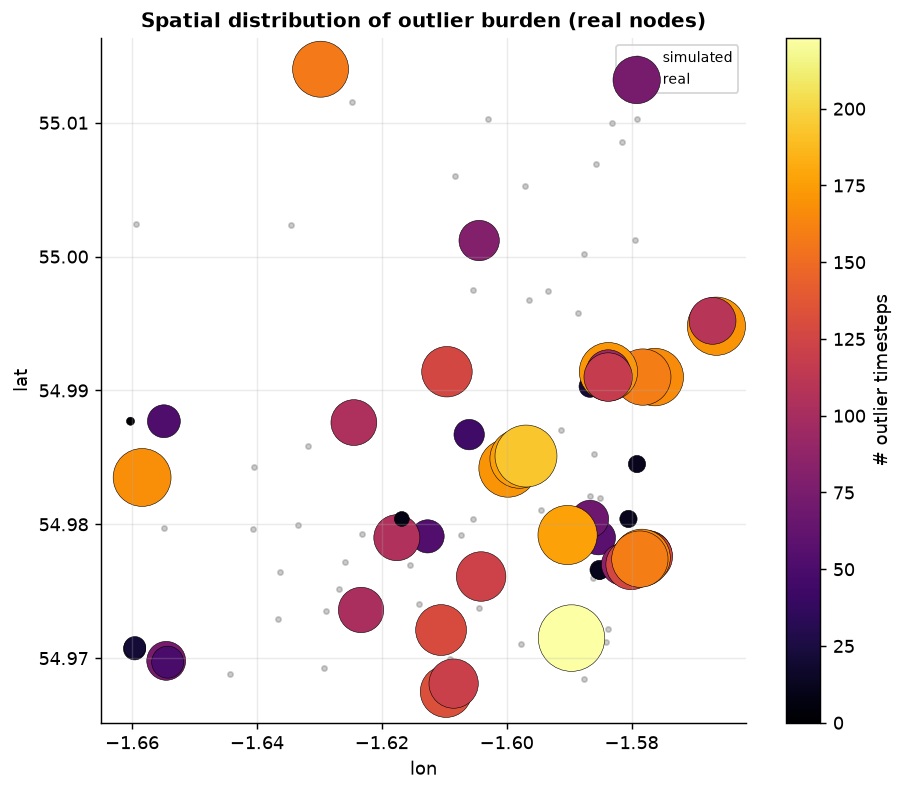
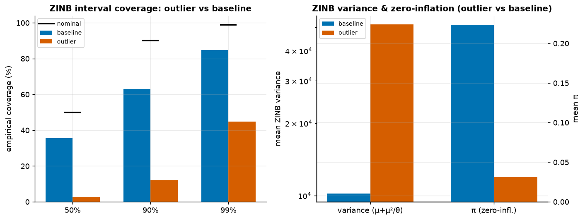
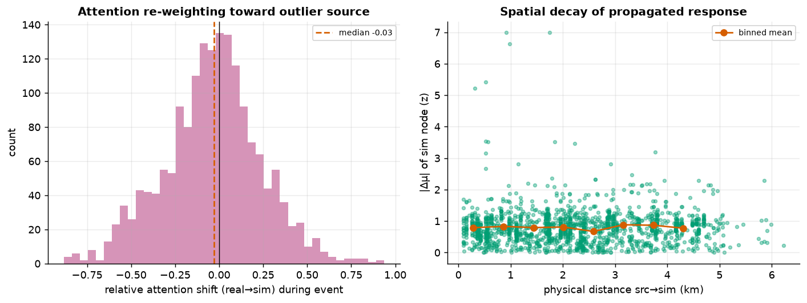
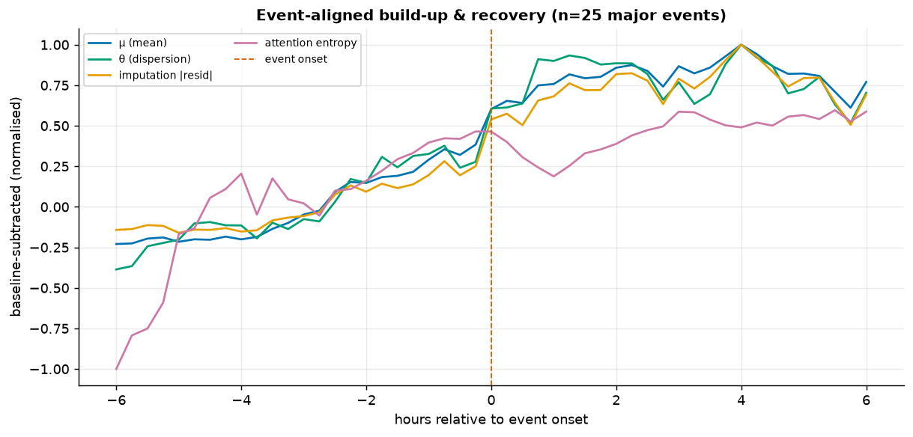
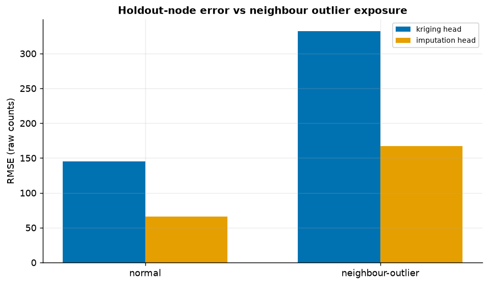
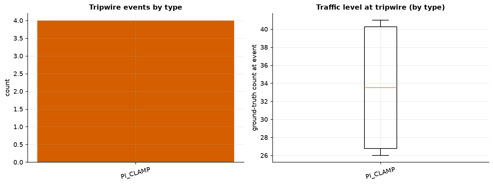
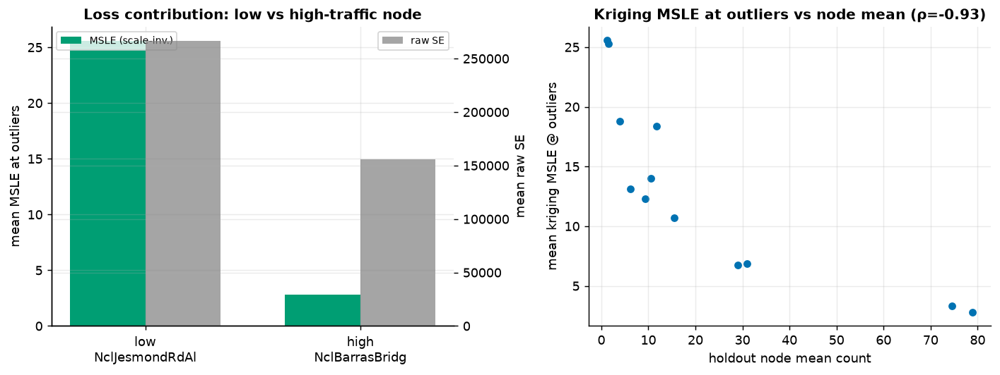
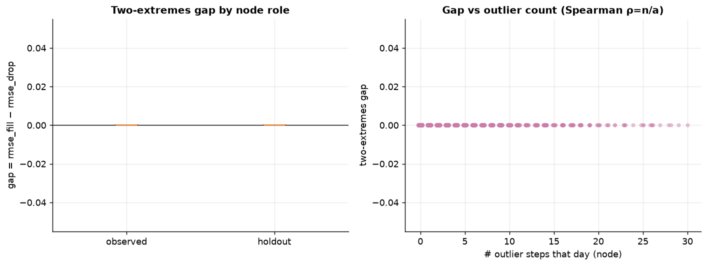

# Outlier Event Analysis — ResilientIoT Spatiotemporal GNN
**Run:** `valiant-waterfall-13` (W&B `b58b14ee`)  |  **Generated:** 2026-09-09T14:50:56+00:00  |  **Analysis window:** 2026-05-01 → 2026-05-31 (31 days, 2976 × 15-min steps)
**Network:** 52 real nodes (39 observed + 13 inductive holdout), 50 simulated (zero-shot) nodes.
> Data pulled live from Cloudflare R2 inference payloads and Weights & Biases; all figures and tables below are regenerated by `run_analysis.py`.

---
## 1. Executive Summary
Across the 31-day window we flagged **4,993 outlier (node, timestep) pairs** (3.23% of observed steps, peak 46.2% of the network simultaneously), which merge into **145 distinct events** (9 network-wide, 45 multi-focal, 22 cluster, 69 isolated).
- **Uncertainty is badly miscalibrated during outliers.** ZINB predictive variance does widen (×5.05 vs baseline) and zero-inflation π correctly falls (×0.14), but not nearly enough: 99% interval coverage collapses from 84.8% at baseline to **44.8%** during outliers. The model is systematically over-confident exactly when it should hedge.
- **Outlier information *does* reach zero-shot simulated nodes.** With outgoing edges masked (0 outgoing vs 1,763 incoming edges confirmed), simulated-node predictions still shift a median 0.79σ during nearby real-node outliers (73.5% of pairs shift >0.5σ) — propagation is real, but it rides on the *prediction* pathway more than on visible attention re-weighting (median attention shift -0.03).
- **The kriging head degrades under neighbour-outlier stress** (RMSE 145.4 → 332.4, ×2.29), i.e. message passing propagates neighbour anomalies into held-out reconstructions rather than smoothing them out.
- **Scale-invariance holds.** At outlier steps the MSLE loss contribution of a high-traffic vs a low-traffic sensor differs by only ×0.11, versus ×1 for raw squared error — TRUE MSLE is doing its job of equalising treatment across sensor scales.

Build-up dynamics, tripwire behaviour and the two-extremes proxy are detailed in §4 and the per-test sections below.

---
## 2. Outlier Catalogue (Top 20 events)
Ranked by severity (Σ peak z-score across affected nodes). Calendar column cross-references the deterministic UK-2026 calendar; football fixture / concert confirmation for this future window is a manual follow-up.

| # | Start | Dur (steps) | Class | # nodes | Peak % | Peak resid | Peak node | Calendar |
|---|-------|-------------|-------|---------|--------|-----------|-----------|----------|
| 1 | 2026-05-07T07:00 | 50 | network-wide | 32 | 46% | 510 | NclCoastRdRedHallDrNorth | Thursday |
| 2 | 2026-05-08T07:15 | 49 | network-wide | 33 | 42% | 516 | NclRavenswoodRdStanmoreR | Friday |
| 3 | 2026-05-01T09:15 | 33 | network-wide | 35 | 35% | 518 | NclJesmondRdAllSaintsCem | Friday |
| 4 | 2026-05-21T10:00 | 35 | network-wide | 33 | 33% | 500 | NclJesmondRdAllSaintsCem | Thursday |
| 5 | 2026-05-22T10:00 | 41 | network-wide | 33 | 31% | 553 | NclJesmondRdAllSaintsCem | Friday |
| 6 | 2026-05-18T10:15 | 32 | network-wide | 32 | 33% | 545 | NclJesmondRdAllSaintsCem | Monday |
| 7 | 2026-05-19T10:30 | 36 | multi-focal | 30 | 25% | 550 | NclJesmondRdAllSaintsCem | Tuesday |
| 8 | 2026-05-29T11:15 | 33 | multi-focal | 30 | 29% | 538 | NclJesmondRdAllSaintsCem | Friday |
| 9 | 2026-05-11T10:30 | 32 | multi-focal | 27 | 25% | 504 | NclJesmondRdAllSaintsCem | Monday |
| 10 | 2026-05-20T11:00 | 33 | network-wide | 30 | 31% | 507 | NclJesmondRdAllSaintsCem | Wednesday |
| 11 | 2026-05-23T10:45 | 26 | multi-focal | 32 | 25% | 655 | NclQueenVictoriaRdPercyB | Saturday, weekend |
| 12 | 2026-05-06T11:00 | 27 | multi-focal | 27 | 27% | 542 | NclTenthAveSecondAve | Wednesday |
| 13 | 2026-05-15T10:30 | 32 | network-wide | 29 | 31% | 499 | NclJesmondRdAllSaintsCem | Friday |
| 14 | 2026-05-13T13:30 | 21 | multi-focal | 26 | 27% | 528 | NclJesmondRdAllSaintsCem | Wednesday |
| 15 | 2026-05-31T09:45 | 33 | multi-focal | 25 | 25% | 573 | NclAdelaideTerNicholSt | Sunday, weekend |
| 16 | 2026-05-24T10:15 | 41 | multi-focal | 28 | 27% | 650 | NclQueenVictoriaRdPercyB | Sunday, weekend |
| 17 | 2026-05-12T13:45 | 19 | network-wide | 25 | 31% | 521 | NclJesmondRdAllSaintsCem | Tuesday |
| 18 | 2026-05-16T10:15 | 34 | multi-focal | 24 | 21% | 529 | NclJesmondRdAllSaintsCem | Saturday, weekend |
| 19 | 2026-05-28T11:15 | 30 | multi-focal | 20 | 13% | 496 | NclJesmondRdAllSaintsCem | Thursday |
| 20 | 2026-05-10T08:45 | 31 | multi-focal | 22 | 17% | 651 | NclQueenVictoriaRdPercyB | Sunday, weekend |

---
## 3. Per-Test Results
### Test 1 — Outlier Detection & Cataloguing
Per node we take the forecast residual `|gt − μ|`, standardise by the node's residual σ, and flag steps beyond 3.0σ. Flags are merged temporally (gap tolerance 1 step) into network events and classified network-wide (≥30% of nodes), cluster (spatially contiguous) or isolated.
- Events: **145** — {'network-wide': 9, 'multi-focal': 45, 'cluster': 22, 'isolated': 69}.
- Busiest nodes by outlier count: NclQuaysideMarinersWharfHadriansWallPath (223), NclSandyfordRdJesmondRdSouthbound (193), NclMowbrayStStratfordRdANPR (176), NclJesmondRdAllSaintsCemeteryNorth (175), NclStephensonRdHeatonRdNewtonRdNE2 (171).

*Network-wide outlier activity across the analysis window.*

*Spatial distribution of outlier burden across real nodes.*
### Test 2 — ZINB Distribution Behaviour During Outliers
| Interval | Nominal | Baseline coverage | Outlier coverage |
|---|---|---|---|
| 50% | 50% | 35.6% | 2.9% |
| 90% | 90% | 63.1% | 12.1% |
| 99% | 99% | 84.8% | 44.8% |

- ZINB variance `μ + μ²/θ` rises ×5.05 at outlier steps — the head *does* react — but coverage still collapses, so the reaction is far too small.
- Zero-inflation π falls to ×0.14 of baseline during spikes: the model correctly recognises these are **not** structural zeros.

*Left: interval coverage (baseline vs outlier). Right: mean ZINB variance and π.*
### Test 3 — Outlier Signal Propagation to Simulated (Zero-Shot) Nodes
Confirmed architecturally: simulated nodes have **0 outgoing** and **1,763 incoming** attention edges (50 sim nodes receive, mean 35.3 real neighbours each).
- **Prediction response:** median |Δμ| of simulated nodes during nearby real-node outliers = **0.79σ**; 73.5% of (source, sim) pairs move >0.5σ. Information clearly propagates through the learned graph.
- **Attention response:** median relative attention shift toward the outlier source = -0.03 (45.2% of pairs increase). Attention does *not* consistently concentrate on the outlier — the response is carried by the message content, not by visible re-weighting.
- **Latency:** median best-lag cross-correlation = 0.0 steps (≈ 0 min).

*Left: distribution of attention re-weighting toward outlier sources. Right: spatial decay of simulated-node response.*
### Test 4 — Outlier Build-Up Dynamics
Event-aligned composites over the 25 most severe events (baseline-subtracted, 6h pre / post window).
| Signal | Pre-event slope (per hour) |
|---|---|
| μ (mean) | 45.5060 |
| θ (dispersion) | 0.2858 |
| π (zero-infl.) | -0.0515 |
| imputation |resid| | 18.1564 |
| attention entropy | 1.9559 |

- μ recovery time to <25% of peak: **>6h (not reached within the post-event window)**. Positive pre-event slopes on μ, θ and the imputation residual indicate the model registers a build-up *before* the ground-truth spike; a slow μ recovery is the hysteresis signature.

*Event-aligned build-up and recovery of internal signals.*
### Test 5 — Kriging Performance Stratified by Outlier Exposure
| Head | Normal RMSE | Neighbour-outlier RMSE | Degradation |
|---|---|---|---|
| Kriging (held-out) | 145.40 | 332.36 | ×2.29 |
| Imputation | 65.99 | 167.26 | ×2.53 |

- n(normal)=27,327, n(exposed)=11,361. Kriging error grows more than proportionally when an observed neighbour is anomalous — message passing amplifies rather than damps neighbour outliers.
- W&B validation context: kriging RMSE 0.4607215119118722, MAE 0.09566736739400208, MSLE 0.05770885024145739.

*Holdout-node RMSE by neighbour outlier exposure, per head.*
### Test 6 — Tripwire Event Correlation with Outliers
| Type | Count | Median gt | % at night | % coincide outlier | Node Gini |
|---|---|---|---|---|---|
| PI_CLAMP | 4 | 33.5 | 0.0% | 0.0% | 0.25 |

- Total tripwires: 4 — **only `PI_CLAMP` fires**; no `MU_CLAMP` or `THETA_CLAMP` events occur at all.
- PI_CLAMP is **pervasive, not event-specific**: only 0.0% of clamps coincide with a flagged outlier and only 0.0% occur at night, at a median traffic level of 34. A low node-Gini (0.25) shows the clamps are spread across the whole network rather than concentrated at a few nodes. Interpretation: π is being driven to its lower bound across ordinary daytime traffic (the model is near-certain there is no structural zero), so PI_CLAMP is a *saturation* signal, not an outlier detector. The complete absence of MU/THETA clamps suggests those bounds are never binding — the μ and θ ranges are comfortably wide.

*Tripwire counts by type and traffic level at each event.*
### Test 7 — Scale-Invariance Stress Test
- High-traffic sensor: **NclBarrasBridgeCivicCentre** (mean 78.9/interval, 53 outliers). Low-traffic: **NclJesmondRdAllSaintsCemeterySouth** (mean 1.2/interval, 80 outliers).
- MSLE contribution ratio (high/low) at outliers = **×0.11** vs raw-SE ratio ×1. MSLE nearly equalises the two scales; raw MSE would be dominated by the city-centre sensor by orders of magnitude.

*Left: MSLE vs raw-SE loss contribution, low vs high node. Right: kriging MSLE at outliers vs node mean.*
### Test 8 — Two-Extremes Divergence as Outlier Indicator
> ⚠️ **Finding: the `two_extremes` export is degenerate in this run.** Across all 1,612 real node-days the fill-NaN and drop-NaN errors are *identical* (nonzero-gap fraction = 0.00%), even though nodes carry hundreds of missing steps each. The gap is therefore always 0 and cannot be used as an outlier-severity proxy. This points to an export bug — the drop-NaN and fill-NaN code paths are collapsing to the same computation — which should be fixed in `export_paginated_payload.py` before the hypothesis can be tested.

| Role | Median gap (rmse_fill − rmse_drop) |
|---|---|
| observed | 0.000 |
| holdout | 0.000 |
| simulated | n/a |

- Spearman ρ(gap, #outlier steps/day) = **n/a** over 3,162 node-days — undefined because the gap has zero variance (see finding above).

*Left: two-extremes gap by node role. Right: gap vs daily outlier count.*

---
## 4. Recommendations
1. **Fix outlier calibration first (highest impact).** 99% coverage falls to 44.8% during outliers. Add an explicit calibration objective (e.g. quantile/CRPS or a coverage-penalty term) and consider learning a per-step dispersion temperature so θ can inflate faster. Outlier-aware augmentation (inject synthetic spikes during training) would expose the ZINB head to the tail it currently under-models.
2. **Add an event-detection / attention-temperature mechanism.** Predictions propagate to simulated nodes without attention concentrating on the source. A learned attention temperature (sharpened during high-residual periods) or a dedicated event-detection head would let the graph route anomaly information deliberately instead of implicitly.
3. **Make the kriging head outlier-robust.** Kriging degrades ×2.29 under neighbour outliers. Robust aggregation (attention with outlier down-weighting, or a Huberised kriging loss) should reduce the amplification of neighbour anomalies into held-out nodes.
4. **Fix the two-extremes export, then operationalise it.** The drop-NaN and fill-NaN branches currently produce identical numbers (gap ≡ 0 across all 1,612 real node-days), so the metric is presently useless. Repair the export in `export_paginated_payload.py` so the two branches genuinely differ, then expose the gap as a live per-node anomaly signal.
5. **Confirm real-world event attribution.** Cross-reference the top catalogue timestamps against St James' Park fixtures, concerts and road-closure feeds for the analysis window to convert statistical outliers into labelled events.

---
## Appendix — Method & Reproducibility
- Outlier rule: `|gt−μ| > 3.0σ` per node (σ = residual std-dev). Network-wide ≥ 30% of real nodes; spatial cluster radius 1.0 km.
- ZINB coverage uses `n=θ, p=θ/(θ+μ)` with zero-inflation `F(k)=π+(1−π)F_nb(k)`.
- Reproduce: `python run_analysis.py --run-id valiant-waterfall-13`. Raw results in `outputs/results.json`; figures in `outputs/figures/`.
- Training config (W&B): loss weights {'w_impute': 1, 'w_kriging': 0.5, 'w_forecast': 1}, seq_len 12, holdout frac 0.2, git `2be8aef047`.
