# RIoT v5 experiment suite — results analysis (Tier 1 + Tier 2, seed 42)

**Scope.** 103 completed runs (42 tier-1 headline runs, 61 tier-2 screens and leave-one-outs), all seed 42.
Tier 3 (seeds 43/44, 106 runs) has not run yet. Every number below is a single-seed result.
**Purpose.** Input for the rewrite of thesis Chapter 7 (Experiment 3) and the zero-collapse follow-up.
**Date.** 2026-10-05.
**Superseded in part.** Tier 3 has since completed. For 3-seed re-scoring of every claim below and the
changed verdicts, see [`riot_v5_seed_report.md`](riot_v5_seed_report.md) (2026-10-08).

**Reproduce.**

```bash
python scripts/riotv5/collect_v5_results.py   # -> docs/experiments/riot_v5/data/{runs,epochs}.csv
python scripts/riotv5/plot_v5_results.py      # -> docs/experiments/riot_v5/figures/*.png
python scripts/riotv5/tables_v5_results.py    # -> docs/experiments/riot_v5/data/appendix_tables.md
```

`grad_cosine_history.csv` was pulled read-only from the W&B project `resilient-iot-v5`. It is
`train_grad_cosine_forecast_impute` per epoch and covers 100 runs; it is absent for `e6_4_detached_impute`
and the two naive baselines. Full per-run tables are in
[`data/appendix_tables.md`](data/appendix_tables.md).

---

## 0. Executive summary

1. **v5 fixes zero collapse and makes the model resilient to outages.** Going from the v4 replica (V4R) to
   full v5 (V5F):
   - SO@12 forecast RMSE on outaged nodes falls from 31.8 to 15.8 (**−50%**).
   - Predicted mass during a 24 h synthetic outage rises from 0.00 to 1.01 of the truth.
   - The real-gap collapse rate falls from 0.79 to 0.06.
   - Transductive RMSE improves by 23% (17.0 → 13.1).
   - All-node RMSE improves by 7.4%, peak RMSE by 6.6%.

   All of these deltas are well outside the noise band and agree between validation and test.
2. **One component does most of the work: the unified missing encoding**, which makes artificial and real
   gaps look identical to the model.
   - Added on its own to the hygiene base (E2.1), it cuts SO@12 by 29% and raises SO@96 mass from 0.14 to 0.88.
   - Removed from V5F, it is the only leave-one-out with a large effect: SO@12 +82%, collapse 0.06 → 0.32,
     SO@96 mass 1.01 → 0.14.
   - Structured masking (block / transplant / tail / mixed) adds a further ~15% on SO@12 over observed-only
     iid masks.
   - The graph matters for long outages (identity graph: SO@96 +47%) but not for normal forecasting.
3. **Loss hygiene removes hard collapse but leaves soft collapse.** After the P1 hygiene steps, the collapse
   rate (point < 1) is 0.000. However, predicted mass in real gaps is only 12–21% of the profile, and SO@96
   mass only 0.12–0.20. The < 1 threshold hides this, so the mass ratios, not the collapse rate, should be the
   reported diagnostic.
4. **Held-out (inductive) stations are not solved.**
   - V5F's held-out RMSE (46.4) is **8.7% worse than a non-learned neighbour-profile baseline** (42.6). Its
     kriging RMSE (46.0) also loses to that baseline.
   - On all-node RMSE, V5F beats the naive profile by only 1.5%. The gain is concentrated at transductive
     stations (−28%) and under outages (−11%).
   - The best held-out models are E2.1 (unified encoding only), E3.3d (profile `inductive_zero`) and E3.2
     (log1p), all at 39.1–39.5. None of them is V5F. From P5B to V5F, held-out accuracy was traded for
     transductive accuracy.
5. **Most of the thesis Experiment 3 conclusions do not survive observed-only scoring.** Re-run on V4R:
   - no-impute (−2.1%) and no-kriging (0.0%) are noise.
   - The LSTM is *better* on RMSE (−4.9%), not 22% worse.
   - bs32 is *worse* (+3.6%), not 7% better.
   - Only no-masks (+6.6%), dropout 0.3 (+5.5%) and, marginally, no-PE (+3.3%) keep their sign.
   - On V5F, **no** thesis ablation leaves the ±3% band.
   - Two measurement artefacts explain the thesis numbers (§7.2). The legacy RMSE scores zero-filled missing
     targets, which rewards collapse; this explains the LSTM. It is also a mean of per-batch RMSEs computed at
     the training batch size, which mechanically favours small batches; this explains bs32.
6. **The P4–P6 screens show no effect beyond noise.**
   - Likelihood variants, magnitude weighting, under-prediction pinball, quantile heads and MTL balancing all
     sit within ±3% of their bases on accuracy.
   - The outage-mixture head adds an outage probability with AUC 0.91 (0.999 at L = 96) and keeps night-time
     zeros. It does not improve accuracy, and it brings back a 2–6% collapse rate.
   - Forecast and imputation gradients never conflict: the cosine is positive in every GNN run that trains both heads (mean 0.22–0.74), which
     falsifies the "negative transfer" hypothesis.
7. **Peaks are the main unsolved problem.** Every model under-predicts the top decile by 50–73 counts, and
   36–69% of peak targets are under-predicted. The interventions aimed at magnitude (α weighting,
   under-prediction pinball, low-end tolerance) do not move this.
8. **Method caveats that limit what can be claimed:**
   - single seed, with a measured noise floor of about ±3% (§2);
   - P3–P5 screens strongly confounded by early stopping (Spearman ρ = −0.90 between selected epoch and
     transductive RMSE);
   - the pre-declared P4B base contradicted by its own P3 screen.

---

## 1. Setup recap

### 1.1 Bases and groups

| Base | Definition | Run |
|---|---|---|
| V4R | v4 `full_inductive` expressed in v5 form | `v4r_full` |
| P2B | V4R + observed-only targets / selection + NB + complete weather | `e1_6_complete_weather` |
| P3B | P2B + unified encoding + observed-only structured masks (mixed, 0.30) | `e2_7_mixed_030` |
| P4B | P3B + calendar, log1p, profile (`inductive_neighbour`), run-length, sensor embedding | `e3_stack` |
| P5B | P4B + anchored outage mixture | `e4_4_anchored` |
| V5F | P5B + magnitude α 0.5, q50/q90 heads, Huber, key padding, GAT missing-source drop, consistent night channel | `v5_full` |

### 1.2 Metrics used in this report

All metrics are raw counts, scored on **observed targets only**, on the test split, unless stated otherwise.

| Metric | Meaning |
|---|---|
| All / Trans / Ind RMSE | Observed-target RMSE over all 81 nodes / the 57 transductive nodes / the 24 held-out nodes |
| Peak RMSE | RMSE on targets ≥ 58 (train p90) |
| SO@L | Synthetic outage. The last min(L, 12) input steps are blanked on 25% of eligible transductive nodes. SO@L RMSE is the forecast RMSE on those nodes; the SO mass ratio is predicted / true sum on them |
| Collapse | P(point < 1 \| target missing, own profile > 10). Hard collapse |
| Real-gap mass | Predicted / profile mass inside real gaps. Detects soft collapse |
| CRPS, PIT, q90 coverage | Probabilistic calibration |
| Impute / Kriging RMSE | Raw RMSE of the imputation and kriging heads |
| Legacy RMSE | The v4 `test_metrics` RMSE. It includes zero-filled missing targets and is a mean of per-batch RMSEs; used only for the thesis cross-check (§7.2) |

**SO@L with seq_len 12.** With a 12-step window, SO@12, SO@48 and SO@96 hide exactly the same inputs. They
differ only through the run-length and lag covariates, which encode how long the gap has lasted. Those three
points therefore test whether the model reacts to *knowing* that a gap is long, not whether it copes with
more missing inputs. The exceptions are the seq48 and seq96 runs.

### 1.3 Things to keep in mind when reading the tables

- **`e3_3a_profile_transductive` is an oracle.** Every node, including held-out ones, gets its own seasonal
  profile. Its numbers (all 18.5, ind 27.1) are a ceiling and are excluded from all rankings.
- **Six runs hit the 100-epoch cap with the selected epoch near the end and may be under-trained:**
  `e2_2_block` (95/100), `e3_6_seq48` (98), `e3_7_seq96` (94), `v4r_lstm` (96), `v4r_night_zero` (96),
  `v5_no_masks_no_impute` (93).
- **The naive baselines are defined as follows.**
  - `naive_profile`: the node's training-slice slot-of-week median. Held-out stations get the
    neighbour-donor substitute.
  - `naive_last_obs`: the last visible value, falling back to the profile when the window is fully hidden.
    This is why the two baselines have identical SO and held-out numbers.
- **The inductive degeneracy metric is asymmetric.** `ind_pred_pairwise_corr_mean` is computed over all test
  timesteps, while `ind_true_pairwise_corr_mean` (0.41) is computed over observed timesteps only. The
  comparison is directional, not exact.

---

## 2. How large is the noise? (no seeds yet)

Tier 3 has not run, so the noise floor was estimated three ways.

1. **Plateau jitter.** The relative std of validation obs-RMSE within ±5 epochs of each selected epoch:
   median **0.8%**.
2. **Natural replicates.** Training is not bitwise deterministic: same seed and config already diverge at
   epoch 1. Two pairs of runs train identically.
   - `v5_full` vs `loo_val_loss_selection`: identical training, only the checkpoint rule differs. The
     per-epoch s.d. of the relative difference is **1.4%**. Test deltas: all −0.7%, trans +1.7%, ind −1.2%,
     peak −0.9%, SO@12 −0.7%, CRPS −1.7%, NLL −3.4%, collapse 0.059 vs 0.045, real-gap mass 0.82 vs 0.96.
   - `v4r_full` vs `v4r_bs128_steps4x`: identical until v4r_full stops at epoch 70. Over the 70 shared epochs
     the s.d. is **2.0%**. After epoch 35 `steps4x` drifts about 2.5% worse; the two runs are not otherwise distinguishable.
3. **Val/test agreement.** Across runs, val and test RMSE correlate at r = 0.95 (all), 0.99 (trans), 0.92 (ind)
   and 0.94 (peak). Every effect claimed below has the same sign on validation and test (see the check table
   in Appendix B).

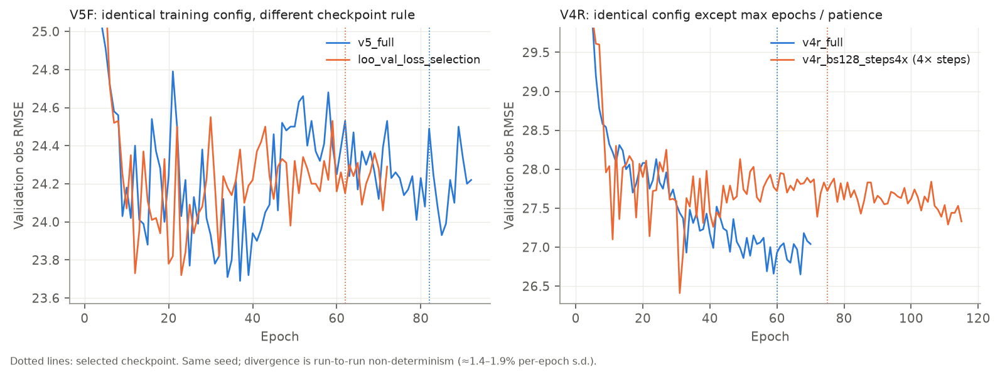

*Figure 3. Validation obs-RMSE trajectories for the two natural replicate pairs. Same seed and config, yet
per-epoch differences of 1–3% are routine. The V4R pair separates by ~2.5% after epoch 35.*

**Adopted noise bands (single seed):**

| Quantity | Noise (treat as no effect) | Suggestive | Clear |
|---|---|---|---|
| All-node RMSE / MAE / peak / CRPS / SO RMSE | ≤ ±3% | 3–6% | > 6%, val and test agree |
| Trans / Ind RMSE (smaller subsets) | ≤ ±5% | 5–8% | > 8% |
| Collapse rate | ≤ ±0.02 abs | | |
| SO mass ratio | ≤ ±0.10 abs | | |
| Real-gap mass ratio | ≤ ±0.15 abs | | |

These bands are wider than the "2 × pooled seed std" rule in the zero-collapse protocol would give if seeds
were available. They should be replaced by seed std once tier 3 completes.

### 2.1 Early-stopping confound

The selected epoch varies from 3 to 98, and it strongly predicts the result:

- Spearman ρ between selected epoch and test transductive RMSE is **−0.90 within P3–P5** (n = 31) and **−0.66
  over all 97 GNN runs** (naive and LSTM runs excluded).
- The P4 and P5 screens stop early (median selected epoch 21 and 21.5). V5F-derived runs train for 60–90
  epochs (V5F: 82 of 92). The LOO minimum is 39.

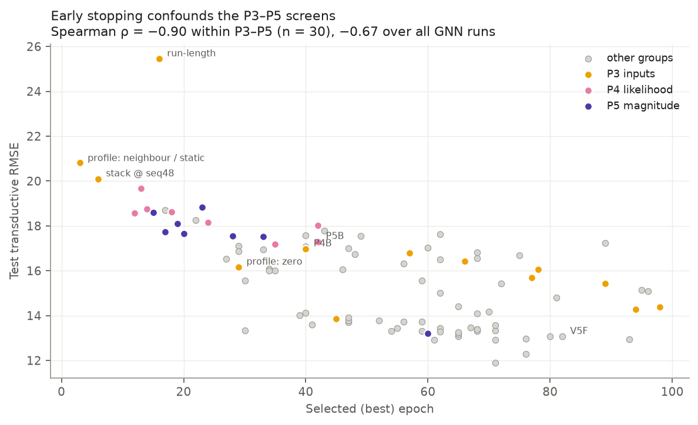

*Figure 4. Selected epoch vs transductive RMSE. The P3–P5 points (coloured) lie on a steep line: runs that
stopped early are worse. The two profile-substitute runs stopped at epoch 3, run-length at 16 and the stack
at seq 48 at epoch 6.*

Consequences:

- The P4 and P5 one-factor screens compare runs with different effective training budgets. A "no effect"
  there means "no effect detectable through this confound", not "no effect".
- Profile substitutes for held-out stations (`inductive_neighbour`, `inductive_static`) hurt *transductive*
  accuracy (≈ 20.8 vs 16.3) even though transductive inputs are identical across profile modes. The cause is a
  training-dynamics problem: validation loss rises from epoch 3. It is not a representational one. The same
  pattern appears for run-length alone (best epoch 16, trans 25.4) and the stack at seq 48 (best epoch 6).
  The mechanism is unexplained and needs a follow-up. Candidates are: distribution shift between the flag-0
  substitute profile and the flag-1 own profile; the very large run-length values; and the absence of an LR
  schedule, with patience 10.
- The jump from P5B to V5F (trans 17.3 → 13.1) is not reversed by removing any single V5F component: all LOO
  transductive RMSEs are 12.3–14.1. Either several V5F additions interact, or V5F simply trains longer and more
  stably (selected epoch 82 vs 42). The data cannot separate these.

---

## 3. The base chain: V4R → V5F

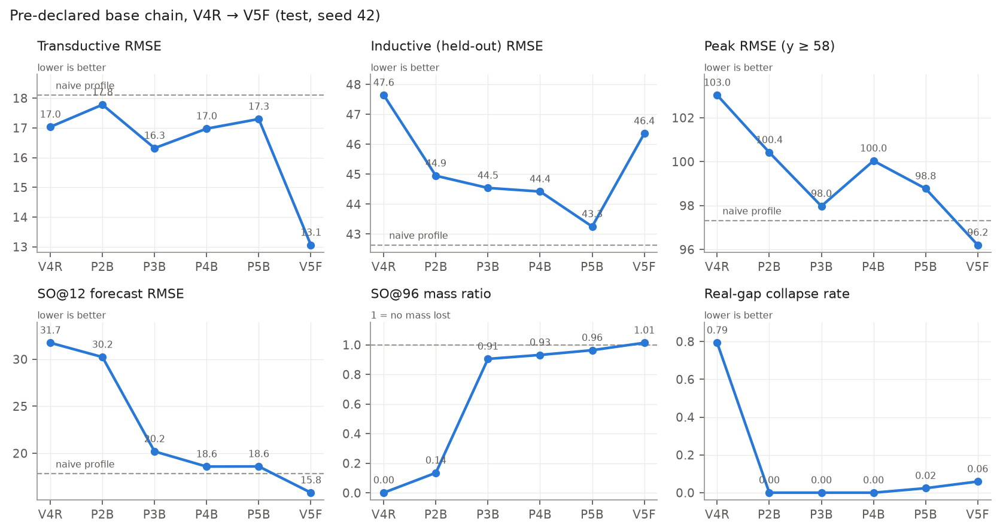

*Figure 1. Headline metrics along the pre-declared base chain. The dashed line is the non-learned
neighbour-profile baseline.*

| Base | All | Trans | Ind | MAE | Peak | SO@12 | SO@96 mass | Collapse | Gap mass | CRPS | q90 cov | Kriging |
|---|---:|---:|---:|---:|---:|---:|---:|---:|---:|---:|---:|---:|
| V4R | 28.97 | 17.03 | 47.64 | 10.65 | 103.0 | 31.75 | 0.00 | 0.793 | 0.03 | 8.77 | 0.77 | 48.1 |
| P2B | 28.09 | 17.78 | 44.95 | 10.30 | 100.4 | 30.23 | 0.14 | 0.000 | 0.21 | 8.31 | 0.81 | 45.2 |
| P3B | 27.25 | 16.32 | 44.54 | 10.14 | 98.0 | 20.19 | 0.91 | 0.000 | 0.71 | 8.07 | 0.82 | 45.3 |
| P4B | 27.49 | 16.97 | 44.42 | 10.06 | 100.0 | 18.58 | 0.93 | 0.000 | 0.49 | 8.13 | 0.84 | 46.4 |
| P5B | 27.11 | 17.30 | 43.25 | 9.74 | 98.8 | 18.60 | 0.96 | 0.024 | 0.57 | 7.90 | 0.82 | 43.7 |
| V5F | 26.82 | 13.06 | 46.36 | 9.60 | 96.2 | 15.81 | 1.01 | 0.059 | 0.82 | 8.06 | 0.82 | 46.0 |
| *naive profile* | *27.22* | *18.10* | *42.63* | *10.28* | *97.3* | *17.82* | *1.02* | *0.000* | *0.84* | – | – | *42.6* |

Reading the chain step by step:

- **V4R → P2B (hygiene).**
  - Collapse disappears and held-out RMSE improves by 5.7%.
  - Outage behaviour hardly changes (SO@12 −5%; SO@96 mass 0.14). This is soft collapse (§4).
- **P2B → P3B (unified encoding + structured masks).** The resilience step:
  - SO@12 −33%;
  - SO@96 mass 0.14 → 0.91;
  - real-gap mass 0.21 → 0.71.
- **P3B → P4B → P5B.**
  - Normal accuracy changes are within noise.
  - SO@12 improves 8% at P4B. P5B adds the outage probability head.
  - Held-out RMSE drifts down slightly (44.5 → 43.3).
- **P5B → V5F.**
  - Transductive RMSE −25% and SO@12 −15%.
  - Held-out RMSE **+7.2%** (43.3 → 46.4), the same as V4R-era levels.
  - Collapse rises to 0.059 (the outage-mixture point forecast; §6.3).

**Two quantities never beat the naive profile along the whole chain:** held-out RMSE and kriging RMSE. The
naive profile also has better peak RMSE than every base except V5F, and V5F's margin there (−1.1%) is within
noise.

---

## 4. Zero collapse: from hard to soft, and what actually fixes it

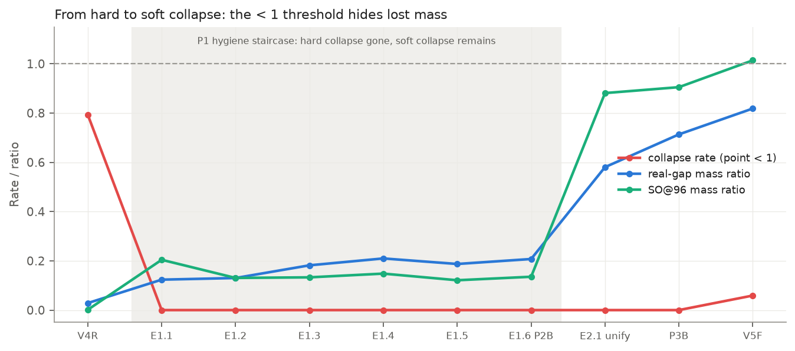

*Figure 15. Collapse rate (point < 1) vs the two mass ratios across the P1 staircase and the masking step.*

The P1 staircase changes one thing at a time from V4R (E1.1 observed-only forecast target, E1.2 + observed-only
impute target, E1.3 + observed-only kriging target, E1.4 + obs-NLL + SO selection, E1.5 + NB likelihood, E1.6 +
complete weather = P2B):

- **E1.1 alone takes collapse from 0.79 to 0.000.** Once missing slots are no longer scored as zeros, the model
  stops predicting zero.
- **Mass is still lost.** Real-gap mass is 0.12–0.21 and SO@96 mass 0.12–0.20 through E1.1–E1.6. The model
  predicts small positive values (above 1, so not counted as "collapsed") inside gaps. This is **soft
  collapse**.
- All-node RMSE across the staircase is non-monotonic and within noise (28.45, 26.12, 28.05, 28.23, 27.53,
  28.09). E1.2 (26.12, −10%) is an outlier that later steps do not keep. It is most likely noise or an
  early-stopping artefact: it was selected at epoch 34.

**Why soft collapse persists after hygiene.** Two mechanisms from the zero-collapse investigation
(`docs/design_reports/zero_collapse_investigation.md`, which is also the source of the two statistics below):

1. **MNAR selection.** P(target missing | last input missing) = 0.923, and 83% of missing slots lie in gaps
   longer than 3 h. Training targets therefore almost never occur inside long gaps, so the model has little
   signal about what to predict there.
2. **Encoding mismatch.** Artificial training masks and real gaps look different to the model (different
   mask/fill patterns), so learning to reconstruct masked inputs does not transfer to real gaps.

**The unified encoding is the fix.** It addresses mechanism 2 directly (Figure 2):

- E2.1 (P2B + unified encoding, iid masks): SO@96 mass 0.14 → 0.88; real-gap mass 0.21 → 0.58.
- Removing it from V5F (`loo_no_unify`) brings soft collapse back (SO@96 mass 0.14) *and* hard collapse
  (0.32), even with every other v5 component present.

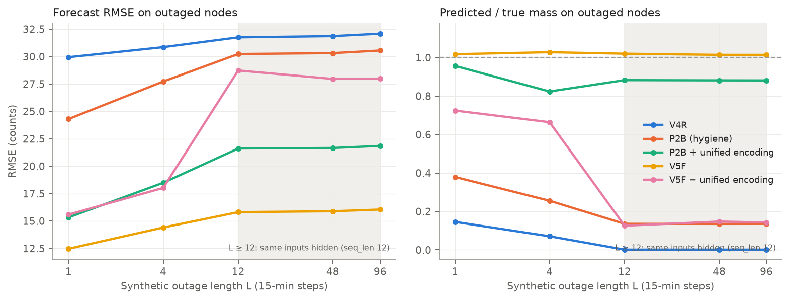

*Figure 2. Forecast RMSE and mass ratio on synthetically outaged nodes vs outage length.*

- V4R loses all mass at L ≥ 12.
- P2B keeps 14%.
- Unified encoding alone keeps 88%. V5F keeps 101% at every length.
- Without unified encoding, V5F keeps most mass for short outages (0.66 at L = 4, where real inputs remain in the window)
  and collapses once the window is fully hidden.

The SO@L hard-collapse rates make the same point:

| Run | SO@4 | SO@12 | SO@48 | SO@96 |
|---|---:|---:|---:|---:|
| V4R | 0.33 | 1.00 | 1.00 | 1.00 |
| P2B, E2.1, V5F, V5F − outage head | 0.00 | 0.00 | 0.00 | 0.00 |
| V5F − unified encoding | 0.00 | 0.44 | 0.55 | 0.63 |
| V5F, identity graph | 0.00 | 0.00 | 0.24 | 0.37 |

The rise from SO@12 to SO@96 in the last two rows is driven purely by the run-length covariate, because the
hidden inputs are identical. Those models have learnt "long gap ⇒ predict near zero". Unified encoding and
the graph both suppress that shortcut.

**Mask-channel reliance.** Flipping the mask channels vs perturbing values changes the point forecast as
follows (mean |Δpoint|):

| Run | Mask flip | Value perturbation |
|---|---:|---:|
| V4R | 5.95 | 7.19 |
| E2.1 | 12.21 | 10.07 |
| P3B | 12.69 | 11.89 |
| P4B | 3.22 | 1.78 |
| V5F | 4.29 | 3.46 |

Once unified encoding is on, the mask channels are the model's main source of missingness information, and
sensitivity doubles. When run-length and the other R3 covariates arrive (P4B), mask sensitivity drops by
three-quarters. This is consistent with the masks × imputation result on V5F (§7.4): the mask channels are
redundant once run-length is present.

---

## 5. Phase-by-phase screens

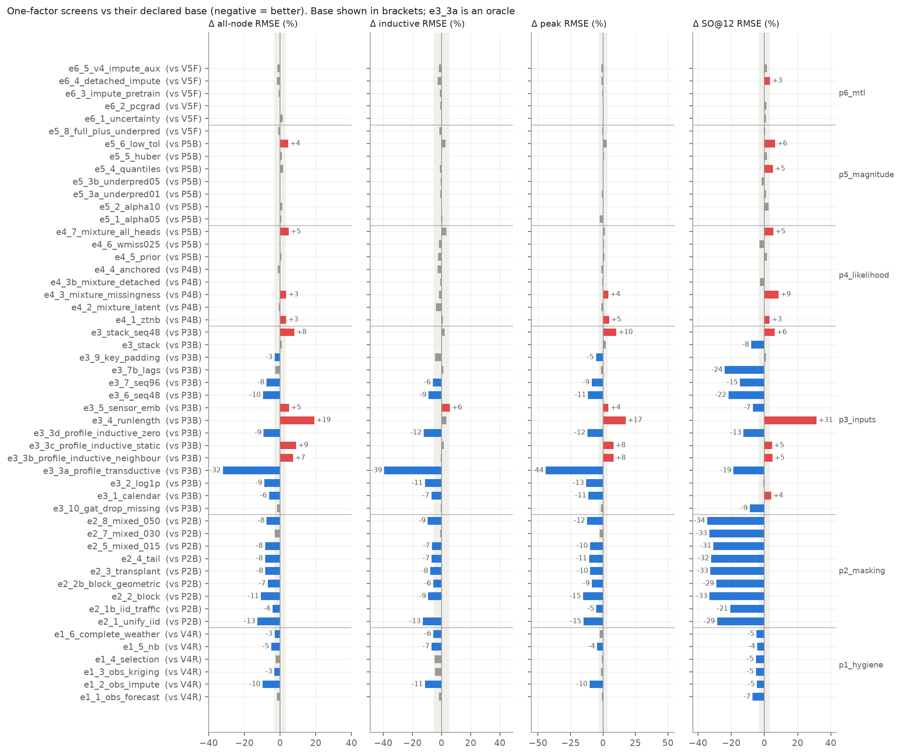

*Figure 14. Every one-factor screen as a % change vs its declared base (in brackets). Shaded = noise band
(±3%, ±5% for inductive). Blue = better, red = worse beyond the band.*

### 5.1 P2 — masking

| Run (vs P2B) | All | Ind | Peak | SO@12 | SO@96 mass | Gap mass |
|---|---:|---:|---:|---:|---:|---:|
| P2B `e1_6` | 28.09 | 44.95 | 100.4 | 30.23 | 0.14 | 0.21 |
| `e2_1_unify_iid` (unify only) | **24.52** | **39.18** | **85.4** | 21.61 | 0.88 | 0.58 |
| `e2_1b_iid_traffic` (unify + obs-only iid) | 26.88 | 44.91 | 95.3 | 24.00 | 0.70 | 0.33 |
| `e2_2_block` | 25.08 | 40.87 | 84.9 | 20.23 | 1.00 | 0.84 |
| `e2_2b_block_geometric` | 26.14 | 42.39 | 91.9 | 21.47 | 0.92 | 0.64 |
| `e2_3_transplant` | 25.75 | 41.47 | 90.5 | 20.40 | 0.92 | 0.70 |
| `e2_4_tail` | 25.72 | 41.90 | 89.7 | 20.53 | 0.96 | 0.78 |
| `e2_5_mixed_015` | 25.72 | 42.01 | 90.4 | 20.95 | 0.94 | 0.68 |
| `e2_7_mixed_030` (= P3B) | 27.25 | 44.54 | 98.0 | 20.19 | 0.91 | 0.71 |
| `e2_8_mixed_050` | 25.98 | 40.73 | 88.2 | **19.81** | 1.02 | 0.72 |

- **Unified encoding is decisive on every axis.** E2.1 is the best non-oracle run in the whole suite on
  all-node RMSE (24.52). It is a close second on CRPS (7.16 vs 7.13 for log1p) and third on peak RMSE (85.4 vs
  84.9 for block and 85.3 for log1p). It is second on held-out RMSE
  (39.18, vs 39.09 for E3.3d).
- **Structured gaps beat observed-only iid** on SO@12 by about 15% (20.2–21.5 vs 24.0). Block, transplant,
  tail and mixed are indistinguishable within noise. Mask ratio 0.15 / 0.30 / 0.50 is also flat
  (SO@12 20.9 / 20.2 / 19.8).
- **P3B (`e2_7`) looks like an unlucky draw.** On normal accuracy it is worse than every structured sibling
  (all 27.25 vs 25.1–26.1; held-out 44.5 vs 40.7–42.4), yet its SO@12 is among the best. Because P3B is the
  base for every P3 comparison, P3 deltas look better than they really are. Read them as "vs a weak base".
- **E2.1 vs E2.1b.** Unified encoding with traffic-agnostic iid masks (E2.1) is better on normal accuracy than
  with observed-only iid masks (E2.1b): all −9%, held-out −13%. E2.1b is better on SO@12, though less so than
  the structured strategies. The observed-only mask restriction may cost normal accuracy (§8, open question 4).

### 5.2 P3 — inputs (vs P3B)

| Run | All | Trans | Ind | Peak | SO@12 | Best ep | Verdict |
|---|---:|---:|---:|---:|---:|---:|---|
| P3B `e2_7` | 27.25 | 16.32 | 44.54 | 98.0 | 20.19 | 56 | base |
| `e3_1_calendar` | −6.1% | −3.8% | −7.0% | −11.2% | +4.0% | 77 | clear gain (normal) |
| `e3_2_log1p` | −8.8% | −1.7% | **−11.4%** | **−13.0%** | −0.6% | 78 | clear gain (all, ind, peak) |
| `e3_3b_profile_neighbour` | +7.3% | +27% | −0.7% | +8.1% | +4.8% | **3** | unstable training |
| `e3_3c_profile_static` | +9.0% | +28% | +1.6% | +8.0% | +4.6% | **3** | unstable training |
| `e3_3d_profile_zero` | −9.2% | −1.0% | **−12.2%** | −11.9% | −12.6% | 29 | clear gain (all, ind, SO) |
| `e3_4_runlength` | +19% | +56% | +3.2% | +17% | +31% | **16** | unstable training |
| `e3_5_sensor_emb` | +5.0% | +2.9% | +5.7% | +4.2% | −7.0% | 57 | hurts held-out |
| `e3_6_seq48` | −9.7% | −11.9% | −8.9% | −11.5% | **−21.7%** | 98 (cap) | clear gain |
| `e3_7_seq96` | −7.6% | −12.5% | −5.9% | −8.6% | −14.7% | 94 (cap) | clear gain, 40.8 GPU-h |
| `e3_7b_lags` (96, 672) | −2.7% | **−15.1%** | +1.3% | −1.5% | **−23.9%** | 45 | clear gain (trans, SO) |
| `e3_9_key_padding` | −3.1% | +0.6% | −4.4% | −5.4% | +0.9% | 66 | noise |
| `e3_10_gat_drop_missing` | −1.7% | −5.5% | −0.5% | −1.4% | −8.8% | 89 | SO gain |
| `e3_stack` (= P4B) | +0.9% | +4.0% | −0.3% | +2.1% | −8.0% | 40 | worse than its best parts |
| `e3_stack_seq48` | +8.0% | +23% | +2.2% | +10.2% | +6.2% | **6** | unstable training |

- **The pre-declared P4B stack was contradicted by its own screen.**
  - It contains the `inductive_neighbour` profile and run-length, which on their own destabilise training
    (selected at epoch 3 and 16).
  - It contains the sensor embedding, which hurts held-out accuracy.
  - It omits the three clearest P3 winners: `inductive_zero` profile, seq 48 and lags.
  - The stack ends up worse than calendar, log1p, profile-zero or seq48 alone.
- **Clear P3 winners** (val and test agree, Appendix B):
  - log1p inputs: all −9%, held-out −11%, peak −13%;
  - profile `inductive_zero`: all −9%, held-out −12%, SO −13%, kriging 37.9 (the best non-oracle kriging in
    the suite);
  - seq 48: all −10%, SO −22%;
  - lag features: transductive −15%, SO −24%;
  - calendar: all −6%, peak −11%.
- **The zero profile beats the neighbour profile for held-out stations** (held-out 39.1 vs 44.2). Telling the
  model "no profile here" (flag 0, value 0) is better than giving it a borrowed neighbour profile. The likely
  reason is that a borrowed profile looks like an own profile and pushes held-out predictions towards the
  donor's pattern (see the degeneracy analysis, §9).
- **seq96 is not worth its cost.** It took 40.8 GPU-h (15% of the whole suite) and is no better than seq48
  (17.2 GPU-h). Both hit the epoch cap and might improve with more epochs.

### 5.3 P4 — likelihood (vs P4B, or vs P5B for E4.5–E4.7)

Every accuracy delta is within ±5% and every one of these runs stopped early (selected epochs 12–42, Fig. 4).
The interpretable differences are in the missingness diagnostics:

| Run | All | SO@12 | Collapse | Gap mass | SO@1 AUC | SO@12 AUC | SO@96 AUC |
|---|---:|---:|---:|---:|---:|---:|---:|
| P4B `e3_stack` (NB) | 27.49 | 18.58 | 0.000 | 0.49 | – | – | – |
| `e4_1_ztnb` | 28.42 | 19.17 | 0.000 | 0.50 | – | – | – |
| `e4_2_mixture_latent` | 27.28 | 18.57 | 0.001 | 0.48 | 0.61 | 0.93 | 0.997 |
| `e4_3_mixture_missingness` | 28.43 | 20.18 | 0.011 | 0.36 | 0.85 | 0.95 | 0.999 |
| `e4_3b_mixture_detached` | 27.41 | 18.08 | 0.004 | 0.46 | 0.53 | 0.85 | 1.000 |
| P5B `e4_4_anchored` | 27.11 | 18.60 | 0.024 | 0.57 | 0.96 | 0.92 | 0.999 |
| `e4_5_prior` | 27.28 | 18.87 | 0.013 | 0.52 | 0.96 | 0.94 | 0.996 |
| `e4_6_wmiss025` | 27.14 | 18.04 | 0.029 | 0.48 | 0.97 | 0.95 | 0.999 |
| `e4_7_mixture_all_heads` | 28.42 | 19.59 | 0.028 | 0.56 | 0.96 | 0.94 | 0.998 |

- ZTNB gives no benefit, as expected given 0% observed zeros.
- The outage mixture learns a well-separated outage probability q:
  - mean q is 0.52–0.68 on missing slots vs 0.04–0.22 on observed slots;
  - SO outage AUC is 0.85–0.95 at L = 12 and 0.996–1.000 at L = 96;
  - anchoring (supervised BCE on artificial outages) raises SO@1 AUC from 0.61 to 0.96.
- **The point forecast `mu` is meant to be counterfactual (traffic had the sensor been working), yet the
  mixture variants bring back up to 3% hard collapse.** This is still far below V4R's 0.79, but not zero. The
  counterfactual head is partly absorbing the zero-mass behaviour.

### 5.4 P5 — magnitude (vs P5B)

| Run | All | Peak | Underpred rate | Bias d10 | SO@12 | Collapse |
|---|---:|---:|---:|---:|---:|---:|
| P5B | 27.11 | 98.8 | 0.458 | −68.3 | 18.60 | 0.024 |
| `e5_1_alpha05` | 27.31 | 96.2 | 0.478 | −64.2 | 18.59 | 0.060 |
| `e5_2_alpha10` | 27.46 | 99.2 | 0.482 | −69.0 | 19.08 | 0.036 |
| `e5_3a_underpred01` | 27.15 | 98.0 | 0.435 | −66.9 | 18.80 | 0.008 |
| `e5_3b_underpred05` | 27.14 | 98.4 | 0.439 | −66.0 | 18.28 | 0.028 |
| `e5_4_quantiles` | 27.54 | 98.8 | 0.530 | −68.8 | 19.55 | 0.001 |
| `e5_5_huber` | 27.35 | 99.7 | 0.445 | −66.6 | 18.89 | 0.022 |
| `e5_6_low_tol` | 28.33 | 101.6 | 0.531 | −72.8 | 19.80 | 0.054 |
| `e5_8_full_plus_underpred` (vs V5F) | −0.9% | −0.7% | – | – | +0.3% | 0.035 |

**Nothing in P5 moves the peak problem beyond noise.** The best peak change (α 0.5, −2.6%) is inside the band.
The top-decile bias stays between −64 and −73 (low-end tolerance is the worst). All P5 runs except E5.8 stopped at epochs 15–33, so this is the
most confounded group (§2.1). The magnitude interventions may still work under a longer training budget, but
the suite gives no evidence that they do.

### 5.5 P6 — multi-task learning (vs V5F)

| Run | All | Trans | Ind | SO@12 | Impute | Mean grad cos |
|---|---:|---:|---:|---:|---:|---:|
| V5F | 26.82 | 13.06 | 46.36 | 15.81 | 27.0 | 0.28 |
| `e6_1_uncertainty` | +1.3% | +8.4% | −0.2% | +0.8% | 27.1 | 0.33 |
| `e6_2_pcgrad` | −0.2% | +2.5% | −0.7% | +1.3% | 27.1 | 0.30 |
| `e6_3_impute_pretrain` | −0.9% | +0.1% | −1.1% | 0.0% | 26.9 | 0.25 |
| `e6_4_detached_impute` | −1.6% | +2.9% | −2.6% | +3.4% | 27.5 | – |
| `e6_5_v4_impute_aux` | −1.5% | 0.0% | −1.8% | +1.6% | 27.0 | 0.30 |

All P6 runs are within ±1.6% of V5F on all-node RMSE. These runs were selected at epochs 62–80, so the
early-stopping confound does not apply and the null result is credible.

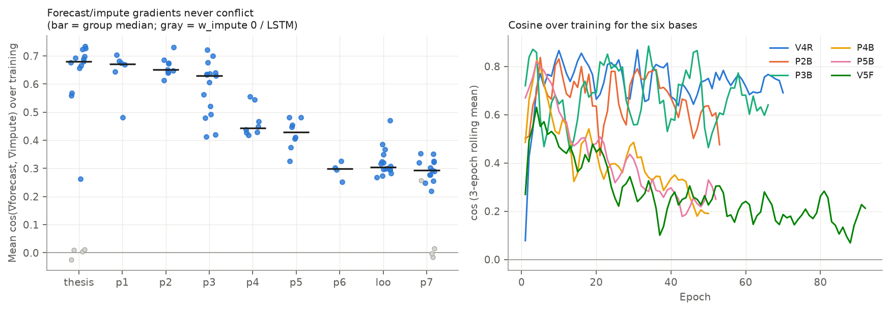

*Figure 10. Left: mean cosine between the forecast and imputation gradients over training, per run, grouped.
Right: trajectories for the six bases.*

**The gradient-conflict hypothesis (Phase 6) is falsified.** The investigation predicted a strongly negative
forecast/impute cosine in v4, approaching 0 after the fixes. Observed:

- Positive cosine everywhere.
- Group medians: thesis/V4R 0.67 (v4r_full 0.735), P1 0.67, P2 0.65, P3 0.63, P4 0.44, P5 0.43, P6 0.30,
  LOO 0.30, v5 suite 0.28.
- Runs without an imputation loss sit at ≈ 0 (−0.02 to 0.01), which validates the instrument.

The high v4 cosine fits the "shared shortcut" explanation: in V4R, forecasting and imputation both benefit
from predicting zero in gaps, so their gradients align. As the v5 fixes remove that shortcut, the tasks become
less aligned but never opposed. There is no conflict for PCGrad or uncertainty weighting to resolve, which
explains why they do nothing.

---

## 6. Leave-one-out from V5F: what V5F actually depends on

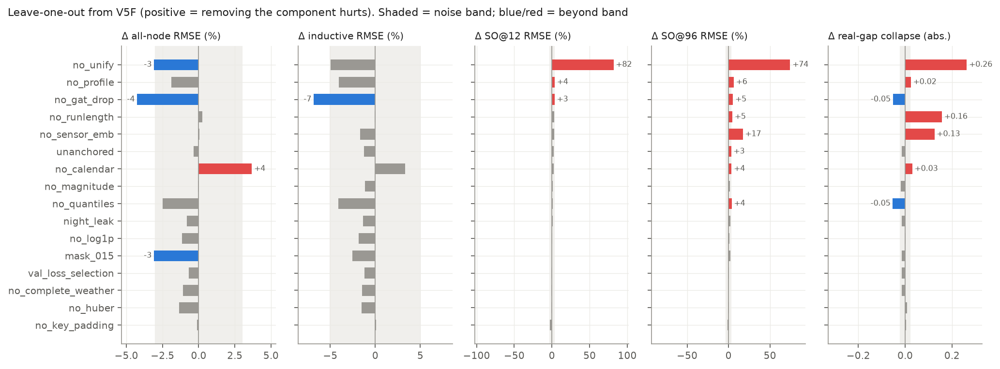

*Figure 5. Δ vs V5F when each component is removed. Positive = removing it hurts. Shaded = noise band.*

| Removed | All | Ind | SO@12 | SO@96 | SO@96 mass | Collapse | Gap mass | Verdict |
|---|---:|---:|---:|---:|---:|---:|---:|---|
| *(V5F)* | 26.82 | 46.36 | 15.81 | 16.04 | 1.01 | 0.059 | 0.82 | |
| unified encoding | −3.1% | −5.0% | **+82%** | **+74%** | **0.14** | **0.322** | 0.71 | essential for resilience |
| sensor embedding | +0.1% | −1.7% | +2.8% | **+17%** | 0.75 | **0.184** | 0.46 | needed for long outages |
| run-length | +0.3% | −0.1% | +3.0% | +4.6% | 1.03 | **0.216** | 0.61 | prevents real-gap collapse |
| profile | −1.9% | −4.0% | +3.7% | +6.3% | 1.08 | 0.083 | **0.47** | supports gap mass |
| calendar | **+3.7%** | +3.3% | +2.1% | +3.7% | 1.05 | 0.089 | 0.70 | small normal-accuracy gain (MAE +7%) |
| GAT missing-source drop | **−4.3%** | **−6.8%** | +3.5% | +5.3% | 1.10 | 0.007 | 0.78 | trade-off: hurts held-out, helps outages |
| mask ratio 0.30 → 0.15 | −3.1% | −2.5% | −0.3% | +2.1% | 1.05 | 0.045 | 0.95 | 0.15 is as good or better |
| quantile heads | −2.5% | −4.1% | +1.1% | +3.9% | 1.08 | 0.006 | 1.09 | noise |
| anchoring | −0.3% | −1.3% | +2.3% | +3.2% | 1.02 | 0.044 | 1.14 | noise |
| log1p | −1.2% | −1.8% | +0.1% | +0.9% | 1.05 | 0.061 | 0.81 | noise |
| magnitude α | −0.1% | −1.1% | +1.2% | +1.9% | 0.99 | 0.040 | 0.96 | noise |
| Huber | −1.4% | −1.5% | −1.0% | +0.4% | 1.07 | 0.067 | 0.76 | noise |
| key padding | −0.1% | +0.1% | −2.8% | −1.2% | 1.05 | 0.064 | 0.87 | noise |
| complete weather | −1.1% | −1.5% | −0.8% | −0.1% | 1.02 | 0.044 | 0.99 | noise |
| night-channel fix | −0.8% | −1.4% | +1.0% | +2.1% | 1.08 | 0.045 | 1.07 | noise |
| obs-NLL+SO selection (→ val loss) | −0.7% | −1.2% | −0.7% | +0.6% | 1.06 | 0.045 | 0.96 | noise (natural replicate) |

Interpretation:

- **Resilience comes from four components, and only one is critical.**
  - Unified encoding is critical.
  - Sensor embedding, run-length and the profile are each needed to keep long-outage mass or to stop
    real-gap collapse.
  - Calendar, GAT missing-source drop and the mask ratio have smaller, mainly normal-accuracy effects (below).
  - The remaining eight components (quantile heads, anchoring, log1p, magnitude α, Huber, key padding,
    complete weather, night-channel fix) move no headline metric outside the noise band. Magnitude α is
    borderline on transductive RMSE (+5.0%). The selection-rule change is a natural replicate, not a component.
- **log1p is noise in LOO but a clear win as a P3 screen** (−9%). The likely reason is that its role
  (compressing the input scale) is covered in V5F by the profile and calendar inputs. Single-factor screens on
  a weak base and LOO from a strong base answer different questions.
- **Dropping missing GAT sources helps outages but hurts held-out stations.** With it removed, all-node RMSE
  is 4.3% better and held-out 6.8% better, at the cost of 3–5% on SO. This is the largest held-out effect in
  the LOO set. Held-out stations never have observed inputs, so if their neighbours are also missing, the
  drop removes the only messages they could receive.
- **Eight of the V5F components could be removed** without a measurable change on this seed. This argues for
  a slimmer final configuration in the thesis (§14).

---

## 7. Thesis Experiment 3 re-run

### 7.1 V4R ablations under v5 scoring

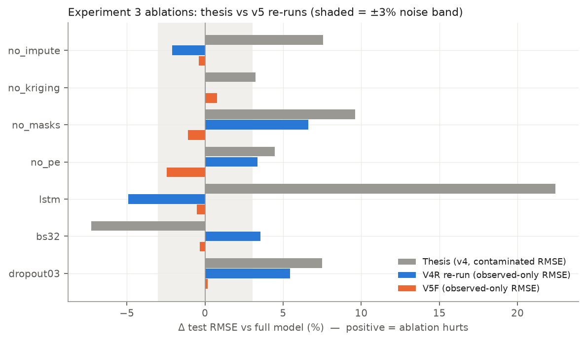

*Figure 6. Δ test RMSE vs the full model: thesis (contaminated v4 metric) vs the V4R re-run and V5F
(observed-only metric). Shaded = ±3% noise band.*

| Ablation | Thesis Δ | V4R Δ (obs-only) | V4R Δ (legacy metric) | V5F Δ (obs-only) | Survives? |
|---|---:|---:|---:|---:|---|
| no imputation loss | +7.6% | −2.1% | −2.5% | −0.4% | **No** (noise) |
| no kriging loss | +3.2% | 0.0% | −0.2% | +0.8% | **No** (noise) |
| no mask channels | +9.6% | **+6.6%** | +6.2% | −1.1% | Yes on V4R; no on V5F |
| no positional encoding | +4.5% | +3.3% | +3.6% | −2.5% | Marginal on V4R; no on V5F |
| LSTM | +22.4% | **−4.9%** | +15.3% | −0.5% | **No** (sign reverses) |
| batch size 32 | −7.3% | **+3.6%** | −9.6% | −0.3% | **No** (sign reverses) |
| dropout 0.3 | +7.5% | **+5.5%** | +4.4% | +0.2% | Yes on V4R; no on V5F |

Absolute reproduction: V4R's legacy test RMSE / MAE is 19.02 / 5.38, against the thesis's 18.16 / 5.17. This
is within 5%, as expected given the v5 scaler and weather-leak fixes.

Auxiliary-head checks:

- **no-kriging:** kriging RMSE +6.7% on V4R (51.3 vs 48.1). The thesis reported +87%. On V5F it is +9.5%.
  The kriging loss helps the kriging head a little, and never helps forecasting.
- **no-imputation:** imputation RMSE +70% on V4R (49.7 vs 29.3) and +26% on V5F (34.1 vs 27.0). This is
  trivially expected, since the head is untrained, and has no forecasting effect.
- **LSTM kriging:** 48.05, identical to the full model's 48.14.

### 7.2 Why the thesis numbers differ: two measurement artefacts

The legacy `test_metrics` RMSE that produced the thesis tables (`src/harness/evaluate.py::evaluate_batch`
with `MetricAccumulator`) has two properties that matter here:

1. **It scores every target slot, including missing slots, which are zero-filled.** About 53% of slots are
   missing, so a model that predicts zero in gaps is rewarded. v5_full's legacy RMSE is 60.9, because it
   predicts mass in gaps, while its observed-only RMSE is 26.8.
2. **It averages per-batch RMSEs, and the test loader uses the training batch size** (identical in the v4
   code at commit `420792a` and in v5). By Jensen's inequality, the mean of per-batch RMSEs is below the pooled
   RMSE, and the gap grows as batches get smaller. A model trained and evaluated at bs32 therefore gets a lower
   legacy RMSE than the same model at bs128.

These two properties explain the two sign reversals. The gap between the legacy and observed-only deltas is:

| V4R run | Legacy Δ − obs-only Δ | Collapse | Batch size |
|---|---:|---:|---:|
| `v4r_lstm` | **+20.2 pp** | 0.634 (least collapse) | 128 |
| `v4r_lstm_rich` | +3.9 pp | 0.558 | 128 |
| `v4r_identity_graph` | +3.4 pp | 0.658 | 128 |
| `v4r_bs32` | **−13.2 pp** | 0.867 | **32** |
| `v4r_bs32_lr_div4` | **−12.6 pp** | 0.805 | **32** |
| all other bs128 runs | −1.1 to +0.5 pp | 0.67–0.88 | 128 |

- **LSTM.** The plain LSTM collapses less (0.63) and puts more mass in gaps (0.31 vs 0.03). The legacy metric
  punishes it for that. On observed targets it is 4.9% better on RMSE, but 22% worse on MAE (12.98 vs 10.65),
  so it trades typical-case accuracy for better large-value fit. The "GNN beats LSTM by 22%" result is an
  artefact of zero-filled scoring. Note also that `v4r_lstm` hit the epoch cap (best epoch 96 of 100).
- **bs32.** Both bs32 runs gain about 13 pp on the legacy metric alone, regardless of learning rate or
  collapse. The bs128 probes that give bs128 the bs32 update budget (`steps4x`) or peak weighting do not
  reproduce the gain (obs-only +3.2% and 0.0%). **The thesis bs32 improvement is an evaluation-batch-size
  artefact, not a training effect.** It should be removed from the chapter, or reported as a cautionary note.

### 7.3 Limitations revisited

| Thesis limitation | Experiment | Result |
|---|---|---|
| Lim. 4: night-channel leak at held-out stations | `v4r_night_zero` | All −3.4% (suggestive), held-out −0.8%. **The leak was not helping.** |
| Lim. 5: role of the total vs night mask channels | `v4r_total_only` / `v4r_night_only` | Collapse 0.88 with total-only, 0.67 with night-only. **The total channel drives collapse.** But `v4r_no_masks` still collapses (0.79), because zero-filled values alone identify gaps. On V5F all variants are noise. |
| Lim. 7: architecture vs inputs confound in the LSTM comparison | `v4r_identity_graph`, `v4r_lstm_rich`, `v5_lstm`, `v5_lstm_plain` | Identity graph −2.3%, rich LSTM +3.1% on V4R (both noise). On V5F the v5-input LSTM matches the GNN on all-node RMSE (26.68 vs 26.82) but is 7% worse transductively and 10% worse on SO@12. The plain LSTM is +9.6% all and +75% SO@12. **Inputs matter more than architecture, and the graph matters for outages.** |
| Lim. 9: masks × imputation interaction | 2 × 2 on V4R and V5F | See below |

### 7.4 Masks × imputation (Lim. 9)

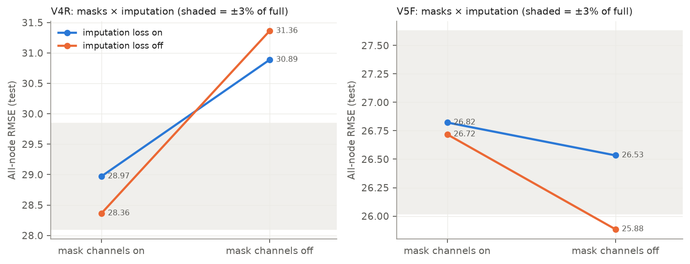

*Figure 13. All-node RMSE for the 2 × 2 of mask channels × imputation loss, on V4R and V5F.*

| | V4R masks on | V4R masks off | V5F masks on | V5F masks off |
|---|---:|---:|---:|---:|
| impute on | 28.97 | 30.89 | 26.82 | 26.53 |
| impute off | 28.36 | 31.36 | 26.72 | 25.88 |

- **On V4R, the mask channels matter (+6.6 to +10.6%) and imputation does not.** There is no interaction
  beyond noise.
- **On V5F, all four cells are within 3.5%.** No-masks-no-impute is nominally best (25.88), but that run hit
  the epoch cap and is within noise.
- **Without mask channels, V4R's outage mass rises** (SO@96 mass 0.54 with no masks and no impute, vs 0.00).
  The model can no longer key on the mask to predict zero.

**Conclusion for the thesis.** In v5 the run-length covariate and unified encoding carry the missingness
information, so the mask channels and the imputation loss are redundant for forecasting accuracy.

---

## 8. Baselines: how much does the learned model add?

| Model | All | Trans | Ind | Peak | SO@12 | Kriging |
|---|---:|---:|---:|---:|---:|---:|
| `naive_profile` | 27.22 | 18.10 | 42.63 | 97.3 | 17.82 | 42.6 |
| `naive_last_obs` | 28.11 | 19.90 | 42.63 | 97.9 | 17.82 | 42.6 |
| V4R | 28.97 | 17.03 | 47.64 | 103.0 | 31.75 | 48.1 |
| V5F | 26.82 | 13.06 | 46.36 | 96.2 | 15.81 | 46.0 |
| V5F, v5-input LSTM | 26.68 | 13.99 | 45.35 | 96.5 | 17.37 | 47.9 |
| V5F, plain LSTM | 29.39 | 19.41 | 46.19 | 102.7 | 27.70 | 47.9 |
| Best held-out (`e3_3d`) | 24.75 | 16.16 | 39.09 | 86.3 | 17.65 | 37.9 |
| Best all-node (`e2_1`) | 24.52 | 15.57 | 39.18 | 85.4 | 21.61 | 39.7 |

- **V4R loses to a seasonal median on every metric except transductive RMSE.**
- **V5F vs the naive profile:**
  - transductive −28%;
  - SO@12 −11%;
  - all-node −1.5% (noise);
  - peak −1.1% (noise);
  - held-out **+8.7%** (worse);
  - kriging **+8.0%** (worse).
- **Some screens beat the naive profile everywhere.**
  - E2.1 and E3.3d beat it on all-node (−10%), held-out (−8%) and peak (−11%).
  - E3.3d also beats it on SO@12, by 1%.
  - These are the configurations to build on.

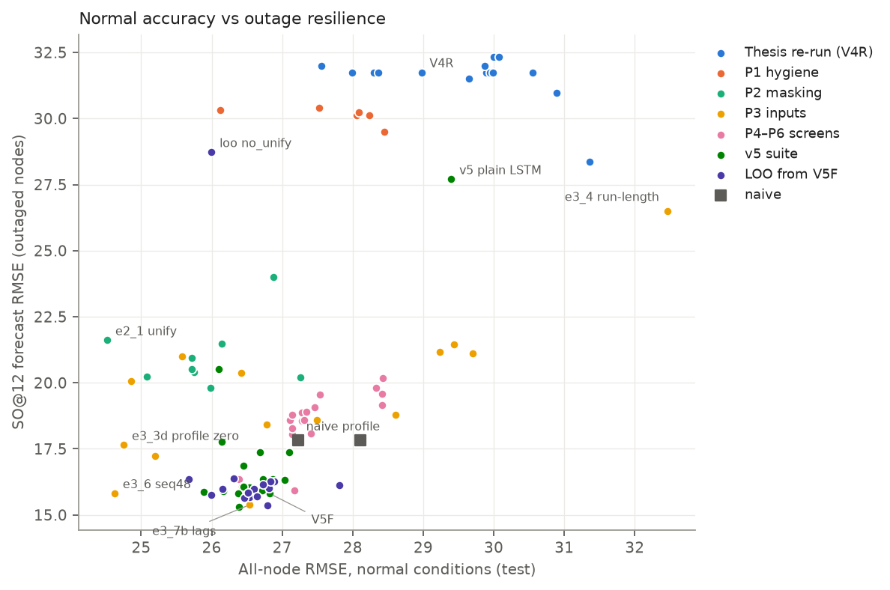

*Figure 12. Normal-condition all-node RMSE vs SO@12 RMSE for every run. The lower-left corner is empty: no run
achieves both E2.1/E3.3d-level normal accuracy and V5F-level resilience. E3.6 (seq 48) and E3.3d come
closest.*

---

## 9. Inductive generalisation and degeneracy

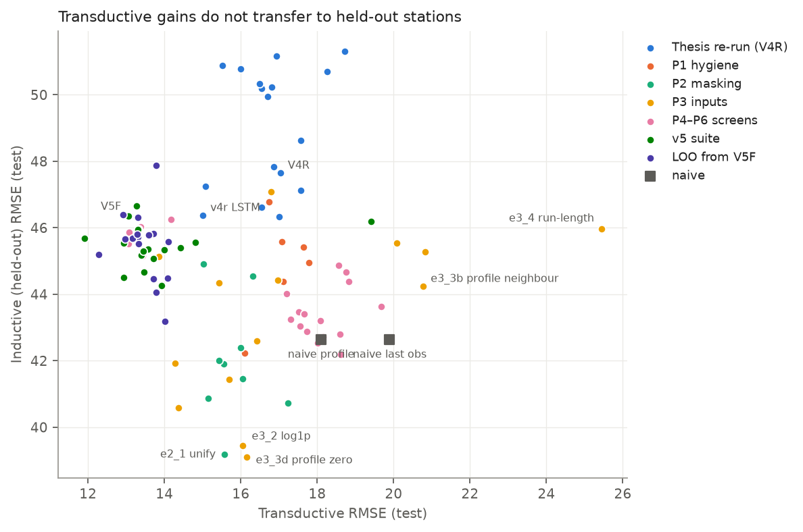

*Figure 7. Transductive vs held-out RMSE for every run. The V5F family (green, purple) clusters at low
transductive and high held-out RMSE. The best held-out runs are the P2/P3 configurations at the bottom.*

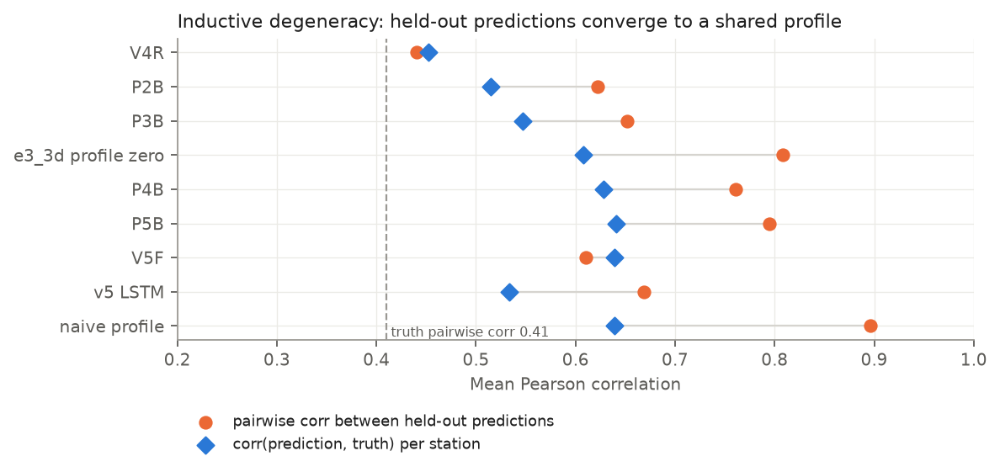

*Figure 11. Orange: mean pairwise correlation between held-out stations' predictions. Blue: mean per-station
correlation between prediction and truth. The truth's pairwise correlation is 0.41.*

| Run | Pred pairwise corr | Corr(pred, truth) | Beats best transductive peer | Node NRMSE (ind, median) |
|---|---:|---:|---:|---:|
| V4R | 0.44 | 0.45 | 0 / 14 | 1.34 |
| P2B | 0.62 | 0.52 | 0 / 14 | 1.29 |
| P3B | 0.65 | 0.55 | 1 / 14 | 1.25 |
| E3.3d (profile zero) | 0.81 | 0.61 | 1 / 14 | 1.14 |
| P4B | 0.76 | 0.63 | 3 / 14 | 1.11 |
| P5B | 0.80 | 0.64 | 5 / 14 | 1.22 |
| V5F | 0.61 | 0.64 | 6 / 14 | 1.30 |
| naive profile | 0.90 | 0.64 | 2 / 14 | 1.16 |

(The "beats peer" fraction is reported over the 14 held-out stations with observed test targets. The best
transductive peer's correlation with each held-out station averages 0.74.)

- **Held-out predictions are more alike than the truth**: 0.61–0.81 vs 0.41 for every model from P2B on. The
  models emit a shared, city-wide daily shape at held-out stations. This is the degeneracy the thesis warned
  about, and it gets *stronger* as profile/calendar inputs are added (P4B 0.76, P5B 0.80, naive 0.90).
- **The shared shape still correlates with each station's truth at 0.61–0.64**, the same as the naive profile.
  The temporal pattern at held-out stations is essentially the city-wide seasonal pattern. The learnt models do
  not recover station-specific dynamics beyond it: correlation never beats 0.64, while the best transductive
  peer achieves 0.74.
- **Held-out RMSE is driven by level, not shape.** E3.3d has degenerate predictions (0.81) but the best
  held-out RMSE, because it gets the level right. V5F has less degenerate predictions (0.61) but worse RMSE.
- **Practical reading.** For held-out stations, the graph + kriging stack currently adds no information beyond
  "the typical city-wide profile at the right level". The thesis should present inductive forecasting as an
  open problem, not a solved capability.

---

## 10. Calibration, peaks and bias

### 10.1 Calibration

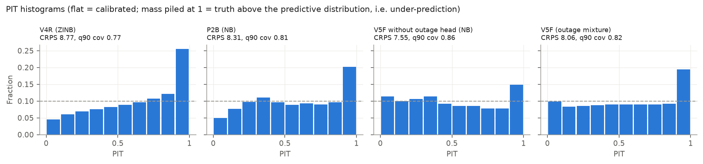

*Figure 9. PIT histograms on observed test targets.*

| Run | CRPS | NLL | q90 coverage | q50 coverage |
|---|---:|---:|---:|---:|
| V4R (ZINB) | 8.77 | 4.47 | 0.77 | – |
| P2B (NB) | 8.31 | 3.77 | 0.81 | – |
| E2.1 | **7.16** | **3.40** | 0.86 | – |
| V5F (outage mixture) | 8.06 | 4.64 | 0.82 | 0.49 |
| V5F without outage head (NB) | 7.55 | 4.52 | 0.86 | 0.48 |

- **Every model under-predicts.** The PIT histograms pile up at 1, so the truth is often above the whole
  predictive distribution. Of the four plotted runs, V4R has the strongest tilt (25% of mass in the top PIT decile) and V5F without the
  outage head the weakest (15%).
- **The outage head costs 6% CRPS** (8.06 vs 7.55) and 4 pp of q90 coverage. The mixture puts probability
  mass on "outage", which widens the forecast in a direction that observed targets never use.
- **q50 coverage is 0.48–0.49**, close to the ideal 0.5. **q90 coverage is 0.82–0.86**, short of 0.9. The
  upper tail is too thin, which is the calibration face of the peak problem.

### 10.2 Peaks and bias

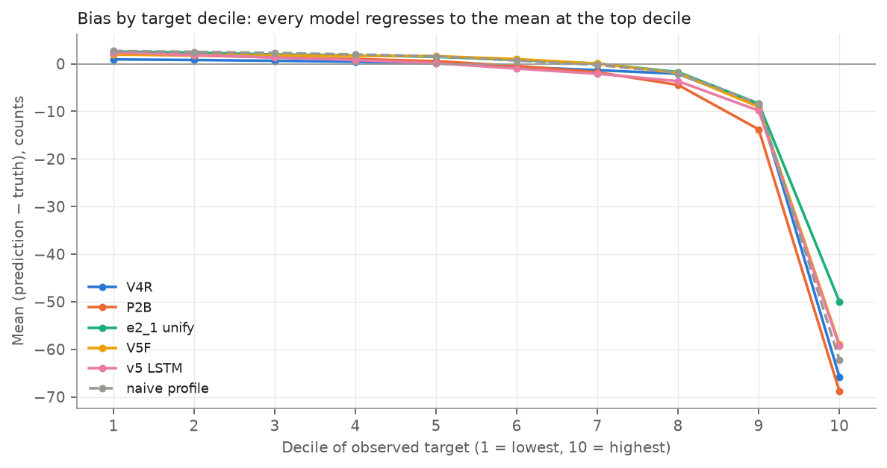

*Figure 8. Mean signed error by decile of the observed target.*

- All models are unbiased up to decile 8 and then under-predict sharply:
  - decile 9: about −7 to −14;
  - decile 10: about −50 to −73 counts (P4B −70.5, plain LSTM −72.7).
- The naive profile has the same shape (−62), so this is regression to the seasonal mean. The models do not
  anticipate unusual peaks.
- **The best top-decile bias comes from normal-accuracy improvements, not magnitude losses.** E2.1 −50 and
  E3.3d −51 are best; V5F is −59.
- E3.3d also has the lowest peak under-prediction rate (0.36 vs 0.46 for V5F).
- None of P5's magnitude interventions changes the top-decile bias beyond noise (§5.4).

---

## 11. Outage head: what R4 adds

`v5_no_outage_head` (V5F with an NB forecast head instead of the anchored outage mixture) isolates
recommendation R4.

| | V5F | V5F − outage head |
|---|---:|---:|
| All / Trans / Ind | 26.82 / 13.06 / 46.36 | 26.39 / 12.93 / 45.55 |
| SO@12 / SO@96 | 15.81 / 16.04 | 15.29 / 15.64 |
| Collapse | 0.059 | **0.000** |
| Real-gap mass | 0.82 | 1.08 |
| CRPS | 8.06 | **7.55** |
| Night short-gap zero rate | **0.42** | 0.00 |
| Outage AUC (SO@12 / SO@96) | **0.91 / 0.999** | – |
| P(zero) vs missing AUC | 0.91 | 0.68 |

- R4 gives **no accuracy or resilience benefit**: every forecast metric is equal or slightly better without it.
- It costs a 6% collapse rate and 6% CRPS.
- **What it buys is interpretability:**
  - an explicit outage probability (AUC 0.91 at 3 h, 0.999 at 24 h);
  - zero predictions in short night-time gaps (0.42 vs 0), which are often genuine zero-pedestrian periods.

**Thesis framing:** the outage head is an optional diagnostic output, not a resilience mechanism.

---

## 12. Compute

| Group | GPU-h | Runs |
|---|---:|---:|
| p3_inputs | 93.8 | 15 |
| thesis_v4 | 43.3 | 17 |
| p7_v5_suite | 30.7 | 19 |
| p2_masking | 30.6 | 9 |
| loo | 26.0 | 16 |
| p1_hygiene | 16.6 | 6 |
| p4_likelihood | 13.7 | 8 |
| p5_magnitude | 12.3 | 8 |
| p6_mtl | 10.0 | 5 |
| **Total** | **277.0** | **103** |

Tier 1 took 85.1 h and tier 2 191.8 h. `e3_7_seq96` alone used 40.8 h, and `e3_6_seq48` 17.2 h. Tier 3 is
budgeted at 117.9 cost units vs 124.7 for tiers 1 + 2, so expect roughly 260 more GPU-hours.

---

## 13. Synthesis: what can and cannot be claimed

### 13.1 Defensible now (large effects; val and test agree; robust to the noise floor)

1. v5 scoring and loss hygiene remove zero collapse (0.79 → 0.00). The v4 thesis results were measured with a
   metric that rewards collapse.
2. Unified missing encoding is the key resilience mechanism: SO@12 −29% when added and +82% when removed;
   outage mass preserved.
3. Structured artificial gaps add ~15% SO@12 over observed-only iid masks.
4. V5F is 50% better than V4R under 3 h–24 h synthetic outages and 23% better at transductive stations.
5. Graph message passing matters for long outages (identity graph: SO@96 +47%, SO@96 mass 0.32), not for
   normal forecasting.
6. Forecast and imputation gradients are aligned in every configuration. MTL balancing is unnecessary.
7. The thesis LSTM (+22%) and bs32 (−7%) results are measurement artefacts (§7.2).
8. Held-out stations are not better served than by a neighbour seasonal profile.

### 13.2 Suggestive (single seed, 3–8% effects, or confounded)

- log1p, profile `inductive_zero`, calendar, seq48 and lags each improve P3B by 6–24% on some axis, against a
  probably-unlucky base.
- Removing GAT missing-source dropping improves held-out RMSE by 7% at a 3–5% outage cost.
- Mask ratio 0.15 vs 0.30: transductive −6%.
- The night-channel leak fix (Lim. 4) slightly improves V4R (−3.4%).

### 13.3 Not supported

- Any P4/P5 likelihood or magnitude intervention improving accuracy or peaks.
- Any thesis Experiment 3 ablation mattering on V5F.
- Auxiliary imputation or kriging losses improving forecasting (either pipeline).
- The pre-declared P4B stack being the right base.

---

## 14. Recommendations

**For the thesis chapter**

1. Replace Table `tab:exp3-main` with observed-only RMSE / MAE / peak / SO@12 for V4R and V5F (§7.1 table).
   Keep the thesis column only as a historical reference.
2. Rewrite the conclusions on imputation, kriging, LSTM and bs32 (§7.1–7.2). Add the two legacy-metric
   artefacts to the limitations as a lesson learnt.
3. Lead the v5 narrative with resilience (Figures 1, 2, 15). Unified encoding is the central mechanism.
4. Present inductive forecasting honestly: no gain over a neighbour profile; degenerate shared profile
   (Figure 11).
5. Report the outage head as an interpretable add-on, not a resilience mechanism (§11).
6. State the single-seed caveat and the measured noise bands until tier 3 lands.
7. Describe the final model as the components that the LOO shows matter (unified encoding, structured
   masks, sensor embedding, run-length, profile, calendar, graph). List the other eight as tested and neutral
   (§6).

**For the next runs** (ordered by value per GPU-hour)

1. **Run tier 3 seeds for the tier-1 core first**, especially `v4r_full`, `v4r_lstm`, `v4r_bs32`,
   `v4r_no_masks`, `e1_6`, `e2_1`, `e2_7`, `v5_full`, `v5_no_outage_head` and `v5_identity_graph`. The naive baselines are
   deterministic and need no seeds. This converts §13.1 into seed-backed claims and
   replaces the ad-hoc noise bands.
2. **Fix early stopping before any re-screen.** Use a minimum of 30–40 epochs, patience 20, or an LR schedule
   (cosine or plateau). Re-run the P4/P5 screens on the corrected protocol; they are cheap.
3. **Re-base on a P3-informed stack** that keeps resilience and wins back held-out accuracy:
   - P3B with mask ratio 0.15;
   - `inductive_zero` profile, log1p, calendar, lags, and seq48 if budget allows;
   - no `inductive_neighbour` profile, no sensor embedding;
   - run-length only if it trains stably;
   - test GAT missing-source drop on and off.

   Target: E2.1/E3.3d normal accuracy with V5F outage behaviour (the empty corner of Figure 12).
4. **Investigate the profile-substitute and run-length instability** (validation loss rises from epoch 3).
   Check the flag-0/flag-1 profile distribution shift and the run-length feature scale (log-transform or clip).
5. **Recompute the legacy metric with pooled SSE at a fixed evaluation batch size** to confirm the bs32
   artefact numerically. Evaluate the saved `v4r_full` and `v4r_bs32` checkpoints at batch size 128 —
   inference only, no retraining.
6. **Peaks.** The tested loss-side remedies do not work. Next candidates are input-side: event/holiday
   features, weather extremes, longer context (seq48 helped peaks −11%), and quantile-based peak forecasts
   (q90) instead of the mean for the high-count use case.
7. **Drop seq96** from further work (cost 2.4× seq48 for no gain).

---

## Appendix A. Figure index

| Figure | File | Shows |
|---|---|---|
| 1 | `figures/fig01_base_chain.png` | Six headline metrics along V4R → V5F |
| 2 | `figures/fig02_outage_length.png` | SO RMSE and mass ratio vs outage length |
| 3 | `figures/fig03_replicate_noise.png` | Natural-replicate trajectories (noise floor) |
| 4 | `figures/fig04_best_epoch_confound.png` | Selected epoch vs transductive RMSE |
| 5 | `figures/fig05_loo_tornado.png` | Leave-one-out deltas from V5F |
| 6 | `figures/fig06_thesis_ablations.png` | Thesis vs V4R vs V5F ablation deltas |
| 7 | `figures/fig07_trans_vs_ind.png` | Transductive vs held-out RMSE, all runs |
| 8 | `figures/fig08_bias_by_decile.png` | Signed error by target decile |
| 9 | `figures/fig09_pit.png` | PIT histograms |
| 10 | `figures/fig10_grad_cosine.png` | Forecast/impute gradient cosine |
| 11 | `figures/fig11_inductive_degeneracy.png` | Held-out prediction degeneracy |
| 12 | `figures/fig12_accuracy_vs_resilience.png` | All-node RMSE vs SO@12, all runs |
| 13 | `figures/fig13_masks_x_impute.png` | Masks × imputation 2 × 2 |
| 14 | `figures/fig14_phase_screens.png` | All one-factor screens vs base |
| 15 | `figures/fig15_soft_collapse.png` | Hard vs soft collapse across P1/P2 |

## Appendix B. Validation / test agreement for the claimed effects (Δ% vs reference)

| Comparison | All val | All test | Trans val | Trans test | Ind val | Ind test | SO@12 val | SO@12 test | Peak val | Peak test |
|---|---:|---:|---:|---:|---:|---:|---:|---:|---:|---:|
| e2_1 vs P2B | −11.8 | −12.7 | −7.8 | −12.4 | −13.5 | −12.8 | −31.0 | −28.5 | −16.4 | −15.0 |
| P3B vs P2B | −3.1 | −3.0 | −3.9 | −8.2 | −2.8 | −0.9 | −35.0 | −33.2 | −2.7 | −2.4 |
| e2_1b vs P2B | −2.3 | −4.3 | −11.3 | −15.5 | +1.1 | −0.1 | −25.1 | −20.6 | −4.8 | −5.1 |
| e2_2 block vs e2_1b | −5.9 | −6.7 | +1.4 | +0.8 | −8.4 | −9.0 | −14.7 | −15.7 | −8.4 | −10.9 |
| e3_2 log1p vs P3B | −8.8 | −8.8 | −1.3 | −1.7 | −11.9 | −11.4 | −1.0 | −0.6 | −12.1 | −13.0 |
| e3_3d profile zero vs P3B | −6.8 | −9.2 | +0.3 | −1.0 | −9.8 | −12.2 | −12.7 | −12.6 | −10.3 | −11.9 |
| e3_1 calendar vs P3B | −5.9 | −6.1 | −5.5 | −3.8 | −6.0 | −7.0 | −0.5 | +4.0 | −10.5 | −11.2 |
| e3_6 seq48 vs P3B | −8.2 | −9.7 | −11.1 | −11.9 | −7.0 | −8.9 | −19.7 | −21.7 | −9.9 | −11.5 |
| e3_7b lags vs P3B | −3.4 | −2.7 | −14.1 | −15.1 | +0.5 | +1.3 | −23.2 | −23.9 | −2.1 | −1.5 |
| e3_5 sensor emb vs P3B | +4.7 | +5.0 | +0.7 | +2.9 | +6.3 | +5.7 | −9.7 | −7.0 | +4.9 | +4.2 |
| loo_no_unify vs V5F | −4.0 | −3.1 | +6.5 | +5.5 | −6.6 | −5.0 | +99.7 | +81.8 | −3.4 | −2.6 |
| loo_no_gat_drop vs V5F | −8.0 | −4.3 | +6.6 | +7.3 | −11.9 | −6.8 | +4.8 | +3.5 | −7.8 | −4.6 |
| loo_no_calendar vs V5F | +3.9 | +3.7 | +5.2 | +5.5 | +3.6 | +3.3 | +1.9 | +2.1 | +3.6 | +2.9 |
| loo_no_sensor_emb vs V5F | −0.3 | +0.1 | +8.4 | +8.0 | −2.6 | −1.7 | +10.5 | +2.8 | +0.7 | +1.0 |
| v5_identity_graph vs V5F | −3.9 | −2.6 | +8.0 | +6.6 | −7.0 | −4.5 | +18.0 | +12.4 | −4.5 | −3.7 |
| v5_iid_masks vs V5F | −2.8 | −2.7 | −9.3 | −8.9 | −1.3 | −1.5 | +32.6 | +29.8 | −2.8 | −2.4 |
| v5_no_outage_head vs V5F | −2.7 | −1.6 | −0.1 | −1.0 | −3.4 | −1.7 | +1.9 | −3.3 | −3.1 | −1.7 |
| v5_lstm vs V5F | −0.4 | −0.5 | +8.9 | +7.1 | −2.7 | −2.2 | +22.2 | +9.9 | +1.1 | +0.3 |
| v5_lstm_plain vs V5F | +13.1 | +9.6 | +50.7 | +48.6 | +2.1 | −0.4 | +92.9 | +75.3 | +10.8 | +6.7 |
| naive_profile vs V5F | +0.2 | +1.5 | +37.4 | +38.6 | −11.0 | −8.0 | +17.9 | +12.7 | +2.0 | +1.2 |
| V5F vs V4R | −9.0 | −7.4 | −20.6 | −23.3 | −5.5 | −2.7 | – | −50.2 | −9.0 | −6.6 |
| v4r_no_masks vs V4R | +6.6 | +6.6 | +9.1 | +7.2 | +5.7 | +6.4 | – | −2.5 | +4.4 | +5.2 |
| v4r_lstm vs V4R | −4.0 | −4.9 | −7.7 | −11.9 | −2.7 | −2.7 | – | +0.8 | −9.0 | −9.3 |
| v4r_bs32 vs V4R | +4.3 | +3.6 | −3.6 | −6.1 | +6.8 | +6.6 | – | +1.9 | +5.3 | +5.0 |
| v4r_dropout03 vs V4R | +6.3 | +5.5 | +2.8 | −0.6 | +7.5 | +7.4 | – | 0.0 | +7.3 | +6.8 |
| v4r_night_zero vs V4R | −0.3 | −3.4 | −8.3 | −11.5 | +2.2 | −0.8 | – | 0.0 | −0.2 | −3.1 |

(V4R-group validation SO@12 is not available: V4R does not run the SO pass on validation.)

## Appendix C. Full per-run tables

See [`data/appendix_tables.md`](data/appendix_tables.md) for every run's metrics, grouped by experiment
group, with selected and trained epochs.
