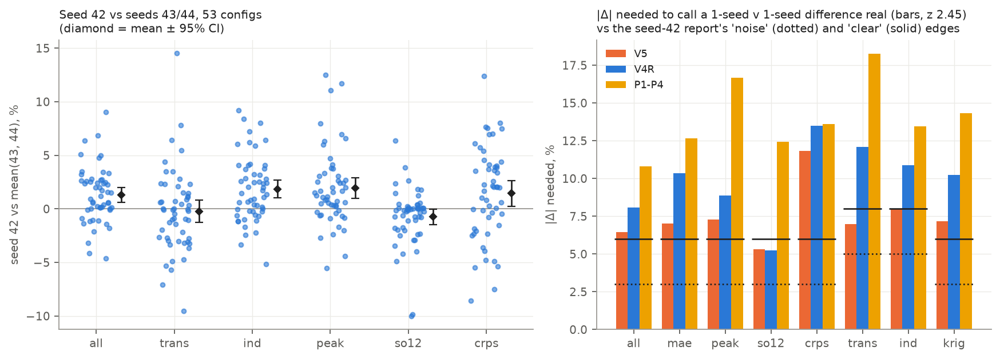
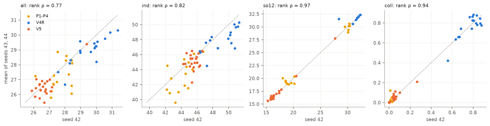
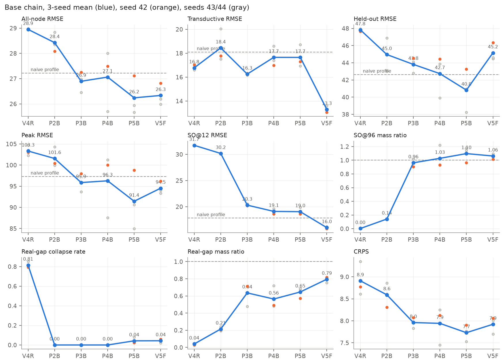
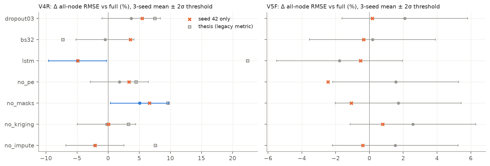
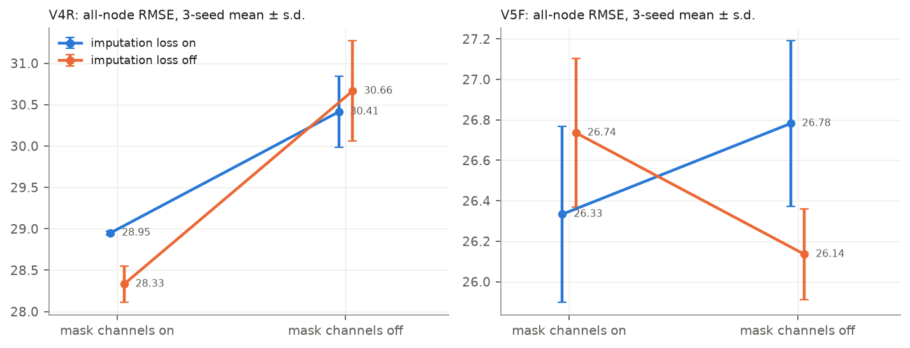
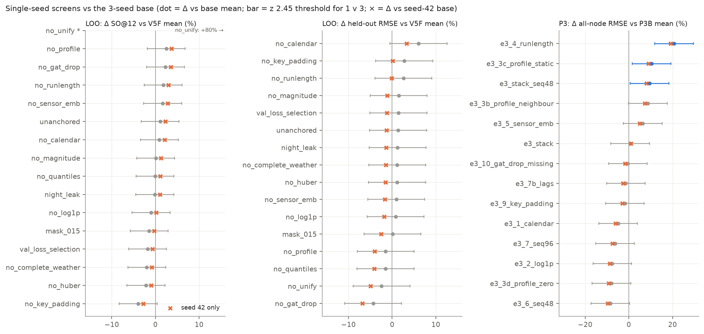
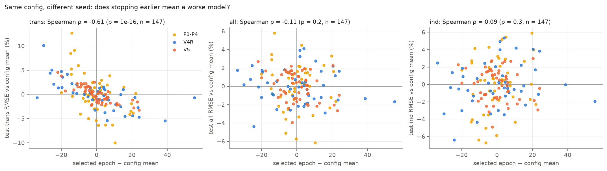
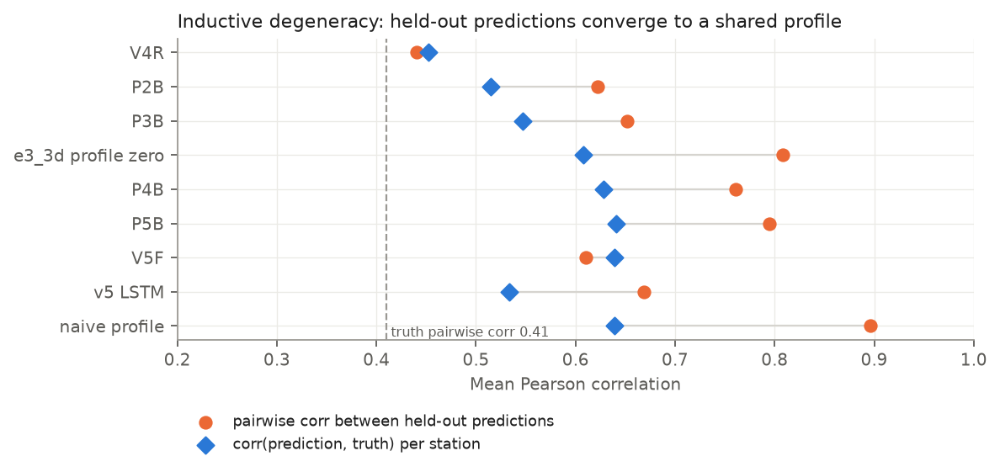
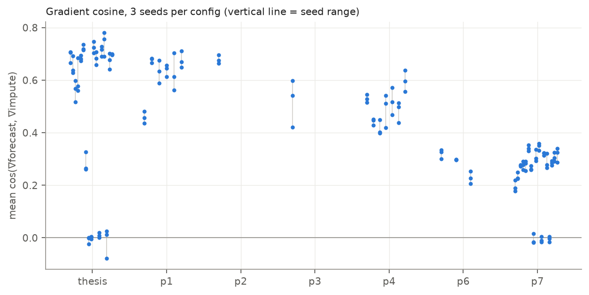

# RIoT v5 experiment suite — tier 3 seed analysis (Tiers 1–3, seeds 42 / 43 / 44)

**Scope.** All 209 runs of the v5 suite: 103 tier-1/2 runs on seed 42 and 106 tier-3 runs. The tier-3 runs
are seeds 43 and 44 of 53 core configurations. This report re-scores the seed-42 results of
[`riot_v5_results_report.md`](riot_v5_results_report.md), hereafter "the seed-42 report", using measured seed
noise. It focuses on which conclusions changed.
**Purpose.** Input for thesis Chapter 7 (Experiment 3) and for planning the next experiment stage.
**Date.** 2026-10-08.

**Reproduce.**

```bash
python scripts/riotv5/collect_v5_results.py   # -> data/{runs,epochs}.csv (all seeds)
python scripts/riotv5/tables_v5_results.py    # -> data/appendix_tables.md (all seeds, per run)
python scripts/riotv5/plot_v5_results.py      # -> figures/fig01–15 (seed 42 only, as in the seed-42 report)
python scripts/riotv5/seeds_v5_results.py     # -> data/seed_{summary,noise,comparisons}.csv, figures/seeds/figS1–S8
```

`grad_cosine_history.csv` now covers 204 runs. The 104 tier-3 histories were pulled read-only from W&B
(`resilient-iot-v5`). As before, it is absent for `e6_4_detached_impute` (all seeds) and for the two naive
baselines. Every run used the same holdout manifest (`holdout_sha 669860aa8b4cdd15`).

---

## 0. Executive summary

1. **The headline v5 story survives three seeds.** V4R → V5F, 3-seed means:
   - SO@12 RMSE −50% (31.7 → 16.0);
   - transductive RMSE −21%;
   - all-node RMSE −9.0%;
   - peak RMSE −8.5%;
   - CRPS −11%;
   - collapse 0.815 → 0.043;
   - SO@96 mass 0.00 → 1.06.

   Every one of these passes the pre-declared protocol: |Δ| > 2 × pooled seed s.d., same sign on validation.
   Unified encoding remains the critical resilience component.
2. **Seed noise depends on the model family, and the seed-42 bands were miscalibrated.**
   - Pooled seed s.d. of all-node RMSE is 1.9% (V5 family), 2.3% (V4R) and 3.1% (P1–P4, where early stopping
     is erratic).
   - A single-seed vs single-seed difference needs 6–11% to be real. The seed-42 report's "noise ≤ 3%,
     clear > 6%" bands were roughly right for V5F-derived runs but too permissive for P1–P4.
   - Of the 41 seeded comparisons that the seed-42 report called "clear", 32 are confirmed. 4 are now noise,
     all of them early-stopped P4 screens.
   - Of the 63 it called "suggestive", 32 are now noise.
3. **Seed 42 was a slightly unlucky draw.** Across the 53 seeded configs, seed-42 runs are worse than seeds
   43/44 by +1.3% on all-node RMSE (p = 5e-4), +1.8% held-out (p = 5e-5) and +2.0% peak. This is a
   common-random-numbers effect: the same seed gives the same initialisation and batch order across configs.
   It cancels in seed-42 deltas between configs, but it made every model look ~1–2% worse against the
   deterministic naive baselines.
4. **What changed in the thesis Experiment 3 re-run:**
   - **bs32 is neutral** on observed-only RMSE (−0.5%, z = −0.3), not "+3.6% worse". The thesis's −7.3% is
     entirely a legacy-metric artefact. The legacy metric favours bs32 by −14.7 ± 1.9 pp on *every* seed.
   - **The LSTM result is confirmed and two-sided.** RMSE −4.9% (real) but MAE +19.7% (real, z = 8.1).
   - **No-masks is the only thesis ablation that survives** (+5.1%, real). Dropout 0.3 drops to suggestive
     (+3.7%). No-PE (+1.8%), no-impute and no-kriging are noise.
   - **The night-channel leak fix (Lim. 4) is now a real gain** (−6.4%, z = −3.3; transductive −10.6%). But
     all three seeds hit the 100-epoch cap, against V4R's 56 ± 5 epochs, so part of the gain is training length.
   - On V5F, no thesis ablation moves all-node RMSE. Several (LSTM, dropout, identity graph, bs32 + lr/4) do
     cost 5–8% transductive accuracy and 3–11% SO@12.
5. **New mechanism: longer training improves transductive accuracy only.** Within a config (seeds differ only
   by randomness), a later selected epoch predicts lower transductive RMSE:
   - Spearman ρ = −0.61 overall (p = 1e-16, n = 147) and −0.79 in the V5 family, about −1.4% per 10 epochs;
   - no relation with all-node (ρ = −0.11) or held-out RMSE (ρ = +0.09).

   The early-stopping confound flagged in the seed-42 report is therefore mostly a *transductive* confound.
6. **V5F trades held-out accuracy for transductive accuracy (now real).** P5B → V5F:
   - transductive −24.7%;
   - SO@12 −16%;
   - MAE −6.5%;
   - held-out **+10.6%** (z = 4.1; seed 42 said +7.2%);
   - kriging +9.3%;
   - all-node unchanged (+0.4%).

   Training length explains at most about a third of the transductive gain and none of the held-out loss.
   With three seeds, P5B (26.24 all, 40.8 held-out, 91.4 peak) is as good as V5F on all-node RMSE and better
   on held-out and peak RMSE.
7. **Held-out stations are still not solved.**
   - V5F is +5.9% worse than the naive neighbour profile on held-out RMSE (real, z = 4.4), and +7.0% on
     kriging. It beats the naive profile by 3.3% on all-node RMSE (real; seed 42 said 1.5%, noise).
   - Only P5B (−4.2%, suggestive) and the single-seed E2.1 / E3.3d (−8%) beat the naive profile on held-out
     stations.
8. **Leave-one-out (LOO) conclusions, re-scored against the 3-seed V5F mean:**
   - **Holds:** unified encoding (SO@12 +80%), sensor embedding (SO@96 +15%, collapse 0.18), run-length
     (collapse 0.22) and calendar (all +5.6%, now real).
   - **Weakened:** removing GAT missing-source drop helps held-out stations by only −4.4% (suggestive, was
     −6.8%).
   - **Strengthened:** mask ratio 0.15 is better than 0.30 (transductive −7.6%, real).
9. **Unchanged:** forecast/impute gradient cosine is positive in all 180 GNN runs that train both heads
   (minimum 0.18; 0.75% of epochs negative). Peaks are still under-predicted by 51–72 counts in the top decile.
   The outage head still costs CRPS (−7.2% without it, real) and gives no accuracy gain.
10. **Corrections to specific seed-42 statements:**
    - E1.2 (observed-only imputation target) is a real −7.2% all-node gain, not an outlier. It is lost when
      the kriging target is made observed-only (E1.3).
    - V4R no-masks-no-impute's "SO@96 mass 0.54" was one seed (mean 0.20; seeds 43/44 give 0.04 / 0.01).
    - Hygiene (P2B) costs transductive accuracy vs V4R (+9.9%, real) while removing collapse.
    - The P4 likelihood screens' "clear" transductive deltas (ZTNB, mixture-missingness, all-heads) are noise.
    - `e4_7_mixture_all_heads` is a real all-node regression (+8.0%).

---

## 1. What tier 3 covers and how it is scored

### 1.1 Coverage

| Group | Configs with 3 seeds | Single seed only |
|---|---|---|
| Thesis re-run (V4R) | all 17 | – |
| P1 hygiene | all 6 | – |
| P2 masking | `e2_7` (P3B) | E2.1, E2.1b, block, block-geometric, transplant, tail, mixed 0.15, mixed 0.50 |
| P3 inputs | `e3_stack` (P4B) | the other 14 runs |
| P4 likelihood | 7 of 8 | `e4_3b_mixture_detached` |
| P5 magnitude | – (base `e4_4` has 3) | all 8 |
| P6 MTL | 4 of 5 | `e6_5_v4_impute_aux` |
| v5 suite | all 17 | – |
| LOO | – (base `v5_full` has 3) | all 16 |

All six pre-declared bases (V4R, P2B, P3B, P4B, P5B, V5F) have three seeds. The candidate configurations that
the seed-42 report recommended building on have **no** extra seeds: E2.1, E3.3d, log1p, seq48 and lags.

Tier 3 took **235.0 GPU-h**: thesis 94.2, v5 suite 61.7, P1 31.1, P4 18.5, P6 18.2, P2 9.1 and P3 2.1. The
suite total is now 512 GPU-h. Seven tier-3 runs hit the epoch cap with a selected epoch ≥ 92: `e2_7-s43`,
`e6_1-s43`, `v4r_lstm-s44`, `v4r_night_zero-s43/s44`, `v5_no_calendar_profile-s44` and
`v5_no_outage_head-s44`. `v4r_bs128_steps4x-s43` reached epoch 164 of 204.

### 1.2 Scoring

The protocol pre-declared in `docs/design_reports/zero_collapse_investigation.md` is applied as written:
*report mean ± s.d. over seeds 42/43/44, and call a difference real if it exceeds 2 × the pooled seed std and
points the same way on validation and test.*

- **Pooled seed s.d. (σ)** is estimated per model family from every configuration with three seeds. The
  families are V4R (17 configs), P1–P4 (15) and V5 (21: the v5 suite and P6). It is expressed as a relative
  s.d. for RMSE-type metrics and as an absolute s.d. for rates and ratios. Pooling over 30–40 degrees of
  freedom gives a stable estimate; per-config s.d. from 3 seeds would not.
- **z-score.** Each comparison is scored as z = Δ / (σ·√(1/n_a + 1/n_b)). For 3 v 3 seeds, the protocol's
  "Δ > 2σ" is exactly |z| > 2.45. The same threshold is used for single-seed screens against a 3-seed base
  (1 v 3, so Δ > 2.83σ) and against the deterministic naive baselines. All comparisons therefore share one
  false-positive rate.
- **Verdicts.** **Real** means |z| ≥ 2.45 and validation agrees. **Suggestive** means 1.5 ≤ |z| < 2.45.
  **Noise** means everything else.
- **Notation.** Every Δ below is a 3-seed mean vs a 3-seed mean, unless the experiment has only seed 42.
  "s42" marks the seed-42 report's value. The full table is in `data/seed_comparisons.csv`: every comparison,
  every metric, test and validation, s42 Δ, 3-seed Δ, σ, z and verdict.

---

## 2. How large is the noise, measured?



*Figure S1. Left: each seeded config's seed-42 value relative to the mean of seeds 43/44. Seed 42 is
systematically worse on all-node, held-out, peak and CRPS. Right: |Δ| needed to call a 1-seed vs 1-seed
difference real (z 2.45), per family, against the seed-42 report's "noise" (dotted) and "clear" (solid)
edges.*

### 2.1 Pooled seed s.d. (test split)

| Metric | V5 | V4R | P1–P4 | All 53 | Seed-42 estimate |
|---|---:|---:|---:|---:|---|
| All-node RMSE | 1.9% | 2.3% | 3.1% | 2.4% | 0.8% plateau jitter; 1.4–2.0% natural replicates |
| Transductive RMSE | 2.0% | 3.5% | 5.3% | 3.7% | |
| Held-out RMSE | 2.3% | 3.1% | 3.9% | 3.1% | |
| MAE | 2.0% | 3.0% | 3.7% | 2.9% | |
| Peak RMSE | 2.1% | 2.6% | 4.8% | 3.2% | |
| SO@12 RMSE | 1.5% | 1.5% | 3.6% | 2.3% | |
| CRPS | 3.4% | 3.9% | 3.9% | 3.7% | |
| Kriging RMSE | 2.1% | 3.0% | 4.1% | 3.1% | |
| NLL | 5.4% | 13.5% | 7.0% | 9.0% | |
| Collapse rate (abs.) | 0.021 | 0.067 | 0.021 | 0.042 | ±0.02 band |
| SO@96 mass (abs.) | 0.033 | 0.073 | 0.081 | 0.063 | ±0.10 band |
| Real-gap mass (abs.) | 0.138 | 0.020 | 0.113 | 0.106 | ±0.15 band |
| Selected epoch (abs.) | 11.6 | 21.0 | 12.6 | 15.5 | |

What this means for the thresholds:

- **3 v 3 seeds (the protocol).** All-node needs |Δ| > 3.7% (V5), 4.7% (V4R) or 6.2% (P1–P4).
- **1 v 1 seed** (the seed-42 report's comparisons) needs 6.4%, 8.1% and 10.8% respectively. The old ±3%
  "noise" band was therefore less than one s.d. of a single-seed difference: half of the "suggestive" (3–6%)
  calls were noise. The old "clear > 6%" edge was about right for V5 runs, too permissive for V4R, and much
  too permissive for P1–P4.
- **The P1–P4 noise is driven by erratic early stopping.** P3B, P4B and P5B select epochs with an s.d. of
  17–21 between seeds. P1 plus P3B alone pool to σ = 2.2% all-node and 3.4% held-out. P3 and P4 configs pool
  to 3.7% and 4.2%.
- **The legacy metric is very noisy in v5 runs** (σ ≈ 20%), because it scores zero-filled gaps. It is only
  usable inside the V4R family (σ 2.2%).

### 2.2 Seed 42 is a biased draw, and why that matters

The table compares seed 42 with the mean of seeds 43/44, averaged over the 53 configs.

| | All | Trans | Ind | Peak | SO@12 | CRPS |
|---|---:|---:|---:|---:|---:|---:|
| Mean offset | **+1.3%** | −0.2% | **+1.8%** | **+2.0%** | −0.8% | +1.4% |
| p (one-sample t) | 5e-4 | 0.65 | 5e-5 | – | 0.045 | – |

The offset is shared across configurations, so the seed acts as a block effect. A two-way fit (config + seed)
gives a seed-42 main effect of +0.9% all-node and +1.2% held-out, with seeds 43/44 at −0.3 to −0.9%. The
holdout is pinned, so the seed only drives initialisation, batch order and mask sampling, and configs with the
same architecture share these random streams. Pairing comparisons by seed removes only about 4% of the
variance, so it is not worth a separate analysis. The offset has two consequences:

1. Seed-42 **deltas between configs** are unaffected, because the offset cancels.
2. **Comparisons with the deterministic naive baselines were pessimistic by ~1–2%.** Single-seed screens
   scored against a 3-seed base mean also carry this offset: the V5 family's seed-42 effect is +0.4%
   all-node and +0.7% held-out. That is small next to the 1 v 3 threshold.

### 2.3 Rank stability

Spearman correlation across the 53 seeded configs, seed 42 vs the mean of seeds 43/44:

| SO@12 | Collapse | Trans | Ind | All | CRPS | Peak |
|---:|---:|---:|---:|---:|---:|---:|
| 0.97 | 0.94 | 0.94 | 0.82 | 0.77 | 0.77 | 0.68 |

- Resilience metrics and transductive RMSE rank configurations reproducibly.
- All-node, CRPS and peak RMSE rank them only moderately, because the differences between configs are close
  to the noise.
- Seed 43 vs seed 44 gives the same ordering. Held-out RMSE is the least stable between those two (0.62).



*Figure S6. Seed-42 value vs the mean of seeds 43/44 for every seeded config.*

---

## 3. The base chain, re-scored



*Figure S2. Base chain, 3-seed means (blue line), seed 42 (orange) and seeds 43/44 (gray). The seed-42 P4B
and P5B points sit at the unlucky end of their spread.*

| Base | All | Trans | Ind | MAE | Peak | SO@12 | SO@96 mass | Collapse | Gap mass | CRPS | Kriging | Sel. epoch |
|---|---:|---:|---:|---:|---:|---:|---:|---:|---:|---:|---:|---:|
| V4R | 28.95 ± 0.02 | 16.78 ± 0.23 | 47.83 ± 0.16 | 10.73 | 103.3 | 31.74 | 0.00 | 0.815 ± 0.031 | 0.04 | 8.91 | 48.7 | 56 ± 5 |
| P2B | 28.43 ± 0.38 | 18.45 ± 1.39 | 44.96 ± 1.93 | 10.80 | 101.6 | 30.18 | 0.14 | 0.000 | 0.21 | 8.59 | 45.0 | 24 ± 17 |
| P3B | 26.89 ± 0.40 | 16.25 ± 0.09 | 43.81 ± 0.90 | 10.14 | 95.9 | 20.30 | 0.96 | 0.000 | 0.64 | 7.96 | 44.5 | 76 ± 21 |
| P4B | 27.06 ± 1.21 | 17.66 ± 0.84 | 42.74 ± 2.46 | 10.25 | 96.3 | 19.10 | 1.03 | 0.000 | 0.56 | 7.94 | 43.4 | 19 ± 18 |
| P5B | 26.24 ± 0.77 | 17.65 ± 0.94 | 40.82 ± 2.51 | 10.08 | 91.4 | 19.04 | 1.10 | 0.042 | 0.65 | 7.73 | 41.7 | 22 ± 17 |
| V5F | 26.33 ± 0.43 | 13.30 ± 0.27 | 45.15 ± 1.05 | 9.43 | 94.5 | 15.99 | 1.06 | 0.043 ± 0.020 | 0.79 | 7.92 | 45.6 | 74 ± 8 |
| *naive profile* | *27.22* | *18.10* | *42.63* | *10.28* | *97.3* | *17.82* | *1.02* | *0.000* | *0.84* | – | *42.6* | – |

Step deltas below are 3-seed Δ (z). Seed-42 values are in brackets where the verdict changed.

| Step | All | Trans | Ind | Peak | SO@12 | Other real effects |
|---|---:|---:|---:|---:|---:|---|
| V4R → P2B | −1.8% (−0.8) | **+9.9% (+2.7)** [s42 +4.4] | −6.0% (−2.1) | −1.7% | −4.9% (−2.2) | collapse −0.82; kriging −7.5%; q90 cov +0.07 |
| P2B → P3B | −5.4% (−2.1) | **−11.9% (−2.8)** | −2.6% | −5.6% | **−32.7% (−11.2)** | SO@96 mass +0.82; gap mass +0.43 |
| P3B → P4B | +0.6% | +8.6% (+2.0) | −2.5% | +0.4% | −5.9% (−2.0) [s42 −8.0, "clear"] | – |
| P4B → P5B | −3.0% | 0.0% | −4.5% | −5.0% | −0.3% | collapse +0.04 (suggestive) |
| P5B → V5F | +0.4% [s42 −1.1] | **−24.7% (−7.6)** | **+10.6% (+4.1)** [s42 +7.2] | +3.4% | **−16.0% (−7.1)** | MAE −6.5%; kriging **+9.3%** |
| V4R → V5F | **−9.0% (−5.2)** | **−20.7% (−8.9)** | **−5.6% (−2.5)** [s42 −2.7, noise] | **−8.5% (−4.5)** | **−49.6% (−40)** | MAE −12.2%; CRPS −11.1%; kriging −6.4% |

What changed:

- **V4R → V5F is stronger than reported.** The held-out improvement (−5.6%) is now real.
- **Hygiene costs transductive accuracy.** P2B is +9.9% worse transductively than V4R (16.8 → 18.4), while
  held-out improves by 6% (suggestive).
  - The cost appears at E1.5 (NB likelihood): E1.4 gives 17.25, E1.5 18.30.
  - At the same step, early stopping becomes erratic: E1.4 selects epoch 60 ± 6, E1.5 20 ± 12 (§9).
- **P4B's SO@12 gain is only suggestive.** The P3B → P4B → P5B segment contains no real effect at all.
- **P5B → V5F is a trade-off, not an improvement.** All-node RMSE is unchanged. Transductive, SO and MAE
  improve; held-out and kriging get worse.
  - The held-out penalty is the largest real held-out effect in the chain.
  - With three seeds, P5B has the best held-out (40.8), peak (91.4) and kriging (41.7) of any base.
- **"P3B looks like an unlucky draw" is half right.**
  - Its seed-42 run was +2% worse than its other seeds.
  - Its 3-seed mean (26.89) is still the weakest of the structured-mask siblings vs P2B (§8.1), which are
    single-seed.

---

## 4. Zero collapse and resilience

### 4.1 P1 staircase (3 seeds each)

| Run | All | Trans | Ind | SO@12 | Gap mass | SO@96 mass | Collapse | Sel. epoch |
|---|---:|---:|---:|---:|---:|---:|---:|---:|
| V4R | 28.95 ± 0.02 | 16.78 | 47.83 | 31.74 | 0.04 | 0.00 | 0.815 | 56 ± 5 |
| E1.1 obs forecast target | 28.22 ± 0.20 | 16.48 | 46.52 | **29.85** | 0.16 | 0.18 | 0.000 | 45 ± 2 |
| E1.2 + obs impute target | **26.87 ± 0.65** | 16.23 | **43.77** | 30.53 | 0.13 | 0.11 | 0.000 | 42 ± 8 |
| E1.3 + obs kriging target | 28.22 ± 0.76 | 17.08 | 45.93 | 29.66 | 0.19 | 0.18 | 0.000 | 44 ± 17 |
| E1.4 + obs-NLL + SO selection | 27.65 ± 0.86 | 17.25 | 44.49 | 29.36 | 0.25 | 0.22 | 0.000 | 60 ± 6 |
| E1.5 + NB | 28.42 ± 0.78 | 18.30 | 45.05 | 30.29 | 0.22 | 0.14 | 0.000 | 20 ± 12 |
| E1.6 + complete weather (P2B) | 28.43 ± 0.38 | 18.45 | 44.96 | 30.18 | 0.21 | 0.14 | 0.000 | 24 ± 17 |

- **Hard collapse goes to 0.000 at E1.1 in all 18 P1 runs, and soft collapse persists** (gap mass 0.13–0.25,
  SO@96 mass 0.11–0.22). This is confirmed on every seed. E1.1's SO@12 gain (−6.0%, real) is the first
  resilience effect.
- **E1.2 is real, not an outlier.**
  - Scoring the imputation loss on observed targets only gives all-node −7.2% (z −3.2) and held-out −8.5%
    (z −2.9) vs V4R.
  - The gain disappears at E1.3: +5.0% all, z ≈ 2.0, suggestive.
  - Hypothesis to test: the observed-only kriging target hurts the shared encoder (§14, rec. 4).
- The seed-42 report attributed E1.2 to early stopping. Its selected epoch (42 ± 8) is in fact the same as
  E1.1 and E1.3.

### 4.2 What V5F's resilience depends on

These are single-seed LOO runs scored against the 3-seed V5F mean, plus the seeded v5 suite.

| Change from V5F | SO@12 | SO@96 | SO@96 mass | Collapse | Gap mass | Verdict |
|---|---:|---:|---:|---:|---:|---|
| *(V5F, 3 seeds)* | 15.99 | 16.38 | 1.06 | 0.043 | 0.79 | |
| − unified encoding (1 seed) | **+80%** | **+71%** | **0.14** | **0.322** | 0.71 | essential (unchanged) |
| − sensor embedding (1 seed) | +1.6% | **+15%** | **0.75** | **0.184** | 0.46 | needed for long outages (unchanged) |
| − run-length (1 seed) | +1.8% | +2.5% | 1.03 | **0.216** | 0.61 | prevents real-gap collapse (unchanged) |
| − profile (1 seed) | +2.5% | +4.1% | 1.08 | 0.083 | 0.47 (sugg.) | gap-mass support only suggestive |
| identity graph (3 seeds) | **+11.3%** | **+41%** | **0.36** | **0.228** | 0.78 | graph essential for long outages (unchanged) |
| iid masks (3 seeds) | **+28.0%** | **+26%** | **0.68** | **0.101** | 0.66 | structured masks essential; but trans **−8.5%** |
| − outage head (3 seeds) | −2.8% (sugg.) | −3.2% | 1.06 | **0.000** | **1.10** | outage head adds collapse, no resilience |

Both claims hold on three seeds: the graph and structured masks are needed for resilience. The identity-graph
transductive penalty (+5.3%) is now real. The iid-mask transductive *gain* (−8.5%) is also real. Structured
masks therefore trade a little normal transductive accuracy for a large outage gain.

---

## 5. Thesis Experiment 3 re-run (3 seeds)



*Figure S3. Δ all-node RMSE vs the full model, 3-seed means. Bars are the protocol threshold (2σ). Blue = real,
orange × = seed 42 only, squares = thesis (legacy metric).*

### 5.1 Ablations

| Ablation | Thesis Δ | s42 Δ (V4R) | **3-seed Δ, V4R (z)** | Verdict | 3-seed Δ, V5F (z) |
|---|---:|---:|---:|---|---:|
| no imputation loss | +7.6% | −2.1% | −2.1% (−1.1) | noise | +1.5% (+1.0) |
| no kriging loss | +3.2% | 0.0% | −0.3% (−0.1) | noise | +2.6% (+1.7) |
| no mask channels | +9.6% | +6.6% | **+5.1% (+2.7)** | **real** | +1.7% (+1.1) |
| no positional encoding | +4.5% | +3.3% | +1.8% (+0.9) | noise (was "marginal") | +1.6% (+1.0) |
| LSTM | +22.4% | −4.9% | **−4.9% (−2.6)** | **real, opposite sign**; MAE **+19.7% (z 8.1)** | −1.8% (−1.2) |
| batch size 32 | −7.3% | +3.6% | −0.5% (−0.3) | **noise (was "worse")** | +0.2% (+0.1) |
| dropout 0.3 | +7.5% | +5.5% | +3.7% (+1.9) | suggestive (was "yes") | +2.1% (+1.4) |

- **On V5F, no ablation moves all-node RMSE.** On transductive and SO@12, several do (real):

  | V5F ablation | Trans | SO@12 |
  |---|---:|---:|
  | LSTM | +7.8% | +9.4% |
  | dropout 0.3 | +8.2% | +3.7% |
  | bs32 + lr/4 | +5.3% | +5.9% |

  The plain LSTM is +11.6% all-node, +46% transductive and +74% SO@12.
- **The LSTM comparison is two-sided.** On V4R, the LSTM is better on RMSE (−4.9%) and peak (−9.2%), and much
  worse on MAE (+19.7%). The v5-input LSTM on V5F matches the GNN on all-node RMSE, is the best-calibrated
  model in the suite (CRPS 7.27 ± 0.33, NLL 3.58), and is worse transductively and under outages.

### 5.2 The legacy-metric artefacts, seed by seed

Each cell is the legacy Δ minus the observed-only Δ, against `v4r_full` on the same seed, in percentage points.

| V4R run | s42 | s43 | s44 | Mean ± s.d. |
|---|---:|---:|---:|---:|
| `v4r_bs32` | −13.2 | −16.7 | −14.1 | **−14.7 ± 1.9** |
| `v4r_bs32_lr_div4` | −12.6 | −17.9 | −13.4 | **−14.6 ± 2.9** |
| `v4r_lstm` | +20.2 | +12.6 | +16.8 | **+16.6 ± 3.8** |
| `v4r_lstm_rich` | +3.9 | +10.7 | +4.3 | +6.3 ± 3.8 |
| other bs128 GNN runs (12) | | | | −3.0 to +1.4 |

Both artefacts replicate on every seed:

- **bs32.** The legacy metric's per-batch RMSE mean at the training batch size favours bs32 by ~15 pp. On the
  3-seed means, bs32 is −15.3% on the legacy metric (the thesis reported −7.3%) and −0.5% observed-only.
- **LSTM.** Zero-filled scoring penalises it by ~17 pp. The bs128 probes `steps4x` (+1.5%) and
  `peak_weighted` (+1.5%) do not reproduce any bs32 gain.

**The thesis bs32 result is entirely an evaluation artefact, and the training effect is null.** The seed-42
report's "bs32 is worse" should not be carried into the chapter.

### 5.3 Limitations revisited

| Limitation | Run (3 seeds) | Result |
|---|---|---|
| Lim. 4 night-channel leak | `v4r_night_zero` | **All −6.4% (z −3.3), trans −10.6%, MAE −6.3%: real** (was "suggestive −3.4%"). All 3 seeds hit the epoch cap (92–96 vs 56 ± 5), so some of the gain is longer training. The leak was hurting, not helping. |
| Lim. 5 total vs night channel | `v4r_total_only`, `v4r_night_only` | Accuracy: both noise (+1.9%, +0.6%). Collapse: total-only 0.811 = full 0.815; night-only **0.663** (real, −0.15). **The total channel drives collapse** (unchanged conclusion; the seed-42 contrast 0.88 vs 0.67 overstated it). |
| Lim. 7 architecture vs inputs | `v4r_identity_graph`, `v4r_lstm_rich` | Identity graph −2.7% (noise), collapse 0.66 (real −0.16). Rich LSTM +2.2% (noise), trans −6.1% (sugg.), collapse 0.47 (real −0.35). |
| Lim. 9 masks × imputation | 2 × 2 | See below |



*Figure S7. Masks × imputation, 3-seed means ± s.d.*

| | V4R masks on | V4R masks off | V5F masks on | V5F masks off |
|---|---:|---:|---:|---:|
| impute on | 28.95 ± 0.02 | 30.41 ± 0.43 | 26.33 ± 0.43 | 26.78 ± 0.41 |
| impute off | 28.33 ± 0.22 | 30.66 ± 0.61 | 26.73 ± 0.37 | 26.14 ± 0.22 |

The conclusion is unchanged. On V4R, mask channels matter (+5.0 to +8.2%) and imputation does not; there is
no interaction. On V5F, all four cells lie within 2.4%. One seed-42 detail does not replicate:
no-masks-no-impute's V4R SO@96 mass of 0.54 averages 0.20 ± 0.30 (seeds 43/44: 0.04, 0.01).

---

## 6. P4 likelihood and P6 MTL screens (seeded)

| Run (vs base) | All | Trans | Ind | SO@12 | CRPS | Verdict |
|---|---:|---:|---:|---:|---:|---|
| `e4_1_ztnb` (P4B) | +0.5% | +2.2% [s42 +9.4] | −0.2% | −0.8% | +0.7% | noise |
| `e4_2_mixture_latent` (P4B) | +0.8% | +2.4% | +0.1% | +0.6% | +0.4% | noise |
| `e4_3_mixture_missingness` (P4B) | −0.8% | +2.0% [s42 +15.9] | −2.0% | +1.4% [s42 +8.6] | +2.4% | noise; collapse +0.085 (real) |
| `e4_5_prior` (P5B) | +2.4% | +3.5% | +2.0% | −0.7% | +2.7% | noise |
| `e4_6_wmiss025` (P5B) | +1.1% | +0.5% | +1.5% | +1.7% | +0.3% | noise |
| `e4_7_mixture_all_heads` (P5B) | **+8.0% (z 3.1)** | +6.3% | **+9.0% (z 2.8)** | +1.1% | **+9.6%** | **real harm** |
| `e6_1_uncertainty` (V5F) | +1.5% | **+9.0% (z 5.4)** | −0.3% | +1.0% | −3.4% | trans harm (real) |
| `e6_2_pcgrad` (V5F) | +0.6% | +2.0% | +0.3% | +2.1% | −2.2% | noise |
| `e6_3_impute_pretrain` (V5F) | +0.8% | +0.3% | +1.0% | −0.7% | −0.9% | noise |
| `e6_4_detached_impute` (V5F) | +1.0% | +0.2% | +1.2% | +2.7% (sugg.) | +2.0% | noise |

- **Every seed-42 "clear" P4 delta is gone**, because the P4 runs stop between epochs 8 and 42. Applying the
  outage mixture to all heads (E4.7) is the only real effect, and it is a regression.
- **The outage-probability head still works as a detector, on every seed.** In the seeded mixture runs, SO
  outage AUC is 0.92–0.96 at L = 12 and 0.99–1.00 at L = 96 (V5F: 0.913–0.920 and 0.999). Anchoring keeps
  SO@1 AUC at 0.91–0.97, against 0.61–0.64 for the unanchored latent mixture.
- **P6 is null for accuracy on three seeds.** Uncertainty weighting costs 9% transductive accuracy, consistent
  with there being no gradient conflict to resolve (§12).

---

## 7. v5 suite on V5F (seeded): what the final model needs

These are 3-seed deltas vs V5F (26.33 / 13.30 / 45.15 / 15.99). Bold = real.

| Variant | All | Trans | Ind | SO@12 | SO@96 | Other |
|---|---:|---:|---:|---:|---:|---|
| plain LSTM | **+11.6%** | **+46%** | +2.3% | **+74%** | **+69%** | CRPS +17.6% |
| v5-input LSTM | −1.8% | **+7.8%** | −4.1% (sugg.) | **+9.4%** | **+9.2%** | CRPS −8.2%, NLL −18% |
| identity graph | 0.0% | **+5.3%** | −1.2% | **+11.3%** | **+41%** | collapse 0.23 |
| iid masks | −1.5% | **−8.5%** | 0.0% | **+28%** | **+26%** | collapse 0.10 |
| no outage head | −1.4% | −3.5% (sugg.) | −1.0% | −2.8% (sugg.) | −3.2% | **collapse 0.000; gap mass 1.10; CRPS −7.2%** |
| no calendar + profile | +0.7% | **+10.8%** | −1.7% | **+7.6%** | **+7.1%** | collapse 0.094 |
| dropout 0.3 | +2.1% | **+8.2%** | +0.7% | **+3.7%** | | |
| bs32 + lr/4 | +0.1% | **+5.3%** | −1.1% | **+5.9%** | | |
| bs32 | +0.2% | −0.1% | +0.2% | +2.8% (sugg.) | | |
| no impute / no kriging / no masks / no PE / night-only / total-only / no masks + no impute | within ±2.6% | within ±3.2% | within ±3.1% | within ±2.2% | | kriging +7.3% without the kriging loss |

**Two observations about the final model.**

- **The held-out RMSE of every V5F variant lies between 43.3 and 46.5.** No component moves it beyond
  suggestive. The held-out penalty of V5F relative to P5B (§3) is therefore not caused by any single v5-suite
  component.
- **The v5-input LSTM ties the GNN on all-node RMSE.** It is better calibrated and 4% better held-out
  (suggestive), but 8–9% worse transductively and under outages. The graph's measured value is entirely
  transductive and outage-time.

---

## 8. Single-seed screens re-scored against the 3-seed bases



*Figure S4. Single-seed screens vs the 3-seed base mean. Dot = Δ vs base mean. Bar = z 2.45 threshold for
1 v 3. × = Δ vs the seed-42 base.*

These screens still have one seed, so a delta must exceed 2.83σ to be called real: 8.8% all-node for P1–P4
runs and 5.3% for V5 runs. Using the less pessimistic σ from P1 plus P3B (2.2% all-node, 3.4% held-out)
lowers the P2/P3 thresholds to 6.3% all-node and 9.7% held-out. Verdicts that depend on this choice are
marked †.

### 8.1 P2 masking (vs P2B mean 28.43 / 18.45 / 44.96 / 30.18)

| Run | All | Trans | Ind | Peak | SO@12 | SO@96 mass |
|---|---:|---:|---:|---:|---:|---:|
| `e2_1_unify_iid` | **−13.8%** | **−15.6%** | **−12.9%** | **−15.9%** | **−28.4%** | 0.88 |
| `e2_1b_iid_traffic` | −5.4% | **−18.6%** | −0.1% | −6.2% | **−20.5%** | 0.70 |
| `e2_2_block` | **−11.8%** | **−17.9%** | −9.1% | **−16.4%** | **−33.0%** | 1.00 |
| `e2_3_transplant` / `e2_4_tail` / `e2_5_mixed_015` | **−9.4 to −9.5%** | −13 to −16% | −6.6 to −7.8% | −11 to −12% | **−31 to −32%** | 0.92–0.96 |
| `e2_8_mixed_050` | −8.6% † | −6.6% | −9.4% | −13.2% | **−34.4%** | 1.02 |
| `e2_7_mixed_030` (P3B, 3 seeds) | −5.4% | **−11.9%** | −2.6% | −5.6% | **−32.7%** | 0.96 |

- **E2.1 (unified encoding only) is the strongest single run in the suite** and passes the threshold on every
  axis. It is still one seed.
- **Structured masks beat observed-only iid masks on SO@12.** Structured runs reach −29 to −34%, against −20.5%
  for observed-only iid. The difference between structured strategies, and between mask ratios 0.15 / 0.30 /
  0.50, remains within noise.
- **The observed-only mask restriction looks costly.** E2.1 vs E2.1b differ by 8–13% on all-node and held-out
  RMSE, and that gap is at the edge of the single-seed threshold. It remains the most important P2 question to
  seed.

### 8.2 P3 inputs (vs P3B mean 26.89 / 16.25 / 43.81 / 20.30)

| Run | All | Trans | Ind | Peak | SO@12 | Kriging | Verdict now |
|---|---:|---:|---:|---:|---:|---:|---|
| `e3_3d_profile_zero` | −8.0% † | −0.6% | −10.8% † | −10.0% | **−13.1%** | **−14.8%** | SO + kriging real; all / ind suggestive † |
| `e3_2_log1p` | −7.6% † | −1.3% | −10.0% † | −11.1% | −1.2% | −10.5% | suggestive † |
| `e3_6_seq48` | −8.5% † | −11.6% | −7.4% | −9.5% | **−22.1%** | −7.3% | SO real; rest suggestive |
| `e3_7b_lags` | −1.4% | −14.8% (sugg.) | +3.0% | +0.6% | **−24.3%** | +2.6% | SO real |
| `e3_7_seq96` | −6.3% | −12.2% | −4.3% | −6.6% | **−15.1%** | | SO real; worse than seq48 |
| `e3_1_calendar` | −4.9% | −3.4% | −5.4% | −9.3% | +3.4% | −7.7% | noise / suggestive (was "clear") |
| `e3_10_gat_drop_missing` | −0.4% | −5.1% | +1.2% | +0.7% | −9.3% (sugg.) | | |
| `e3_5_sensor_emb` | +6.4% | +3.3% | +7.5% (sugg.) | +6.5% | −7.5% (sugg.) | | hurts held-out (suggestive) |
| `e3_3b` / `e3_3c` profile neighbour / static | +8.7% / **+10.4%** | **+28%** | +1.0% / +3.3% | +10.5% | +4% | | unstable training (real) |
| `e3_4_runlength` | **+20.7%** | **+56.5%** | +4.9% | **+20.1%** | **+30.6%** | | unstable training (real) |
| `e3_stack_seq48` | **+9.5%** | **+23.6%** | +3.9% | +12.7% | +5.6% | | unstable training (real) |
| `e3_stack` (P4B, 3 seeds) | +0.6% | +8.6% (sugg.) | −2.5% | +0.4% | −5.9% (sugg.) | | |

- **The P3 SO@12 effects are robust:** profile-zero, seq48, seq96 and lags are each real at 1 v 3.
- **The damage from the unstable configs is also real:** profile-neighbour, profile-static, run-length and
  stack-seq48.
- **The normal-accuracy winners (profile-zero, log1p, seq48) sit right at the threshold,** at z ≈ −2.1 to
  −2.4. They are real under the P1 + P3B σ but not under the family σ. They are the most valuable runs to
  seed (§14).
- **Calendar weakens to noise as a P3 screen.** As a LOO it is now a real loss (§8.3).

### 8.3 P5 magnitude and LOO (vs 3-seed bases)

P5 is null, and more firmly so than before. Against the 3-seed P5B (26.24 / 91.4 peak), every P5 run is +3.4
to +8.0% on all-node and +5 to +11% on peak RMSE. That is because P5B's seed-42 run was its worst seed (§3).
No P5 intervention is better than its base on any axis. Low-end tolerance (E5.6) is the worst, at +8.0% all
(z 2.2, suggestive).

LOO, against V5F's 3-seed mean (only verdicts that changed or matter are shown):

| Removed | All | Trans | Ind | Peak | SO@12 | Seed-42 verdict | Verdict now |
|---|---:|---:|---:|---:|---:|---|---|
| calendar | **+5.6% (z 2.6)** | +3.7% | +6.0% (sugg.) | +4.7% | +0.9% | small gain | **real normal-accuracy component** (MAE +8.9%, real) |
| GAT missing-source drop | −2.5% | +5.4% (sugg.) | −4.4% (z −1.6) | −2.9% | +2.3% | "largest held-out effect", −6.8% | **suggestive only** |
| mask ratio 0.30 → 0.15 | −1.3% | **−7.6% (z −3.3)** | +0.1% | −0.7% | −1.4% | "0.15 as good or better" | **0.15 better transductively (real)** |
| sensor embedding | +1.9% | **+6.1%** | +1.0% | +2.8% | +1.6% | long-outage only | also transductive (real) |
| profile | −0.1% | **+6.0%** | −1.5% | −0.6% | +2.5% | gap mass | transductive (real); gap mass suggestive |
| unified encoding | −1.3% | +3.6% | −2.4% | −0.9% | **+79.6%** | essential | essential |
| the other 10 | −0.7 to +2.1% | −2.9 to +3.2% | −1.5 to +2.8% | | −3.9 to +1.8% | noise | noise (run-length: collapse, §4.2) |

The parsimony conclusion is unchanged. The quantile heads, anchoring, log1p, magnitude α, Huber, key padding,
complete weather, the night-channel fix and the selection rule all move no metric beyond the threshold.

---

## 9. Early stopping, seen through seeds



*Figure S5. Selected epoch vs test RMSE, both expressed relative to their config mean. Every point is one seed
of one config, so the only differences between points in the same config are random.*

The selected epoch varies a lot between seeds of the same configuration: pooled s.d. 15.5 epochs, for example
P3B 56 / 98 / 74 and `steps4x` 75 / 164 / 87. This variation predicts the result:

| Family (n runs) | ρ(epoch, trans) | Trans per +10 epochs | ρ(epoch, all) | ρ(epoch, ind) |
|---|---:|---:|---:|---:|
| V5 (57) | **−0.79** (p 2e-13) | −1.4% | −0.26 (p 0.05) | −0.12 |
| V4R (45) | **−0.73** (p 1e-8) | −1.1% | −0.13 | +0.16 |
| P1–P4 (45) | **−0.40** (p 0.006) | −2.0% | 0.00 | +0.19 |
| All (147) | **−0.61** (p 1e-16) | −1.4% | −0.11 | +0.09 |

Within a configuration, transductive and held-out errors are uncorrelated (ρ = −0.05).

- **Longer training only buys transductive accuracy.** Seeds that train longer fit the 57 training stations
  better, with no benefit at held-out stations and little on all-node RMSE. Training length is therefore a
  hidden variable behind every transductive comparison in the suite. Examples: P2B vs V4R; P5B vs V5F (Δ epoch
  ≈ 52, so about −7% transductive is expected from length alone, against −24.7% observed); and the night-zero
  run (cap-limited).
- **For screens, the remedy is protocol, not seeds.** Fix the training budget (LR schedule, a minimum epoch
  count), or compare at matched epochs.
- **For the inductive use case, selecting on all-node validation loss is the wrong criterion.** It keeps
  training while the transductive fit improves, which does not help held-out stations. Selection should use a
  held-out-station validation score (§14, rec. 1).

---

## 10. Baselines and held-out stations

| Model (n seeds) | All | Trans | Ind | Peak | SO@12 | Kriging |
|---|---:|---:|---:|---:|---:|---:|
| naive profile (deterministic) | 27.22 | 18.10 | 42.63 | 97.3 | 17.82 | 42.6 |
| V4R (3) | **+6.4%** | **−7.3%** | **+12.2%** | **+6.2%** | **+78%** | +14% |
| P5B (3) | −3.6% (sugg.) | −2.5% | −4.2% (sugg.) | −6.1% | +6.8% | −2.1% |
| V5F (3) | **−3.3% (z −3.0)** [s42 −1.5, noise] | **−26.5%** | **+5.9% (z 4.4)** | −2.9% (sugg.) | **−10.3%** | **+7.0%** |
| V5F − outage head (3) | **−4.6%** | **−29.1%** | **+4.9%** | **−4.5%** | **−12.8%** | +7.0% |
| v5-input LSTM (3) | **−5.0%** | **−20.8%** | +1.6% | **−5.7%** | −1.8% | +9.6% |
| E2.1 (1) | **−9.9%** | **−14.0%** | −8.1% (sugg.) | **−12.2%** | **+21.3%** | −6.8% |
| E3.3d profile zero (1) | **−9.1%** | −10.8% (sugg.) | −8.3% (sugg.) | −11.3% (sugg.) | −1.0% | −11.0% |

- **V5F beats a seasonal median on all-node RMSE by a real but small margin (3.3%).** It does so through
  transductive stations (−27%) and outages (−10%), while losing 6% at held-out stations and 7% on kriging.
  The seed-42 claim "held-out not better than the naive profile" holds for V5F on three seeds.
- **Some configurations do beat the naive profile on held-out stations.** P5B (−4.2%, 3 seeds, suggestive),
  E2.1 and E3.3d (−8%, single seed, suggestive) do, and so does the v5-input LSTM on all-node RMSE.



*Figure 11 (seed 42, unchanged). Inductive degeneracy.*

Degeneracy metrics, 3-seed means:

| Run | Pred pairwise corr | Corr(pred, truth) | Beats best peer |
|---|---:|---:|---:|
| V4R | 0.39 ± 0.11 | 0.40 ± 0.12 | 0.00 |
| P2B | 0.69 ± 0.07 | 0.56 ± 0.04 | 0.00 |
| P3B | 0.63 ± 0.03 | 0.56 ± 0.02 | 0.02 |
| P4B | 0.74 ± 0.06 | 0.63 ± 0.01 | 0.26 |
| P5B | 0.70 ± 0.09 | 0.63 ± 0.01 | 0.29 |
| V5F | 0.61 ± 0.02 | 0.64 ± 0.03 | 0.38 |
| v5-input LSTM | 0.67 ± 0.07 | 0.54 ± 0.04 | 0.02 |
| naive profile | 0.90 | 0.64 | 0.14 |

The seed-42 reading holds:

- Held-out predictions are more alike than the truth (truth pairwise corr 0.41).
- No model exceeds the naive profile's 0.64 correlation with the truth.
- Held-out RMSE is driven by level, not shape.

The GNN's graph is what lets V5F beat the best transductive peer on 38% of held-out stations, against 2% for
the LSTM. That is shape information the LSTM lacks. It does not translate into lower held-out RMSE.

---

## 11. Calibration, peaks and the outage head

| Run (3 seeds) | CRPS | q90 cov | Top-decile bias | Peak under-prediction rate |
|---|---:|---:|---:|---:|
| V4R | 8.91 ± 0.39 | 0.75 | −63.9 ± 1.9 | 0.511 |
| P2B | 8.59 ± 0.28 | 0.82 | −71.7 ± 2.6 | 0.637 |
| V5F | 7.92 ± 0.19 | 0.81 | −57.4 ± 1.5 | 0.462 |
| V5F − outage head | **7.35 ± 0.33** | **0.86** | −54.4 ± 3.6 | 0.434 |
| v5-input LSTM | **7.27 ± 0.33** | 0.83 | −51.7 ± 6.8 | 0.384 |
| naive profile | – | – | −62.2 | 0.496 |

- **The outage head costs calibration and adds collapse, with no accuracy gain** (confirmed on three seeds).
  Without it: CRPS −7.2% (z −2.6), collapse 0.043 → 0.000 (real), gap mass 0.79 → 1.10 (real), q90 coverage
  0.81 → 0.86. The q90 shift is test-only; validation disagrees in sign.
- **Peaks are unchanged.** Every model under-predicts the top decile by 51–72 counts. The best values come
  from the LSTM and the single-seed E2.1 / E3.3d (≈ −50), not from any magnitude loss (§8.3).

---

## 12. Gradient cosine across seeds



*Figure S8. Mean forecast/impute gradient cosine per run, three seeds per config.*

- **All 180 GNN runs with an imputation loss have a positive mean cosine** (minimum 0.18, `v5_bs32-s44`).
- Only 0.75% of 10,738 epochs are negative.
- The within-config s.d. of the mean cosine is 0.022.
- Group medians: thesis 0.69, P1 0.65, P2 0.66, P3 0.61, P4 0.50, P5 0.43, P6 0.30, LOO 0.30, v5 suite 0.29.
- The controls without an imputation loss sit at −0.08 to +0.03. The v5-input LSTM trains an imputation head
  and sits at 0.26.

The falsification of the gradient-conflict hypothesis is seed-robust.

---

## 13. Claims register: seed 42 → three seeds

| # | Claim (seed-42 report) | Seed-42 status | Three-seed status |
|---|---|---|---|
| 1 | Hygiene removes hard collapse (0.79 → 0) | defensible | **confirmed** (18/18 P1 runs at 0.000) |
| 2 | Unified encoding is the key resilience mechanism | defensible | **confirmed** (P3B vs P2B SO@12 z −11; LOO +80%) |
| 3 | Structured masks add ~15% SO@12 over iid | defensible | **confirmed and larger on V5F** (iid +28% SO@12, real), but iid is −8.5% transductive |
| 4 | V5F −50% SO@12 and −23% transductive vs V4R | defensible | **confirmed** (−49.6%, −20.7%); held-out −5.6% now also real |
| 5 | Graph matters for long outages, not normal forecasting | defensible | **confirmed** for outages (SO@96 +41%); also +5.3% transductive (real) |
| 6 | Forecast/impute gradients never conflict | defensible | **confirmed** on 180 runs |
| 7 | Thesis LSTM and bs32 results are metric artefacts | defensible | **confirmed and sharpened**: bs32 training effect is null (−0.5%), not worse; LSTM RMSE −4.9% / MAE +19.7% |
| 8 | Held-out stations no better than the naive profile | defensible | **confirmed for V5F** (+5.9%, real); P5B −4.2% (suggestive) |
| 9 | Hygiene does not change normal accuracy | implied | **revised**: P2B transductive +9.9% (real), held-out −6.0% (suggestive) |
| 10 | E1.2 is an early-stopping outlier | noise | **revised**: real −7.2% gain, lost at E1.3 |
| 11 | V5F trades held-out for transductive accuracy | suggestive (+7.2%) | **real** (+10.6%) |
| 12 | P3 winners (log1p, profile-zero, seq48, lags, calendar) | suggestive | SO effects **real**; normal-accuracy effects at the threshold; calendar noise |
| 13 | No GAT missing-source drop helps held-out by 7% | suggestive | **weaker** (−4.4%, suggestive) |
| 14 | Mask ratio 0.15 vs 0.30: transductive −6% | suggestive | **real** (−7.6%) |
| 15 | Night-channel leak fix helps V4R | suggestive (−3.4%) | **real** (−6.4%), epoch-cap caveat |
| 16 | No-PE marginal; dropout 0.3 survives on V4R | marginal / yes | **noise / suggestive** |
| 17 | Calendar is a small LOO gain | small | **real** (+5.6% all, MAE +8.9%) |
| 18 | P4 likelihood variants: no accuracy effect | not supported | **confirmed**; mixture-on-all-heads is a real regression |
| 19 | P5 magnitude: no peak effect | not supported | **confirmed**, firmer (all P5 runs worse than the 3-seed P5B) |
| 20 | Outage head: interpretability only, costs 6% CRPS | defensible | **confirmed** (−7.2% CRPS without it) |
| 21 | Early stopping confounds P3–P5 (ρ −0.90 between configs) | caveat | **refined**: within configs it affects transductive RMSE only (ρ −0.61) |
| 22 | Noise ≈ ±3% | assumption | **revised**: σ 1.9–3.1% per seed; single-seed thresholds 6–11% |

---

## 14. Recommendations

### 14.1 For the thesis chapter

1. **Report 3-seed means ± s.d. and the protocol verdict** for every seeded comparison: Tables 3 and 5,
   `data/seed_summary.csv`. Drop the ad-hoc noise bands.
2. **Thesis Experiment 3 conclusions:**
   - Only no-masks survives (+5.1%), and only on V4R.
   - Imputation, kriging and PE are null.
   - Dropout is suggestive.
   - The LSTM is better on RMSE and worse on MAE.
   - bs32 has no effect; its thesis gain is an evaluation-batch-size artefact (−14.7 ± 1.9 pp on every seed).
3. **Lead with resilience** (Fig. S2, Fig. 2). Present the V5F held-out regression and the naive-profile
   comparison honestly: −3.3% all-node, −27% transductive, +5.9% held-out.
4. **Lim. 4:** the night-channel fix is a real −6.4% gain on V4R, with the epoch-cap caveat.
5. **Add the within-config training-length finding (§9) as a methodological lesson.** All-node selection
   optimises the transductive fit.

### 14.2 Next stage of experiments (ordered by value per GPU-hour)

1. **Fix the training protocol first: about 12 runs, ≈ 35 GPU-h.** Every remaining question is confounded by
   erratic early stopping (selected-epoch s.d. 17–21 in P1–P4).
   - Adopt a cosine or plateau LR schedule, a minimum of 40 epochs, patience 20 and a fixed 120-epoch budget.
   - Add a **held-out-station validation split**: carve 4–6 of the 57 training stations out as inductive
     validation nodes. Log both all-node and held-out validation scores, and select the inductive checkpoint
     on the latter.
   - Validate on V5F, P5B, P2B and E2.1 with 3 seeds each. Success means the selected-epoch s.d. falls below
     10 and P1–P4 σ approaches the V5 family's 1.9%.
2. **Seed the candidate building blocks: 7 configs × 3 seeds = 21 runs, ≈ 70 GPU-h, or ≈ 120 GPU-h with
   seq48.** Use the fixed protocol, and seed all three rather than adding two to the old seed 42.
   - The configs are E2.1, E2.1b, E2.2 block, E3.3d profile-zero, E3.2 log1p, E3.7b lags and E3.6 seq48. Run
     seq48 last (17 GPU-h per run).
   - These are the single-seed results that most affect the base choice. Their normal-accuracy deltas sit at
     z ≈ −2.1 to −2.4, and the E2.1 vs E2.1b observed-only mask question is unresolved.
3. **Build and seed a slim, P3-informed V6 base: about 6 configs × 3 seeds = 18 runs, ≈ 45 GPU-h.**
   - **Keep:** unified encoding, structured masks at ratio 0.15, graph, calendar, run-length, sensor embedding
     (resilience) and NB without the outage head.
   - **Change:** profile `inductive_neighbour` → `inductive_zero`; add lags.
   - **Drop** the nine neutral components: quantile heads, anchoring, magnitude α, Huber, key padding, complete
     weather, night-channel variant, log1p if step 2 does not support it, and the outage head.
   - **Variants:** GAT missing-source drop on/off; sensor embedding on/off (LOO says it is needed for SO@96,
     the P3 screen says it costs 7.5% held-out); observed-only vs traffic-agnostic iid component.
   - **Targets:** V5F resilience (SO@12 ≤ 16.5, SO@96 mass 0.9–1.1, collapse < 0.02), held-out RMSE ≤ 42.6
     (naive), all-node ≤ 25.
   - The outage head stays an optional diagnostic and is reported separately.
4. **Run a held-out / kriging study as its own track: about 12 runs, ≈ 30 GPU-h.** Held-out RMSE is driven by
   level, not shape (§10).
   - **(a) Kriging target:** E1.2 vs E1.3 says the observed-only kriging target may hurt. Test kriging loss
     off / iid target / observed-only target on the V6 base.
   - **(b) Static level covariates** for held-out stations: betweenness and land-use features exist in
     `src/features.py`.
   - **(c) Calibrate the held-out level** against the naive neighbour profile, e.g. residual-to-profile
     prediction.

   Report per-station NRMSE against the naive profile.
5. **Re-run only the borderline LOOs on V6: about 5 × 3 = 15 runs, ≈ 35 GPU-h.** The candidates are GAT drop,
   profile, sensor embedding, calendar and mask ratio. The other ten LOO components are noise and need no
   repeat.
6. **Peaks, input side: about 6 runs, after V6 is fixed.**
   - Event/holiday features, weather extremes and seq48 context.
   - Evaluate the q90 forecast as the operational peak forecast. The v5-input LSTM's better top-decile bias
     (−51.7) and calibration (CRPS 7.27) suggest a GNN+LSTM ensemble is worth one cheap test.
   - Do not re-run P5 magnitude losses; they are null on three seeds.
7. **Inference-only checks (no training).**
   - Recompute the legacy metric with pooled SSE at a fixed evaluation batch size on saved `v4r_full` /
     `v4r_bs32` checkpoints. This closes the bs32 artefact numerically for the thesis.
   - Re-score all checkpoints on the new held-out validation split.
8. **Do not run:** seq96, further P4 likelihood variants, PCGrad or uncertainty weighting (no gradient
   conflict exists), or seeds for the unstable configs (run-length alone, profile-neighbour/static,
   stack-seq48) until step 1 is done.

**Budget.** Steps 1–5 come to roughly 215–265 GPU-h, about the cost of tier 3.

---

## Appendix A. Figures

| Figure | File | Shows |
|---|---|---|
| S1 | `figures/seeds/figS1_seed_noise.png` | Seed-42 offset per config; required Δ vs old bands |
| S2 | `figures/seeds/figS2_base_chain_seeds.png` | Base chain with all three seeds |
| S3 | `figures/seeds/figS3_thesis_ablations_seeds.png` | Thesis ablations, 3-seed means vs threshold |
| S4 | `figures/seeds/figS4_screens_rebased.png` | LOO and P3 screens vs 3-seed base |
| S5 | `figures/seeds/figS5_epoch_within_config.png` | Within-config selected epoch vs RMSE |
| S6 | `figures/seeds/figS6_seed42_vs_others.png` | Seed 42 vs seeds 43/44, rank stability |
| S7 | `figures/seeds/figS7_masks_x_impute_seeds.png` | Masks × imputation with seed s.d. |
| S8 | `figures/seeds/figS8_grad_cosine_seeds.png` | Gradient cosine, three seeds per config |
| 1–15 | `figures/fig*.png` | Seed-42 figures of the seed-42 report (regenerated seed-42 only) |

## Appendix B. Data files

| File | Content |
|---|---|
| `data/runs.csv`, `data/epochs.csv` | All 209 runs (tier column; `-s43` / `-s44` suffixes) |
| `data/appendix_tables.md` | Every run's metrics, seeds interleaved |
| `data/seed_summary.csv` | Per experiment: n seeds, test and val mean / s.d. of every metric, selected epoch, GPU-h |
| `data/seed_noise.csv` | Pooled seed s.d. per family and metric (test and val) |
| `data/seed_comparisons.csv` | 120 comparisons: s42 Δ, 3-seed Δ, σ, z, val Δ, verdict, seed-42 verdict |
| `data/grad_cosine_history.csv` | Per-epoch forecast/impute cosine, 204 runs (all seeds) |
