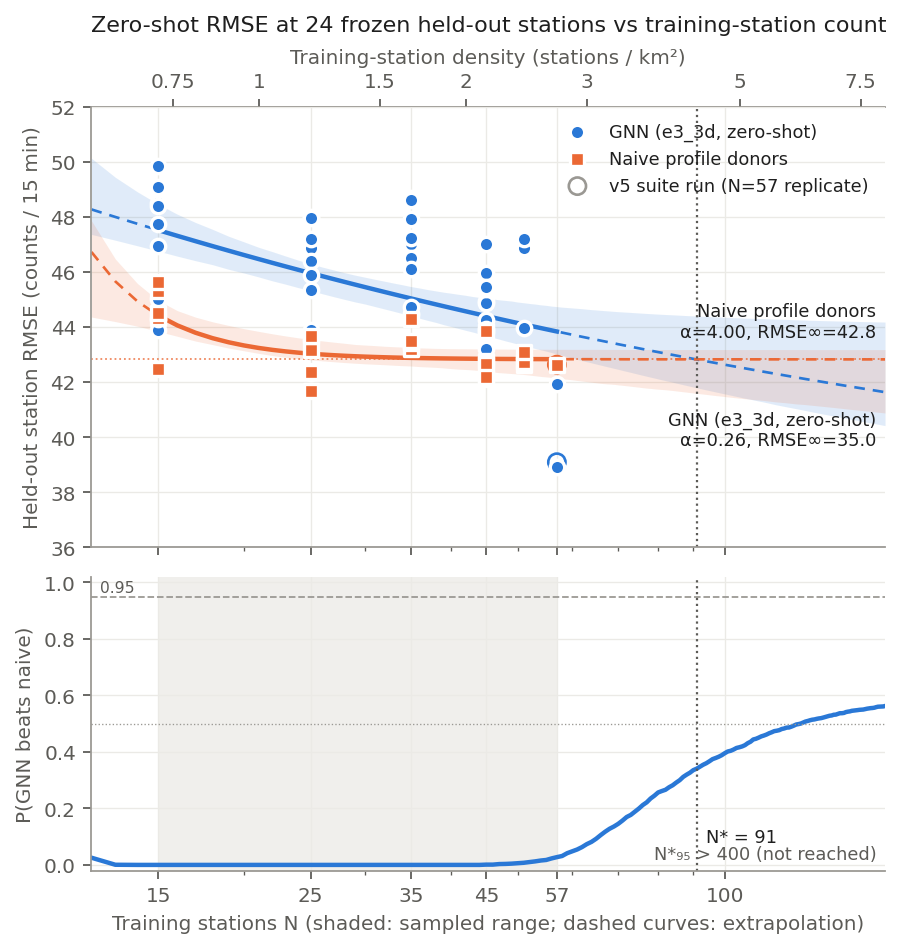

# Spatial sparsity scaling: GNN vs naive profile donors

Metric: `v5_test_metrics.obs_ind_rmse` on 24 frozen held-out stations (holdout identical to the v5 suite (seed 42)). 69 runs.

Network area (convex hull of all stations): 21.0 km².

| N_train | density /km² | GNN RMSE | naive RMSE | Δ (GNN − naive) | mean nearest-train km |
|---:|---:|---:|---:|---:|---:|
| 15 | 0.71 | 46.93 | 44.45 | +2.48 | 0.42 |
| 25 | 1.19 | 45.74 | 42.67 | +3.07 | 0.31 |
| 35 | 1.67 | 46.84 | 43.57 | +3.27 | 0.21 |
| 45 | 2.14 | 44.88 | 42.71 | +2.17 | 0.18 |
| 51 | 2.43 | 46.01 | 42.81 | +3.20 | 0.17 |
| 57 | 2.71 | 40.42 | 42.63 | -2.22 | 0.15 |

RMSE(N) = A · N^(−α) + RMSE∞  (bootstrap 90% intervals in brackets)

| arm | A | α | RMSE∞ | noise sd (source) |
|---|---:|---:|---:|---|
| gnn | 25.38 | 0.261 [0.21, 1.73] | 35.00 [35.0, 44.0] | 1.72 (pooled replicate sd over 45 runs at 6 N) |
| naive | 80853.37 | 4.000 [0.18, 4.00] (at bound — not identified) | 42.83 [35.0, 43.2] | 0.79 (pooled replicate sd over 23 runs at 5 N) |

- Point-fit crossover N* = 91 — **extrapolated beyond the sampled range**
- Definitive crossover N*₉₅ (P(GNN better) ≥ 0.95 from there on) = > 400 (not reached)
- Bootstrap N* 90% interval: [61, > 400 (not reached)]; never crosses in 37% of resamples, GNN always better in 0%
- As density: N* ≈ 4.33 training stations / km²

