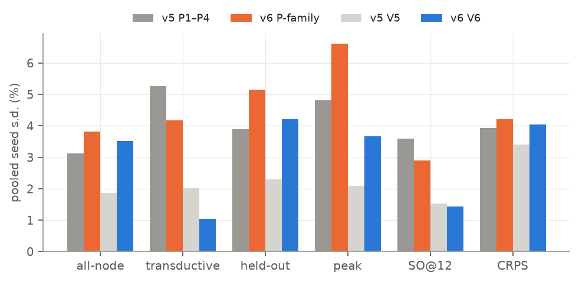
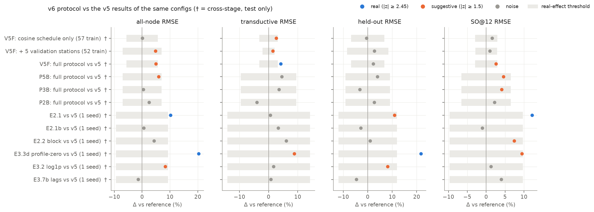
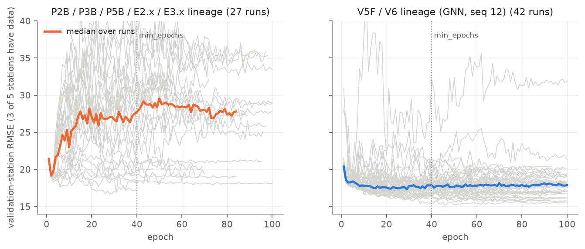
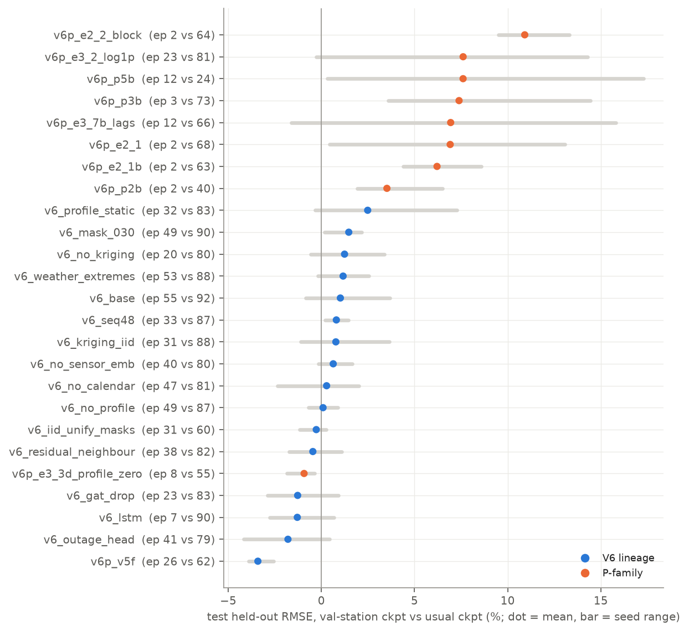
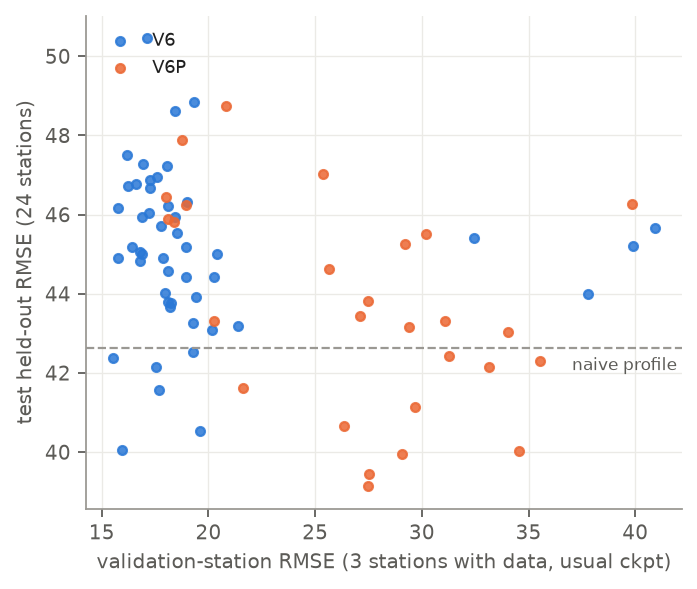
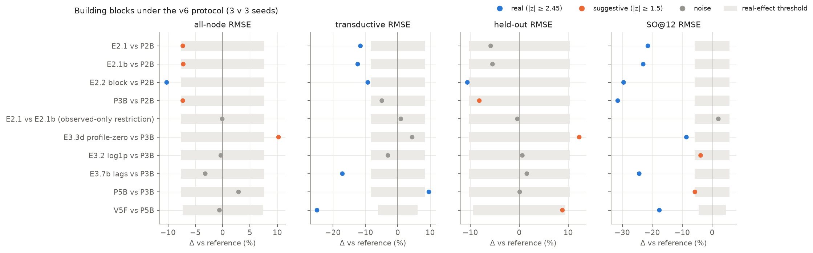
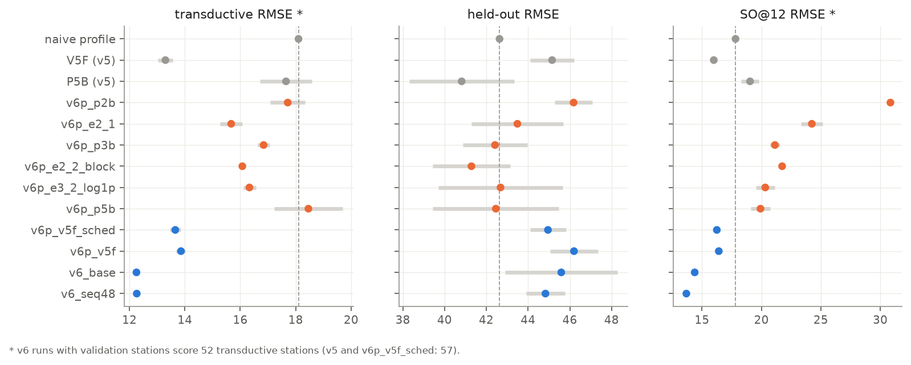
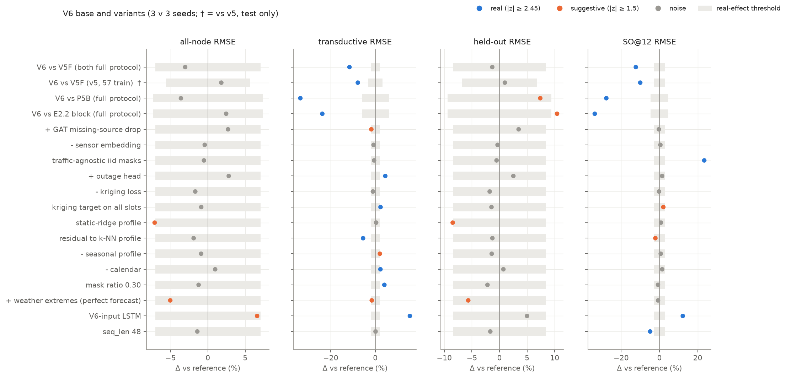

# RIoT v6 stage: 3-seed analysis (26 experiments × seeds 42 / 43 / 44)

**Scope.** All 78 runs of the v6 stage (26 experiments × 3 seeds). They cover:
- the v6 training protocol;
- the building blocks re-run under it;
- the pre-declared V6 base with its variants, held-out arms, LOOs and peak arms;
- the post-hoc GNN+LSTM ensemble;
- the legacy batch-size check.

The analysis follows the protocol of [`riot_v5_seed_report.md`](../riot_v5/riot_v5_seed_report.md), hereafter "the v5 seed report". Each v6 run is scored at both of its checkpoints:
- the usual selection (`best_model.pt`, obs-loss + SO);
- the validation-station checkpoint (`best_model_ind.pt`, written `@ind`).

**Purpose.** Close out the seven next-stage recommendations of v5 §14.2, and feed thesis Chapters 6–7.
**Date.** 2026-10-22. The runs went from 2026-10-10 14:52 to 2026-10-13 18:45: about 76 h of wall time on 4 GPUs, one job per GPU, 289 GPU-h of training in total.

**Reproduce.**

```bash
python scripts/riotv5/collect_v5_results.py --manifest ... --out docs/experiments/riot_v6/data  # run by run_v6_stage.sh
python scripts/riotv5/seeds_v6_results.py   # -> data/seed_*.csv, val_station_epochs, ensemble, legacy,
                                            #    ind_checkpoint_paired; figures/fig01–08
```

The script reads:
- `docs/experiments/riot_v6/data/{runs,epochs}.csv`;
- the v5 `runs.csv`, for cross-stage references;
- `logs/v6_stage/runs/*.log`, for the per-epoch validation-station RMSE, which `epochs.csv` lacks;
- `logs/v6_stage/posthoc/*.json`.

Every run used `holdout_sha 669860aa8b4cdd15`.

**Comparability (read this first).**
- **Station sets.** The v6 runs with validation stations train on 52 stations, not 57. At test time they score:
  - 52 transductive stations;
  - 76 stations for all-node;
  - the same 24 held-out stations as v5.

  So held-out RMSE, kriging and the naive-profile baseline are directly comparable with v5. Transductive, all-node and SO metrics are not. Any cross-stage comparison is test-only and marked †. `v6p_v5f_sched` has no validation stations, so it scores 57 / 81 like v5.
- **Coverage.** Station coverage in the test window is thin. Only 15 of the 24 held-out stations and 41 of the 52 training stations have any observation there. This is the same for v5 and v6.

---

## 0. Executive summary

1. **The protocol did what it was meant to, for the V6 lineage only.**
   - **Selected epoch:** for V6 its pooled s.d. is 8.8 (target < 10; v5 V5 had 11.6). No V6 run selected before epoch 40.
   - **Transductive noise** halved: 1.0% vs 2.0% in v5 V5.
   - **Held-out and all-node noise** did *not* shrink:
     - held-out 4.2% vs 2.3%;
     - all-node 3.5% vs 1.9%.

     Taking 5 stations out of training made the held-out estimate noisier.
   - **The P-family** became less stable under the protocol: selected-epoch s.d. 18.0, held-out σ 5.2%.

2. **The validation-station checkpoint failed and should not be used for model selection.** Three reasons:
   - **Coverage.** Two of the five validation stations, HeatonHallRd and NorthumberlandSt, stopped reporting in early 2024. They have no data in the validation or test windows.
   - **Scale.** The other three run at about half the level of the held-out test stations: RMS 6.6 vs 11.6–12.5 in the validation window.
   - **Sign.** As a result, validation-station RMSE is *negatively* correlated with test held-out RMSE (ρ −0.38 over all GNN runs, p 0.0009; within-config in the P-family ρ −0.40, p 0.04).
   - **Consequences.**
     - In the P-family, the checkpoint lands at epoch 2–3, inside the warmup, in 5 of 9 configs.
     - It costs +10 to +26% all-node, +21 to +67% transductive and up to +11% held-out.
     - In the V6 lineage it is neutral to harmful.
   - **The one exception** is `v6p_v5f@ind`: held-out −3.4%, noise, at the cost of +12% transductive.

3. **The V6 base meets the resilience targets but not the accuracy targets.** 3-seed results:

   | metric | V6 base | target | met? |
   |---|---|---|---|
   | SO@12 | 14.38 ± 0.10 | ≤ 16.5 | yes |
   | SO@96 mass | 0.94 | 0.9–1.1 | yes |
   | collapse | 0.0003 | < 0.02 | yes |
   | all-node | 26.81 ± 1.34 | ≤ 25 | no |
   | held-out | 45.59 ± 2.68 | ≤ 42.6, the naive profile | no; +6.9% vs naive, real |

   Against V5F under the same protocol, V6 is better on:
   - transductive (−11.6%);
   - SO@12 (−12.4%);
   - MAE (−9.7%);
   - CRPS (−15.1%).

   All four are real. Held-out and all-node do not move.

4. **The static-ridge profile is the stage's best result, and the only V6 arm that meets every target.**

   `v6_profile_static` gives unseen stations a ridge level estimate from static features instead of a zero profile. Against the V6 base:

   | metric | static-ridge profile | V6 base | Δ |
   |---|---|---|---|
   | all-node | 24.89 ± 0.64 | 26.81 | −7.1% |
   | held-out | 41.72 ± 1.29 | 45.59 | −8.5% |
   | peak | 87.9 | 95.8 | −8.2% |
   | CRPS | 6.90 | 7.47 | −7.7% |
   | transductive | 12.30 | 12.25 | unchanged |

   - It is lower than the base on held-out for every seed (40.5 / 41.6 / 43.1 vs 42.5 / 46.7 / 47.5), and it beats the naive profile by 2.1%, which is noise.
   - The verdict is **suggestive** (z −2.5): the validation window does not confirm it (val all-node +1.9%). It is the clear candidate for the confirmatory run.

5. **Most v5 single-seed claims about building blocks were overturned or cut back** (§4):
   - **E2.1:** the v5 single-seed result was a lucky draw. It replicates +10.3% worse, real.
   - **E2.1 vs E2.1b:** −0.1%, so the observed-only restriction has no effect.
   - **E3.3d profile-zero:** reverses. It is +10% all-node and +12% held-out vs P3B, against −8% in v5.
   - **E2.2 block masking** is the one block that holds up. It beats P2B by a real margin on all-node (−10.2%) and held-out (−10.6%), and gives the best P-family held-out (41.29).
   - **The V5F vs P5B trade-off** replicates: transductive −24.9%, held-out +8.8%.

6. **Of the other arms, two are worth keeping, one is diagnostic only, and the rest are null or harmful:**
   - **Keep: traffic-aware masks.** iid masks cost +23% SO@12, real.
   - **Keep: no outage head.** Adding it costs +4.5% transductive and +9.9% CRPS, real, and collapse goes to 0.074.
   - **Diagnostic only: perfect-forecast weather extremes.** −5 to −6% everywhere, suggestive. It is an upper bound, not a deployable feature.
   - **Null:** no kriging loss, residual-to-k-NN on held-out, seq48 (apart from SO@12 −4.9%, for 35 h), no sensor embedding.
   - **Harmful:**
     - kriging on all slots;
     - GAT drop (MAE +7.1%, real);
     - the V6-input LSTM (+15.5% transductive, +16.3% CRPS, real);
     - the GNN+LSTM ensemble, which is worse than V6 alone on the usual checkpoint for 2 of the 3 seeds on held-out.

7. **Legacy closure.**
   - Pooled RMSE does not depend on evaluation batch size (difference < 0.1%).
   - The v4 "mean of batches" metric is about 12% lower at bs32 than at bs128 for every checkpoint. That fully explains the old bs32 advantage as a metric artefact.
   - At equal evaluation batch size, bs32 training is −3.1% (z ≈ −1.7, suggestive).

---

## 1. Coverage and scoring

| tier | experiments | runs | notes |
|---|---|---|---|
| 1 protocol | `v6p_v5f_sched`, `v6p_v5f` | 6 | separates the schedule from the 5 validation stations |
| 1–2 blocks | `v6p_p2b`, `p3b`, `p5b`, `e2_1`, `e2_1b`, `e2_2_block`, `e3_2_log1p`, `e3_3d_profile_zero`, `e3_7b_lags` | 27 | v5 blocks re-run with 3 seeds under the protocol |
| 2 V6 | `v6_base`, `gat_drop`, `no_sensor_emb`, `iid_unify_masks`, `outage_head` | 15 | V6 = V5F with NB head, no outage / quantiles / magnitude / Huber / key padding, profile `inductive_zero`, lags [96, 672], mask 0.15 |
| 4 held-out | `v6_no_kriging`, `kriging_iid`, `profile_static`, `residual_neighbour` | 12 | |
| 5 LOO + peaks | `v6_no_profile`, `no_calendar`, `mask_030`, `weather_extremes`, `lstm` | 15 | |
| 6 stretch | `v6_seq48` | 3 | 35.4 h over the 3 runs |
| post-hoc | ensembles `v6_base` + `v6_lstm` (1:1) at both checkpoints; legacy V4R bs32-vs-full | – | `logs/v6_stage/posthoc/` |

All 78 runs completed.

**Protocol.**
- Cosine LR with 3 warmup epochs, 100-epoch budget, `min_epochs` 40, patience 20.
- Five validation stations from training (`val_station_seed` 0), the same for every seed.

**Scoring.** Unchanged from the v5 seed report:
- mean ± s.d. over 3 seeds;
- pooled seed σ per family, as log-CV % for RMSE-type metrics and absolute for rates;
- z = Δ / √(σa²/na + σb²/nb).

Verdicts:
- **real:** |z| ≥ 2.45 *and* the validation window agrees in sign;
- **suggestive:** |z| ≥ 1.5;
- **noise:** otherwise.

**Families.**
- **V6:** the `v6_*` runs plus `v6p_v5f` and `v6p_v5f_sched`.
- **V6P:** the P-family block runs.
- **`@ind`:** the validation-station checkpoints of the same runs, kept as separate pseudo-experiments.

## 2. Noise under the v6 protocol



### 2.1 Pooled seed s.d. (test)

| metric | v5 P1–P4 | v6 P-family | v5 V5 | v6 V6 |
|---|---|---|---|---|
| all-node | 3.1% | 3.8% | 1.9% | 3.5% |
| transductive | 5.3% | 4.2% | 2.0% | **1.0%** |
| held-out | 3.9% | 5.2% | 2.3% | 4.2% |
| peak | 4.8% | 6.6% | 2.1% | 3.7% |
| SO@12 | 3.6% | 2.9% | 1.5% | 1.4% |
| CRPS | 3.9% | 4.2% | 3.4% | 4.0% |

**Transductive and SO.** For V6, transductive noise halved and SO noise stayed the same. That is the protocol working on the stations the model trains on.

**Held-out and all-node.** Noise roughly doubled. The likely cause is that 5 fewer training stations and one fixed validation draw change the station graph that the held-out stations are kriged from. Seed pairing does not help much: it removes only 15–20% of the within-config variance (35% for CRPS). Seed 42 is again the favourable draw (held-out about −1.9% within V6).

**What this costs.** With σ ≈ 4% on held-out, a 3 v 3 comparison needs Δ ≈ 8% to count as real. Every held-out claim below should be read with that bar in mind.

### 2.2 Early stopping (v5 rec. 1)

| family | selected-epoch pooled s.d. | mean selected epoch | selected < 40 | hit 100-epoch cap |
|---|---|---|---|---|
| v5 P1–P4 | 12.6 | 30 | 62% | – |
| v5 V5 | 11.6 | 62 | 10% | – |
| **v6 V6** | **8.8** | 82 | 0% | 67% |
| v6 P-family | 18.0 | 59 | 22% | 19% |

- **V6 meets the < 10 target.** But two-thirds of V6 runs were still improving at epoch 100, so the budget, not the stopping rule, now sets the selection.
- **The P-family is less stable than in v5.** The `v6p_p5b` runs select at epoch 24 on average and P2B at 40.
- **Epoch confound.** The within-config link between selected epoch and test RMSE has weakened for V6:
  - transductive ρ −0.32 (p 0.026), −0.34% per 10 epochs, against −0.79% in v5;
  - all-node and held-out: not significant.

  It is still strong in the P-family (transductive ρ −0.62, −1.3% per 10 epochs).

### 2.3 What the protocol changed on V5F (v5 rec. 1 and 2)



| comparison | all-node | trans | held-out | CRPS | MAE | collapse |
|---|---|---|---|---|---|---|
| cosine schedule only (`v6p_v5f_sched` vs v5 V5F, both 57 train) | +0.1% | +2.7% s | −0.4% | −3.3% | −0.2% | 0.021 vs 0.043 |
| + 5 validation stations (`v6p_v5f` vs `_sched`) † | +4.9% s | +1.5% s | +2.8% | **+14.9% R** | +8.0% s | 0.046 vs 0.021 |

- **The schedule alone is neutral.** It halves collapse.
- **Removing the 5 stations from training costs.** Probabilistic calibration suffers most (CRPS +15%, real).
- **Comparing the v6-protocol runs with v5 directly** (test-only, †): V5F +5.0% all-node, P5B +6.0%, P3B +0.5%, P2B +2.5%. Part of this is the different station set, so it is not counted as a protocol effect.

## 3. The validation-station checkpoint (v5 rec. 2)



### 3.1 What happened

**V6 lineage.** Validation-station RMSE drops to about 17–18 within 5 epochs and then stays flat. It tells you nothing useful after warmup.

**P-family.**
- The curve reaches its minimum (about 19) at epoch 2–3, while the learning rate is still warming up.
- It then climbs to 25–37 while every test metric improves.
- `best_model_ind.pt` is therefore an almost untrained model: the mean `@ind` epoch is 7 in the P-family.



| family | selected epoch, `@ind` vs usual | all-node | transductive | held-out |
|---|---|---|---|---|
| P-family (9 configs) | 2–23 vs 24–81 (5 of 9 at ≤ 3) | +10 to +26% | +21 to +67% | −0.9 to +10.9% (8 of 9 worse) |
| V6 lineage (16 configs) | 7–55 vs 60–92 | −0.4 to +8% | +4 to +44% | −3.4 to +2.5% |

The best `@ind` result is `v6p_v5f@ind`: held-out 44.62 vs 46.20 (−3.4%, noise). It pays for that with transductive +11.9% and SO@12 +7.3%. No `@ind` checkpoint beats its usual-selection twin by a margin that counts as real on any headline metric. The checkpoint does not work.

### 3.2 Why: the validation stations are the wrong population



Validation-station RMSE (usual checkpoint) against test held-out RMSE, GNN runs:

| subset | Spearman ρ | p |
|---|---|---|
| all runs | −0.38 | 0.0009 |
| all runs, within config | −0.17 | 0.14 |
| V6 | −0.22 | 0.14 |
| V6, within config | −0.03 | 0.82 |
| P-family | −0.47 | 0.014 |
| P-family, within config | −0.40 | 0.041 |

A model that does better on the validation stations does *worse* on the held-out stations. The station data (`data/station_levels.csv`, from `master_dataset_15T.parquet`) explains why:

| group | stations with data, validation window | mean RMS level | stations with data, test window | mean RMS level |
|---|---|---|---|---|
| validation stations | **3 / 5** | **6.6** | 3 / 5 | 6.7 |
| held-out (test) | 16 / 24 | 11.6 | 15 / 24 | 12.5 |
| training | 42 / 52 | 8.5 | 41 / 52 | 8.4 |

- **Two dead stations.** `NclHeatonHallRdCardiganTer` ends on 2024-01-26 and `NclNorthumberlandStSavilleRowWest` on 2024-03-28. Both stop before the validation window starts (2025-05-08). Validation-station RMSE therefore comes from 3 stations.
- **The wrong level.** Those 3 stations are quieter than the held-out set (RavenswoodRd has RMS 4.1). A checkpoint that predicts low levels at unseen nodes scores well on them and badly on the busier held-out stations.

This is the same mechanism that makes the static-ridge profile work (§6.2): **at unseen stations, getting the level right dominates the error.**

**Implication.** Inductive model selection needs a validation set that resembles the test set in level, coverage and size. That means at least 8–10 stations, stratified by volume, and only stations with data in the validation window. A fixed random draw of 5 does not meet this.

## 4. Building blocks under the protocol (v5 rec. 3)



3 v 3, same protocol. R = real, s = suggestive. Δ in %; z in brackets.

| comparison | all-node | transductive | held-out | peak | SO@12 | CRPS |
|---|---|---|---|---|---|---|
| E2.1 vs P2B | −7.3 s | **−11.5 R** | −5.8 | −8.8 s | **−21.4 R** | **−8.5 R** |
| E2.1b vs P2B | −7.2 s | **−12.3 R** | −5.5 | −8.2 s | **−23.0 R** | −8.0 s |
| **E2.2 block vs P2B** | **−10.2 R** | **−9.3 R** | **−10.6 R** | −13.2 s | **−29.5 R** | **−11.2 R** |
| P3B vs P2B | −7.3 s | −4.9 | −8.2 s | −13.1 s | **−31.5 R** | −6.7 s |
| E2.1 vs E2.1b (observed-only restriction) | −0.1 | +0.9 | −0.4 | −0.7 | +2.1 | −0.5 |
| E3.3d profile-zero vs P3B | +10.2 s (+3.3) | +4.4 | +12.3 s (+2.9) | **+20.7 R** | **−8.6 R** | **+14.8 R** |
| E3.2 log1p vs P3B | −0.3 | −3.0 | +0.6 | +2.7 | −3.8 s | −1.3 |
| E3.7b lags vs P3B | −3.2 | **−17.1 R** | +1.5 | +1.2 | **−24.3 R** | **−9.2 R** |
| P5B vs P3B | +2.9 | **+9.6 R** | +0.1 | +11.7 s | −5.8 s | +1.4 |
| V5F vs P5B | −0.6 | **−24.9 R** | +8.8 s | −1.5 | **−17.6 R** | +4.8 |

The two profile-zero rows have |z| ≥ 2.45 but are marked suggestive because validation does not agree (all-node −0.5%).

**Replication of the v5 single-seed screens** (3 v6 seeds vs 1 v5 seed, test-only †):
- E2.1 +10.3% all-node (R);
- E3.3d profile-zero +20.4% all-node and +21.8% held-out (R);
- E3.2 log1p +8.4% (s);
- E2.1b +0.6%, E2.2 block +4.3%, E3.7b lags −1.4% (noise).

**Reading.**
- **E2.1 and its mask question.**
  - The 8–13% v5 gap between E2.1 and E2.1b was noise: they are identical under seeds (−0.1%).
  - E2.1's v5 headline was a lucky seed.
  - Traffic-agnostic masking is still worth −21% SO@12 over P2B, but it is no better than P3B's inputs.
- **E2.2 block masking is the only block that is real on held-out** (41.29 ± 1.86). It is also the best P-family model on held-out, kriging (41.3) and peak (88.0).
- **Profile-zero hurts.** The v5 −8% was the wrong sign: it gives up the level information at unseen stations (§3.2). It only helps SO@12.
- **Lags** buy transductive and SO accuracy (−17 / −24%) without touching held-out, which is why V6 includes them.
- **The V5F vs P5B trade-off** (better transductive, worse held-out) replicates exactly. V6 inherits it: V6 vs E2.2 block is held-out +10.4% (s) and transductive −23.8% (R).

## 5. The V6 base (v5 rec. 4)



| | all-node | trans | held-out | MAE | peak | SO@12 | SO@96 | SO@96 mass | collapse | CRPS | kriging | epoch |
|---|---|---|---|---|---|---|---|---|---|---|---|---|
| **V6 base** | 26.81 ± 1.34 | 12.25 ± 0.02 | 45.59 ± 2.68 | 9.18 | 95.8 | 14.38 | 15.97 | 0.94 | 0.0003 | 7.47 | 46.0 | 92 ± 10 |
| V5F, v6 protocol | 27.65 ± 0.58 | 13.86 | 46.20 ± 1.15 | 10.16 | 97.0 | 16.41 | 16.78 | 1.06 | 0.046 | 8.80 | 46.1 | 62 |
| V5F, schedule only | 26.37 ± 0.35 | 13.65 | 44.95 ± 0.86 | 9.41 | 94.2 | 16.25 | 16.74 | 1.07 | 0.021 | 7.66 | 45.3 | 78 |
| E2.2 block | 26.17 ± 0.88 | 16.07 | 41.29 ± 1.86 | 10.26 | 88.0 | 21.74 | 22.01 | 0.92 | 0 | 7.88 | 41.3 | 64 |
| naive profile (v5) | – | – | 42.63 | | | | | | | | | |

**V6 vs V5F, both on the v6 protocol:**

| metric | Δ | verdict |
|---|---|---|
| transductive | −11.6% | real |
| SO@12 | −12.4% | real |
| SO@96 | −4.8% | real |
| MAE | −9.7% | real |
| CRPS | −15.1% | real |
| all-node | −3.0% | noise |
| held-out | −1.3% | noise |

Collapse falls from 0.046 to 0.0003. Against the v5 V5F runs (†, 57 training stations): transductive −7.9% and SO@12 −10.1% are real; held-out +1.0%.

**Against the v5 §14.2 targets:**

| target | V6 base | met? |
|---|---|---|
| SO@12 ≤ 16.5 | 14.38 | yes |
| SO@96 mass 0.9–1.1 | 0.94 | yes |
| collapse < 0.02 | 0.0003 | yes |
| held-out ≤ 42.6 | 45.59 | **no** (+6.9% vs naive, real) |
| all-node ≤ 25 | 26.81 | **no** |

**So V6 is a cleaner V5F.** Its gains come from the simpler head and the lags, and they show up on observed stations and under outages. It inherits V5F's weakness at unseen stations.

## 6. V6 variants, held-out track, LOO and peaks (v5 rec. 4–6)



All rows are 3 v 3 against the V6 base. Δ in %; R = real, s = suggestive.

| arm | all-node | trans | held-out | peak | SO@12 | CRPS | other |
|---|---|---|---|---|---|---|---|
| + GAT missing-source drop | +2.7 | −1.8 s | +3.5 | +1.7 | −0.3 | +8.1 s | MAE **+7.1 R**, SO@96 mass 0.89 |
| − sensor embedding | −0.4 | −0.8 | −0.4 | −0.6 | +0.5 | +1.2 | SO@96 +3.1 s, mass 0.90 |
| traffic-agnostic iid masks | −0.5 | −0.5 | −0.5 | −0.7 | **+23.4 R** | −1.3 | SO@96 **+25.2 R**, mass 0.68 |
| + outage head | +2.8 | **+4.5 R** | +2.5 | +2.1 | +1.4 | **+9.9 R** | collapse 0.074 |
| − kriging loss | −1.7 | −1.1 | −1.8 | −2.2 | −0.2 | −0.9 | kriging +4.0 |
| kriging target on all slots | −0.9 | **+2.3 R** | −1.5 | −1.6 | +2.0 s | +0.1 | kriging +8.2 s |
| **static-ridge profile** | **−7.1 s** (z −2.5) | +0.4 | **−8.5 s** (z −2.5) | **−8.2 s** | +0.8 | **−7.7 s** | MAE −4.8 s |
| residual to k-NN profile | −1.9 | **−5.5 R** | −1.3 | −2.2 | −2.2 s | −2.1 | SO@96 mass 0.98 |
| − seasonal profile | −0.9 | +2.0 s | −1.4 | −1.1 | +0.7 | −1.8 | SO@96 **+4.2 R** |
| − calendar | +1.0 | **+2.3 R** | +0.7 | −0.9 | +1.4 | −3.2 | |
| mask ratio 0.30 | −1.2 | **+4.1 R** | −2.2 | −1.8 | −0.8 | −0.6 | |
| + weather extremes (perfect forecast) | −5.0 s | −1.6 s | −5.7 s | −6.2 s | −0.8 | −6.3 s | top-decile bias −52 vs −58 |
| V6-input LSTM | +6.6 s | **+15.5 R** | +5.0 | +5.3 s | **+12.2 R** | **+16.3 R** | MAE **+13.5 R** |
| seq_len 48 | −1.4 | +0.1 | −1.7 | −2.0 | **−4.9 R** | −1.9 | 35.4 h for the 3 runs |

### 6.1 Architecture variants

- **GAT missing-source drop: harmful.** MAE is +7.1% (real) and calibration worse. Keep `gat_drop` off.
- **Sensor embedding: keep it.** Dropping it is null on accuracy, but SO@96 mass falls to 0.90, which is on the edge of the target.
- **Traffic-aware masks are essential.** iid masks push SO@96 mass to 0.68 and cost 23–25% SO error. This replicates v5.
- **Outage head: stays out.** It costs transductive accuracy and CRPS and brings collapse back (0.074).

### 6.2 Held-out track (v5 rec. 4a–c)

- **Kriging loss: still null.** It was null in v5 too. Running it on all slots is slightly worse. The observed-only kriging target is not what holds held-out back.
- **Residual to k-NN profile: an observed-station gain only.** It improves transductive accuracy (−5.5%, real) and SO@96 mass (0.98), but held-out only by −1.3% (noise).
- **Static-ridge profile: the one arm that moves held-out.**
  - Seeds: lower than the base on every seed (40.5 / 41.6 / 43.1 vs 42.5 / 46.7 / 47.5).
  - Spread: the across-seed s.d. halves (1.29 vs 2.68).
  - Transductive and SO: untouched (12.30, 14.50, mass 0.92, collapse 0). That is expected, since it only changes the prior at unseen nodes.
  - Targets: it meets all of them (all-node 24.89, held-out 41.72).
  - **Verdict: suggestive, not real.** z is −2.5 on all-node and held-out, but the validation-window all-node is +1.9%. The validation-station metric is +11%, but §3 shows that metric is uninformative.
  - **Mechanism:** the same as §3.2. The error at unseen stations is mostly a level error.
  - **Other screens:** it was unstable as a v5 single-seed screen, and that instability is gone here.

### 6.3 LOO (v5 rec. 5)

- **Seasonal profile.** Removing the profile entirely costs only transductive +2.0% (s) and SO@96 +4.2% (R). Combined with E3.3d, this says the profile matters at observed stations only through the SO horizon. Its held-out value depends on how unseen stations get their profile (zero vs static ridge), not on whether it exists.
- **Calendar features:** a small real transductive gain. Keep them.
- **Mask ratio 0.30:** worse transductive (+4.1%, real). This confirms v5; 0.15 stays.

### 6.4 Peaks (v5 rec. 6)

- **Weather extremes** improve every accuracy metric by 5–6% (suggestive) and cut top-decile bias from −58 to −52.
  - **Caveat:** the features assume a perfect weather forecast at the target step. Treat this as an upper bound on what a forecast feed could give.
  - **Before using it as a result:** the next stage needs the same arm with lagged (observed-at-origin) weather.
- **V6-input LSTM: clearly worse.** It loses on transductive, MAE, SO@12 and CRPS, all real. In v5 the LSTM tied V5F, because V5F's extra inputs helped the GNN more than the LSTM. Under V6 the graph earns its keep.
- **seq_len 48:** SO@12 −4.9% (real), nothing else. Not worth 3.3× the GPU cost (11.8 h per run vs 3.6 h).

### 6.5 GNN+LSTM ensemble (v5 rec. 7)

Usual checkpoint, 1:1 weights:

| seed | all-node: V6 → ensemble | held-out: V6 → ensemble | CRPS: V6 → ensemble | q90 coverage |
|---|---|---|---|---|
| 42 | 25.27 → 26.61 | 42.53 → 44.87 | 7.06 → 7.47 | 0.845 → 0.863 |
| 43 | 27.38 → 27.89 | 46.73 → 47.43 | 7.60 → 7.93 | 0.840 → 0.842 |
| 44 | 27.77 → 27.10 | 47.51 → 45.88 | 7.75 → 7.57 | 0.852 → 0.867 |

- **Accuracy:** the ensemble is worse than V6 alone for 2 of 3 seeds. It only helps seed 44, where the LSTM happened to be the better member on held-out (46.25 vs 47.51).
- **Coverage:** q90 improves slightly (about +0.015).
- **Checkpoint:** on the `@ind` checkpoint the ensemble is worse again, because the LSTM's `@ind` is from epoch 5–9.

**Not worth pursuing** with a member this weak.

## 7. Legacy closure (V4R bs32 vs full batch)

| eval | metric | full-batch trained (s42 / 43 / 44) | bs32 trained (s42 / 43 / 44) |
|---|---|---|---|
| bs32 | mean of batches | 16.75 / 17.65 / 17.08 | 17.20 / 16.01 / 16.32 |
| bs128 | mean of batches | 19.03 / 20.05 / 19.38 | 19.58 / 18.25 / 18.58 |
| bs32 | pooled | 19.85 / 20.74 / 20.17 | 20.47 / 19.03 / 19.42 |
| bs128 | pooled | 19.89 / 20.76 / 20.18 | 20.48 / 19.04 / 19.44 |

**Pooled RMSE** does not depend on evaluation batch size (< 0.1%).

**Mean of batches** at bs32 is about 12% lower than at bs128 for *every* checkpoint. That is the artefact behind the v4 bs32 headline.

**At equal evaluation batch size** (pooled, bs128):
- bs32 training averages 19.65 against 20.28 for full-batch: −3.1%;
- with V4R legacy σ 2.2% this gives z ≈ −1.7, suggestive.

Possibly a small real gain from smaller batches, but the thesis claim should be framed as mostly a metric artefact.

## 8. Claims register: v5 → v6

| v5 claim (source) | v6 result (3 seeds, v6 protocol) | status |
|---|---|---|
| Plateau-selection protocol will cut epoch noise (rec. 1) | V6 selected-epoch s.d. 8.8; transductive σ 1.0%; held-out σ up to 4.2% | **partly confirmed** |
| A held-out validation split enables inductive selection (rec. 2) | negative correlation; checkpoint picked in warmup; 2 of 5 stations dead | **refuted as implemented** |
| E2.1 best P2 mask (seed 42) | +10.3% vs its v5 seed; equals E2.1b | **overturned** |
| Observed-only restriction costs 8–13% (E2.1 vs E2.1b) | −0.1% | **overturned (noise)** |
| E2.2 block masking helps | real vs P2B on all-node, transductive, held-out, SO | **confirmed, strengthened** |
| E3.3d profile-zero helps held-out −8% (seed 42) | +12.3% held-out, +20.7% peak vs P3B | **reversed** |
| E3.2 log1p helps | null vs P3B | **overturned** |
| Lags help transductive / SO | −17% / −24% (R), held-out null | **confirmed** |
| V5F trades held-out for transductive | −24.9% transductive (R), +8.8% held-out (s) | **confirmed** |
| Outage head is dispensable | adding it: +4.5% transductive, +9.9% CRPS (R) | **confirmed** |
| Traffic-aware masks drive resilience | iid: +23% SO@12 (R) | **confirmed** |
| Kriging loss is null | null again; all-slot target worse | **confirmed** |
| LSTM ties the GNN on V5F inputs | V6-input LSTM +15.5% transductive (R) | **does not carry over to V6** |
| bs32 advantage is an artefact | mean of batches −12% at bs32 for all checkpoints; pooled −3.1% (s) | **confirmed (mostly artefact)** |

## 9. Recommendations

### 9.1 For the thesis

1. **Report V6 at the usual checkpoint.** Leave `best_model_ind.pt` out of the results tables.
2. **Report the validation-station failure as a methodological finding.** Use §3.2: coverage plus level mismatch gives a negative correlation.
3. **Present V6 as the resilience model.** It is real-better than V5F on transductive, SO, MAE and CRPS, and meets every resilience target.
4. **Present held-out as an open problem with a lead.** The level prior is the lever: static-ridge −8.5% (s), against profile-zero +12% in the P-family.
5. **Quote held-out claims with σ ≈ 4% per family.** They need Δ ≳ 8% at 3 v 3.
6. **Correct the v5 single-seed claims** on E2.1, E2.1b, E3.3d and log1p (§8). Keep E2.2 block masking as the strongest masking result.
7. **Mark † on every cross-stage comparison.** Use held-out and kriging as the only like-for-like metrics.

### 9.2 Next stage (in order of value per GPU-hour)

1. **Confirm the static-ridge profile.**
   - 3 more seeds (45–47) of `v6_base` and `v6_profile_static`, on the v5 57-station training set with no validation stations.
   - This removes the station-set confound and doubles n, so a −8% effect would clear z 2.45 on its own.
   - About 25 GPU-h.
2. **Fix inductive validation before trying it again.**
   - Draw 8–10 validation stations stratified by volume quantile, and only from stations with data in the validation window.
   - Check that validation-station RMSE correlates positively with held-out on the existing 78 runs' predictions before training anything.
   - The alternative is to drop it and select on the usual criterion.
3. **Combine static-ridge with E2.2 block masking.**
   - E2.2 is the best held-out block, and the static profile is orthogonal to it.
   - A `v6_profile_static` + block-mask arm, 3 seeds.
4. **Lagged weather extremes.** Rerun `v6_weather_extremes` with weather observed at the forecast origin only, to see how much of the −5% survives.
5. **Raise the epoch budget to 150 for V6.** 67% of runs hit the cap, and transductive still improves −0.34% per 10 epochs.
6. **Stop:** LSTM and ensemble work, seq48, GAT drop, the kriging-loss variants and the outage head.

---

## Appendix A. Figures (`figures/`)

| file | content |
|---|---|
| `fig01_val_station_curves.png` | per-epoch validation-station RMSE, P-family vs V6 lineage |
| `fig02_seed_noise.png` | pooled seed s.d. by family, v5 vs v6 |
| `fig03_bases.png` | transductive / held-out / SO@12 for the bases, mean and seed range, naive reference |
| `fig04_ind_checkpoint.png` | held-out Δ of the validation-station checkpoint vs the usual one, per config |
| `fig05_val_vs_test_heldout.png` | validation-station RMSE vs test held-out RMSE, all GNN runs |
| `fig06_blocks.png` | forest plot, building blocks under the protocol |
| `fig07_v6_variants.png` | forest plot, V6 base comparisons and all V6 arms |
| `fig08_protocol_replication.png` | forest plot, protocol effects and v5 single-seed replications |

In the forest plots:
- blue = real, orange = suggestive, grey = noise;
- the shaded band is the |z| = 2.45 threshold.

## Appendix B. Data files (`data/`)

| file | content |
|---|---|
| `runs.csv`, `epochs.csv` | collected per-run and per-epoch metrics (both checkpoints in `runs.csv`) |
| `seed_summary.csv` | per experiment (v5, v6 and `@ind`): mean and s.d. of every metric, selected epoch, GPU-h |
| `seed_noise.csv` | pooled seed σ per family and metric |
| `seed_comparisons.csv` | every comparison in this report: Δ, z, validation Δ, verdict per metric |
| `ind_checkpoint_paired.csv` | paired `@ind` vs usual per config |
| `val_station_epochs.csv` | per-epoch validation-station RMSE parsed from the run logs |
| `station_levels.csv` | per-station sample count, mean and RMS in the validation and test windows, by group |
| `ensemble.csv` | ensemble and member metrics per seed and checkpoint |
| `legacy.csv` | V4R bs32 vs full-batch, mean of batches and pooled, at evaluation bs32 and bs128 |
