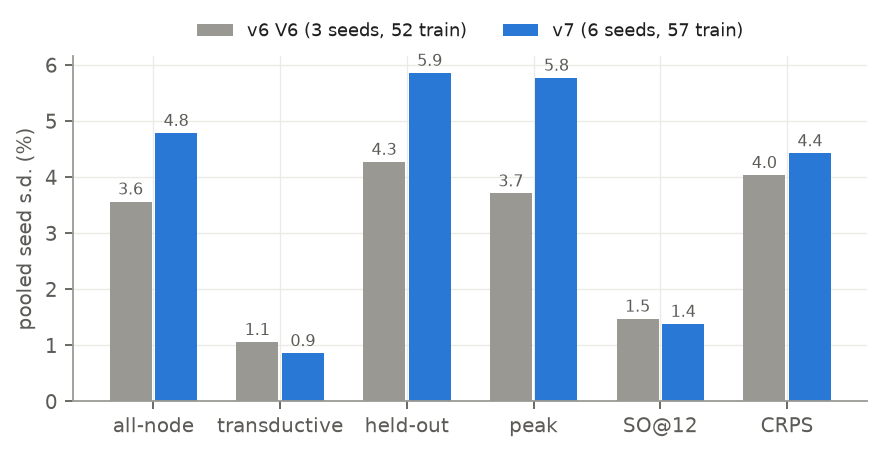
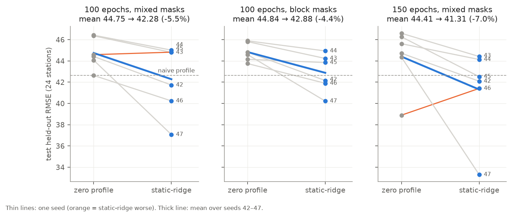
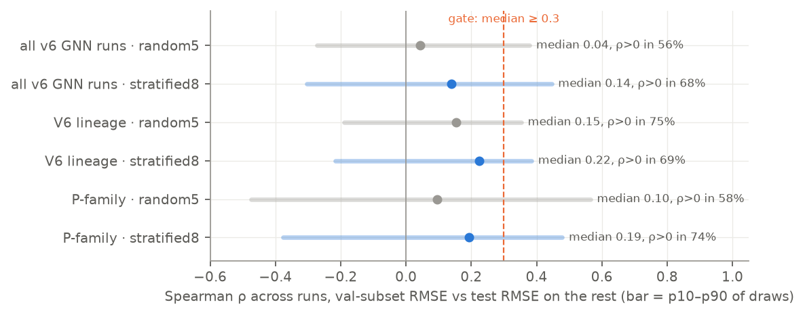
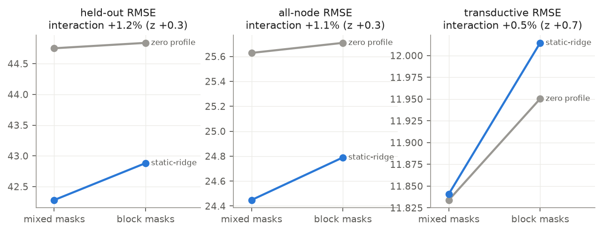
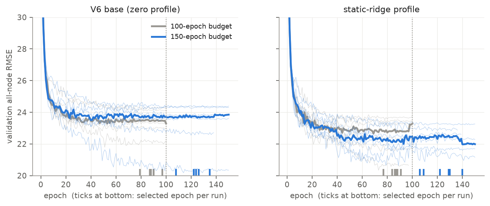
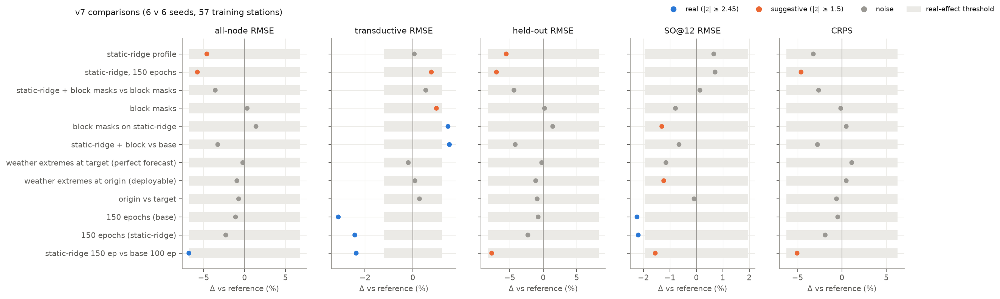

# RIoT v7 stage: 6-seed analysis (8 experiments × seeds 42–47)

**Scope.** All 48 trained runs of the v7 stage. The stage turned the six next-stage recommendations of [`riot_v6_seed_report.md`](../riot_v6/riot_v6_seed_report.md) §9.2 (hereafter "the v6 report") into one unattended run:

| rec | what | outcome |
|---|---|---|
| 1 | confirm the static-ridge profile on 57 training stations | tier 1, 12 runs |
| 2 | fix inductive validation, but only if a pre-check passes | **gate failed**, so tier 2 (12 runs) was not trained |
| 3 | static-ridge × E2.2 block masks | tier 3, 12 runs (a 2×2 with tier 1) |
| 4 | weather extremes observed at the forecast origin | tier 4, 12 runs |
| 5 | 150-epoch budget | tier 5, 12 runs |
| 6 | stop list | audit **passed** (60 configs, 0 violations) |

**Purpose.** Close out v6 §9.2 and supply the v7 results for thesis Chapter 7.
**Date.** 2026-10-28. Training took 198 GPU-h for the 48 runs, against an estimated 219 GPU-h without tier 2. The copied data does not include wall-clock start and end times.

**Reproduce.**

```bash
python scripts/riotv5/collect_v5_results.py --manifest configs/train/v7/suite_manifest.yaml \
    --out docs/experiments/riot_v7/data                     # run by run_v7_stage.sh
python scripts/riotv5/seeds_v7_results.py                   # -> data/seed_*.csv, factorial, seed_effects,
                                                            #    epoch_stats; figures/fig01–06
```

The script reads:
- `docs/experiments/riot_v7/data/{runs,epochs}.csv`, `rec2_gate.json` and `rec6_stop_list.json`;
- the v6 `runs.csv`, for the cross-stage rows (†);
- the v5 `runs.csv`, for the naive profile.

Every run used `holdout_sha 669860aa8b4cdd15`, seq_len 12, and selection on `obs_loss_plus_so`.

**Comparability (read this first).**
- **Station sets.** Every v7 run trains on the v5 57-station set with no validation stations, and is tested on the same 24 held-out stations. So **every v7 metric is directly comparable with v5 and with the naive profile**. Against v6, which trained on 52 stations, only held-out and kriging are like-for-like. Those rows are marked † and use test metrics only.
- **Validation window.** With no validation stations, the validation split scores the same 24 held-out stations as "ind", in an earlier window (`src/train.py`). Selection does not read them. The sign check on held-out claims is therefore a *temporal* replication on the same stations, not an independent station set.
- **Coverage.** Coverage is unchanged from v5 and v6: only 14 of the 24 held-out stations have any observation in the test window (15 in the validation window). (Corrected 2026-10-28: earlier counts of 15 included NclTynebridgeNorthEast, which has no pedestrian records after April 2025.)

---

## 0. Executive summary

1. **The static-ridge profile holds up in direction, but the effect is about half the v6 estimate. It does not reach "real".**
   - Against the V6 base on 57 stations: held-out −5.5% (z −1.6), all-node −4.6% (z −1.7), peak −5.1%, CRPS −3.2%. Transductive is unchanged.
   - The validation window agrees in sign on every one of these. The verdict is **suggestive**, as in v6.
   - The paired seed evidence is stronger than the z-score:
     - static-ridge wins 16 of 18 seed-matched pairs across the three settings (mixed masks, block masks, 150 epochs);
     - averaged over those settings, it wins for **all 6 seeds** (sign test p 0.031).
   - The size is uncertain. The per-seed mean is −6.0%, the median −3.4%, and −3.4% without seed 47. Seed 47 alone gives −17% at 100 epochs and −29% at 150 epochs.
   - Cost: SO@96 mass falls from 0.94 to 0.90 (real). Two of six seeds drop below the 0.9 target.
2. **Against the naive profile the static-ridge model still only ties on held-out.**
   - Test: −0.8% at 100 epochs and −3.1% at 150 epochs, both noise.
   - Validation window: the naive profile is *better* (+3.0% and +2.6%).
   - On the same stations, v5's P5B (40.82) still has the lowest held-out RMSE of any 3+-seed model. V7's best is static-ridge at 150 epochs, 41.31 ± 4.10.
3. **The inductive-validation gate failed, and tier 2 was skipped as designed.**
   - On the v6 checkpoints, 8 stratified validation stations predict held-out ranking on the remaining stations with median ρ 0.14 (needed ≥ 0.3), and ρ > 0 in only 68% of draws (needed ≥ 80%).
   - Held-out RMSE itself is very stable *over time*: validation-window vs test-window held-out RMSE on the same 24 stations has ρ 0.96 (0.93 within config).
   - So the failure is about *which stations* are scored, not about noisy windows. A subset of 8 stations does not rank models the way the other stations do.
4. **The perfect-forecast weather gain from v6 did not replicate.**
   - Weather extremes at the target step: held-out −0.2%, all-node −0.2%, MAE +2.1%, against v6's −5.7% / −5.0%.
   - Weather observed at the origin: held-out −1.1%, noise.
   - Neither variant is worth keeping.
5. **Block masks do nothing on held-out for V6, and they cost transductive accuracy.**
   - Held-out +0.2% on the base and +1.4% on static-ridge.
   - Transductive +1.0% (s) on the base and +1.5% (real) on static-ridge.
   - No interaction with the profile (held-out interaction +1.2%, z 0.25).
   - The E2.2 held-out gain is a P-family result: V6 + block masks is +8.6% held-out against v6's P-family E2.2 (†, s).
6. **A 150-epoch budget buys a small observed-station gain and nothing at unseen stations.**
   - Transductive −3.1% and SO@12 −2.2% on the base (both real, 6 of 6 seeds). Held-out −0.8%, noise.
   - Every run selects after epoch 100 (mean 123), and most still run to the cap.
   - The cost is 51% more GPU time (5.5 h per run against 3.6 h).
7. **Noise.**
   - Unpaired held-out σ is *higher* than in v6 (5.9% against 4.3%), even with all 57 stations in training. So the v6 explanation (5 fewer training stations) is wrong.
   - Most of the extra noise comes from the static-ridge arms (per-config held-out s.d. 7.8% and 10.7%, against 1.9–3.7% for zero-profile arms).
   - Seed is now a strong shared factor: a seed main effect removes 50% of the within-config variance on held-out and all-node, against 15–20% in v6. Paired designs are worth using.
   - Selected-epoch s.d. is 6.7, and the epoch confound is gone (transductive ρ −0.19, p 0.21).

---

## 1. Coverage and scoring

| tier | experiments | runs | GPU-h | notes |
|---|---|---|---|---|
| 1 static (rec 1) | `v7_base`, `v7_profile_static` | 12 | 44.0 | `v7_base` = V6 with no validation stations; control for every arm |
| 2 valid (rec 2) | `v7v_*` (4 configs × seeds 42–44) | 0 | – | **skipped**: gate FAIL (`rec2_gate.json`, exit 1) |
| 3 block (rec 3) | `v7_block`, `v7_static_block` | 12 | 43.8 | 2×2 with tier 1 on shared seeds |
| 4 weather (rec 4) | `v7_weather_target`, `v7_weather_origin` | 12 | 45.4 | target = v6 replication (perfect forecast); origin = deployable |
| 5 epochs (rec 5) | `v7_base_e150`, `v7_profile_static_e150` | 12 | 65.2 | 150 epochs, `min_epochs` 60, patience 30 |
| 6 stop list | audit of all 60 generated configs | – | – | PASS: no LSTM, seq48, GAT drop, outage head or kriging-loss variant |

All 48 scheduled runs completed.

**Protocol.** The v6 schedule: cosine LR, 3 warmup epochs, 100-epoch budget, `min_epochs` 40, patience 20. Tier 5 is the exception.

**Scoring.** The v5/v6 protocol, generalised to 6 seeds:
- mean ± s.d. over seeds 42–47;
- pooled within-config seed σ over the 8 v7 configs (ddof 1 per config), as log-CV % for RMSE-type metrics and absolute for rates;
- z = Δ / √(σa²/na + σb²/nb).

Verdicts are unchanged:
- **real:** |z| ≥ 2.45 *and* the validation window agrees in sign;
- **suggestive:** |z| ≥ 1.5;
- **noise:** otherwise.

**New in v7: seed-paired statistics.** Every arm shares seeds 42–47, so each within-v7 comparison also reports:
- the paired t on per-seed log ratios (df 5);
- the number of seeds that favour the arm;
- the range of Δ when any one seed is left out.

These do not change the verdicts. They show how far a result rests on one seed.

## 2. Noise and early stopping



### 2.1 Pooled seed s.d. (test)

| metric | v6 V6 (3 seeds, 52 train) | v7 (6 seeds, 57 train) |
|---|---|---|
| all-node | 3.6% | 4.8% |
| transductive | 1.1% | **0.9%** |
| held-out | 4.3% | **5.9%** |
| peak | 3.7% | 5.8% |
| SO@12 | 1.5% | 1.4% |
| CRPS | 4.0% | 4.4% |
| SO@96 mass (abs.) | 0.031 | 0.020 |

**Observed stations:** as quiet as in v6. Transductive σ is 0.9%, so a 3 v 3 effect of about 2% counts as real.

**Unseen stations: noisier, and not because of the station set.** The v6 report put the higher held-out σ down to 5 stations leaving training. With all 57 back, held-out σ went *up*. Per config (log s.d. of held-out RMSE):

| config | held-out seed s.d. |
|---|---|
| `v7_block` | 1.9% |
| `v7_weather_target` / `_origin` | 3.1% / 3.7% |
| `v7_base` | 3.2% |
| `v7_static_block` | 4.2% |
| `v7_base_e150` | 6.7% |
| `v7_profile_static` | **7.8%** |
| `v7_profile_static_e150` | **10.7%** |

The static-ridge arms dominate the pooled figure. In v6 the static-ridge spread *halved* (1.29 against 2.68), but that was 3 seeds. Here seed 47 produces an exceptionally good static-ridge model (§3.3).

**Seed is a shared factor.** A seed main effect removes 50% of the within-config variance on held-out and all-node, 40% on CRPS and 29% on transductive (v6: 15–20%). Seeds 43 and 44 are unfavourable for every arm (held-out +4.0% and +4.3% against the config mean). Seeds 46 and 47 are favourable (−3.8% and −5.5%). This is why the paired statistics in §3–§7 are tighter than the unpaired z.

### 2.2 Early stopping

| config | selected epoch | ran to the cap | selected after epoch 100 |
|---|---|---|---|
| 100-epoch configs (6) | 84–89 (pooled s.d. **6.7**) | 67–83% | – |
| `v7_base_e150` | 123 ± 9 | 83% | 6 / 6 |
| `v7_profile_static_e150` | 123 ± 13 | 67% | 6 / 6 |

- **Selected-epoch s.d.** is 6.7, better than v6 V6's 8.8. No run selected before epoch 74.
- **Epoch confound gone.** Within config, a later selected epoch no longer predicts lower test RMSE: transductive ρ −0.19 (p 0.21, −0.19% per 10 epochs), all-node and held-out ρ ≈ 0.08. In v6 it was ρ −0.32.
- **Budget.** As in v6, most runs end at the budget, not by early stopping. §7 covers what more epochs buy.

## 3. Rec 1: the static-ridge profile on 57 training stations



### 3.1 Headline comparison (6 v 6, same seeds)

| metric | V6 base | static-ridge | Δ | z | validation Δ | paired t (p) | seeds favouring | leave-one-seed-out Δ | verdict |
|---|---|---|---|---|---|---|---|---|---|
| held-out | 44.75 ± 1.45 | 42.28 ± 3.22 | **−5.5%** | −1.63 | −4.7% | −2.37 (0.064) | 5 / 6 | −6.7 to −3.5% | suggestive |
| all-node | 25.63 ± 0.69 | 24.45 ± 1.51 | **−4.6%** | −1.67 | −3.8% | −2.43 (0.059) | 5 / 6 | −5.6 to −3.0% | suggestive |
| peak | 93.0 | 88.3 | −5.1% | −1.52 | −4.1% | −2.41 | 6 / 6 | −6.1 to −3.2% | suggestive |
| CRPS | 7.08 | 6.85 | −3.2% | −1.26 | – | −1.87 | 5 / 6 | −4.2 to −1.7% | noise |
| MAE | 8.83 | 8.61 | −2.5% | −1.24 | −2.6% | −1.98 | 5 / 6 | | noise |
| kriging | 45.1 | 43.4 | −3.9% | −1.13 | −3.8% | −1.71 | 5 / 6 | | noise |
| transductive | 11.83 | 11.84 | +0.1% | 0.12 | −0.1% | | 3 / 6 | | noise |
| SO@12 | 14.10 | 14.20 | +0.7% | 0.82 | +0.6% | | 3 / 6 | | noise |
| SO@96 mass | 0.941 | **0.903** | −0.038 | −3.21 | | | | | **real** (worse) |
| top-decile bias | −55.5 | −52.3 | +3.2 | 1.31 | | | | | noise |

The other two paired settings point the same way:

| setting | held-out Δ | all-node Δ | z (held-out) | seeds favouring |
|---|---|---|---|---|
| block masks (`v7_static_block` vs `v7_block`) | −4.4% | −3.6% | −1.29 | **6 / 6** (paired t −3.25, p 0.023) |
| 150 epochs (`_e150` pair) | −7.0% | −5.8% | −2.06 | 5 / 6 |

The 2×2 main effect of the profile over both mask settings is held-out −5.1% (z −2.1) and all-node −4.2% (z −2.1).

### 3.2 Pooled over the three settings, per seed

Seeds are the independent unit, so the per-seed effect is averaged over the three settings (log %):

| seed | 42 | 43 | 44 | 45 | 46 | 47 | mean | median |
|---|---|---|---|---|---|---|---|---|
| held-out Δ, static − zero | −6.2 | −3.9 | −2.8 | −2.9 | −1.3 | **−18.8** | −6.0 | −3.4 |

- **Direction: consistent.** The arm wins for all 6 seeds (sign test p 0.031) and in 16 of 18 seed-matched pairs. The two losses are seed 45 at 100 epochs (+0.5%) and seed 46 at 150 epochs (+6.3%). In the second case the zero-profile partner happens to be the best zero-profile model in the stage (38.90).
- **Magnitude: uncertain.** Without seed 47 the effect is about −3.4%. With it, the mean is −6%. The v6 estimate (−8.5%, 3 seeds on 52 stations) looks like the upper end.
- **Protocol: not "real".** The v6 report expected 6 v 6 seeds to clear z 2.45 "on its own". That assumed Δ ≈ 8% at σ ≈ 4%. In v7, Δ is 5.5% and σ is 5.9%.

### 3.3 Seed 47

Seed 47's static-ridge models are the best unseen-station models of the stage:

| | held-out (test) | held-out (val window) | top-decile bias | median node nRMSE (held-out) |
|---|---|---|---|---|
| `v7_base` s47 | 44.07 | 39.13 | −54.2 | 1.22 |
| `v7_profile_static` s47 | **37.07** | **34.05** | −44.4 | 0.98 |
| `v7_profile_static_e150` s47 | **33.30** | 35.47 | −32.5 | 0.97 |
| naive profile | 42.63 | 37.03 | −62.2 | |

- **Not a test-window accident.** The gain shows in the validation window too. The run-to-run correlation between the two windows is ρ 0.96 (§4.2).
- **It is a level effect, the same mechanism as in v6 §3.2.** Under-prediction of the busiest decile shrinks from −54 to −44 / −32. So some seeds learn to use the ridge level much more than others.
- **Next step.** A station-level look at these runs is the natural follow-up (§11.2). It needs inference only.

### 3.4 Against the naive profile and v6

| comparison | held-out Δ | validation Δ | verdict |
|---|---|---|---|
| `v7_base` vs naive profile | +5.0% | +8.1% | suggestive (worse) |
| `v7_profile_static` vs naive | −0.8% | **+3.0%** | noise |
| `v7_profile_static_e150` vs naive | −3.1% | **+2.6%** | noise |
| `v7_static_block` vs naive | +0.6% | +4.7% | noise |
| `v7_base` vs `v6_base` † | −1.8% | – | noise |
| `v7_profile_static` vs `v6_profile_static` † | +1.3% | – | noise |

- **Against the naive profile.** On held-out the static-ridge V6 ties it. On every other metric the models are far better (all-node −10.2%, transductive −34.6%, SO@12 −20.4%, MAE −16.2%, all real).
- **Five more training stations bought nothing measurable at unseen stations** (−1.8% and +1.3%, †). The transductive rows against v6 (−3.4% and −3.7%, "real") are station-set artefacts: 57 against 52 scored stations.

## 4. Rec 2: inductive validation, gated



### 4.1 The gate

Before training tier 2, `posthoc_v7_eval.py` re-scored 75 saved v6 GNN checkpoints per held-out station. It then simulated validation-station selection. The 24 held-out stations, the only stations no v6 run trained on, stood in for candidate validation stations. Each draw picks a subset as "validation" and keeps the rest as "test". The statistic is Spearman ρ across runs between the two.

| rule | runs | median ρ | p10 – p90 | ρ > 0 |
|---|---|---|---|---|
| random5 (the v6 rule), all GNN runs | 75 | 0.04 | −0.27 – 0.38 | 56% |
| **stratified8 (the v7 rule), all GNN runs** | 75 | **0.14** | −0.30 – 0.45 | **68%** |
| random5, V6 lineage | 42 | 0.15 | −0.19 – 0.35 | 75% |
| stratified8, V6 lineage | 42 | 0.22 | −0.22 – 0.38 | 69% |
| random5, P-family | 33 | 0.10 | −0.47 – 0.56 | 58% |
| stratified8, P-family | 33 | 0.19 | −0.38 – 0.48 | 74% |

**Verdict: FAIL.** The rule needed median ρ ≥ 0.3 and ρ > 0 in ≥ 80% of draws. Stratifying by volume and requiring coverage does improve the rule over v6's random 5: the median moves from 0.04 to 0.14, and the correlation is no longer negative on average. But a validation score that ranks models the wrong way in a third of draws cannot select checkpoints. Tier 2 was skipped, and every v7 model is selected on the usual criterion.

**Caveat on the simulation.**
- Only 15 of the 24 held-out stations have ≥ 25% validation-window coverage, and only 14 have any test-window data.
- So each stratified8 draw scores "test" on just 6–7 stations.
- The high-volume stations (NorthumberlandSt Monument Mall, level 293; The Pearl, 101) have no data in either window.

The gate is therefore pessimistic. But the population it would face in practice is just as thin: training stations have similar coverage (v6 §3.2).

### 4.2 What v7 adds: held-out RMSE is stable over time, but not across stations

v7 has no validation stations, so its validation split scores the 24 held-out stations in the earlier window:

| subset (48 v7 runs) | Spearman ρ, val-window vs test-window held-out RMSE |
|---|---|
| all runs | **0.96** (p 1e-26) |
| within config | **0.93** (p 5e-21) |
| config means (8) | 0.98 |

Two consequences:
- **Seed differences at unseen stations are a real property of each trained model.** They persist across windows and are not evaluation noise. A seed that kriges the held-out stations well does so in both periods.
- **Rec 2 failed on station heterogeneity, not on temporal noise.** Which stations are scored matters more than when. With 15 usable unseen stations of very different volume, no 8-station subset ranks models the way the rest do.

The v6 conclusion stands: report the usual checkpoint and do not select on validation stations.

## 5. Rec 3: static-ridge × block masks



| metric | zero, mixed | static, mixed | zero, block | static, block | profile main effect | masks main effect | interaction |
|---|---|---|---|---|---|---|---|
| held-out | 44.75 | 42.28 | 44.84 | 42.88 | **−5.1% (z −2.1)** | +0.8% (z 0.3) | +1.2% (z 0.3) |
| all-node | 25.63 | 24.45 | 25.71 | 24.79 | **−4.2% (z −2.1)** | +0.9% | +1.1% |
| transductive | 11.83 | 11.84 | 11.95 | 12.01 | +0.3% | **+1.2% (z 3.5)** | +0.5% |
| SO@12 | 14.10 | 14.20 | 13.99 | 14.01 | +0.4% | −1.0% (z −1.9) | −0.5% |
| peak | 93.0 | 88.3 | 93.4 | 89.8 | −4.6% (z −1.9) | +1.1% | +1.2% |
| SO@96 mass | 0.941 | 0.903 | 0.941 | 0.912 | **−0.03 (z −4.0)** | 0.00 | +0.01 |

Main effects are averaged over the other factor (σ/√6). The interaction is the difference of the simple effects (2σ/√6).

- **Block masks do not transfer from the P-family to V6.**
  - In v6, E2.2 block masks were the one P-family block that was real on held-out (−10.6% vs P2B).
  - On V6 they are null on held-out and cost transductive accuracy (+1.0% s on the base, +1.5% real on static-ridge; 5 and 6 of 6 seeds worse).
  - The likely reason is that V6's lags and traffic-aware mixed masks already give the outage-robustness that block masks added to P2B.
- **No interaction.** The profile effect is the same with either mask (interaction z 0.25). The two levers are orthogonal, as v6 predicted, but only one of them works on V6.
- **Lower spread?** Block-mask arms have the smallest held-out seed spread (1.9% and 4.2% against 3.2% and 7.8%). With 6 seeds that is a description, not a test.

## 6. Rec 4: weather extremes

| arm vs `v7_base` | all-node | trans | held-out | MAE | peak | SO@12 | CRPS | top-decile bias |
|---|---|---|---|---|---|---|---|---|
| at target step (perfect forecast) | −0.2 | −0.2 | −0.2 | +2.1 | −1.4 | −1.2 | +1.1 | −54.2 vs −55.5 |
| at forecast origin (deployable) | −0.9 | +0.1 | −1.1 | +1.6 | −2.2 | −1.2 s | +0.5 | −53.2 |
| origin vs target | −0.7 | +0.3 | −0.9 | −0.5 | −0.8 | −0.1 | −0.6 | |
| *v6: target vs v6 base* | *−5.0 s* | *−1.6 s* | *−5.7 s* | | *−6.2 s* | *−0.8* | *−6.3 s* | *−52 vs −58* |

All v7 rows are noise. The one suggestive entry is SO@12 at the origin, z −1.5.

- **The v6 result does not replicate.** The perfect-forecast arm gives nothing here. v6's −5 to −6% was a 3 v 3 suggestive result, and its held-out is now +3.8% against its own v6 run (†). It was most likely a favourable draw.
- **MAE is slightly worse in both variants** (+1.6 to +2.1%; 4 and 5 of 6 seeds worse). The extreme-weather flags shift the distribution at low counts.
- **The "survival fraction" question is moot.** The origin arm does no worse than the target arm, because neither does anything.

**Weather extremes should be dropped.**

## 7. Rec 5: a 150-epoch budget



| comparison | all-node | trans | held-out | SO@12 | CRPS | GPU-h per run |
|---|---|---|---|---|---|---|
| base: 150 vs 100 | −1.1 | **−3.1 R** (6/6, t −9.3) | −0.8 | **−2.2 R** (6/6) | −0.5 | 5.5 vs 3.6 |
| static-ridge: 150 vs 100 | −2.3 | **−2.4 R** (6/6) | −2.3 | **−2.2 R** (6/6) | −1.9 | 5.4 vs 3.7 |
| static-ridge 150 vs base 100 | **−6.8 R** | **−2.4 R** | −7.7 s | −1.6 s | −5.1 s | |

- **Observed stations improve as v6 predicted.** v6 projected −0.34% per 10 epochs, which is −1.7% over 50. The observed gain is −2.4 to −3.1% transductive, and SO@12 −2.2% as well.
- **Validation all-node RMSE barely moves after epoch 100** (−0.2% / −0.1% median best-after-100 against best-by-100). The gain is concentrated on the transductive stations. All-node includes the noisier held-out set.
- **Held-out does not improve** (−0.8% and −2.3%, noise). Seed spread on held-out grows (6.7% and 10.7%).
- **Static-ridge at 150 epochs is the best model of the stage on mean held-out (41.31), all-node (23.89), peak (85.8) and CRPS (6.72).** Against the base at 100 epochs, all-node is −6.8% (real) and held-out −7.7% (suggestive). Most of that is the profile, not the epochs.
- **Cost:** +51% GPU-h for about 3% transductive. Worth it for a final model, not for screening.
- **Stopping still does not trigger.** With patience 30 and selection at about 123, most runs reach epoch 150. The budget, not the stopping rule, still decides when training ends.

## 8. Rec 6: stop list

`generate_v7_configs.py --audit` re-read all 60 generated configs, including the 12 untrained tier-2 configs. None uses an LSTM / ensemble, seq_len ≠ 12, GAT missing-source drop, an outage head or likelihood, or a kriging-loss variant. Verdict: **PASS**.

## 9. Where v7 stands



### 9.1 All v7 configs (test, mean over 6 seeds)

| config | all-node | trans | held-out | MAE | peak | SO@12 | SO@96 | SO@96 mass | CRPS | kriging | q90 cov. | top-decile bias | epoch | GPU-h |
|---|---|---|---|---|---|---|---|---|---|---|---|---|---|---|
| `v7_base` | 25.63 ± 0.69 | 11.83 ± 0.07 | 44.75 ± 1.45 | 8.83 | 93.0 | 14.10 | 15.67 | 0.941 | 7.08 | 45.1 | 0.856 | −55.5 | 88 ± 6 | 21.9 |
| `v7_profile_static` | 24.45 ± 1.51 | 11.84 ± 0.11 | 42.28 ± 3.22 | 8.61 | 88.3 | 14.20 | 15.95 | 0.903 | 6.85 | 43.4 | 0.852 | −52.3 | 86 ± 5 | 22.1 |
| `v7_block` | 25.71 ± 0.41 | 11.95 ± 0.09 | 44.84 ± 0.87 | 8.80 | 93.4 | 13.99 | 15.62 | 0.941 | 7.07 | 45.3 | 0.857 | −55.5 | 84 ± 7 | 21.3 |
| `v7_static_block` | 24.79 ± 0.84 | 12.02 ± 0.04 | 42.88 ± 1.77 | 8.62 | 89.8 | 14.01 | 15.72 | 0.912 | 6.88 | 43.7 | 0.850 | −53.1 | 87 ± 7 | 22.4 |
| `v7_weather_target` | 25.57 ± 0.64 | 11.81 ± 0.11 | 44.65 ± 1.37 | 9.02 | 91.7 | 13.94 | 15.66 | 0.937 | 7.16 | 44.8 | 0.860 | −54.2 | 88 ± 8 | 22.6 |
| `v7_weather_origin` | 25.39 ± 0.78 | 11.84 ± 0.14 | 44.25 ± 1.62 | 8.97 | 91.0 | 13.93 | 15.69 | 0.939 | 7.11 | 44.5 | 0.862 | −53.2 | 86 ± 7 | 22.8 |
| `v7_base_e150` | 25.35 ± 1.35 | 11.46 ± 0.13 | 44.41 ± 2.84 | 8.79 | 91.5 | 13.79 | 15.46 | 0.944 | 7.05 | 44.6 | 0.854 | −53.7 | 123 ± 9 | 33.0 |
| `v7_profile_static_e150` | 23.89 ± 1.96 | 11.55 ± 0.09 | 41.31 ± 4.10 | 8.50 | 85.8 | 13.88 | 15.68 | 0.913 | 6.72 | 42.4 | 0.853 | −49.1 | 123 ± 13 | 32.2 |

Collapse is 0 (< 0.0005) for every run.

**Same-station references** (v5 runs, 57 training / 24 held-out):

| reference | all-node | trans | held-out | SO@12 |
|---|---|---|---|---|
| naive profile | 27.22 | 18.10 | 42.63 | 17.82 |
| V5F, v5 (3 seeds) | 26.33 | 13.30 | 45.15 | 15.99 |
| P5B, v5 (3 seeds) | 26.24 | 17.65 | **40.82** | 19.04 |

`v7_base` vs V5F on identical stations: transductive −11.0%, SO@12 −11.8%, CRPS −10.6%, held-out −0.9%. This is the v6 "V6 is a cleaner V5F" result, now without the station-set caveat.

### 9.2 Against the v5 §14.2 targets

| target | `v7_base` | `v7_profile_static` | `v7_profile_static_e150` |
|---|---|---|---|
| SO@12 ≤ 16.5 | 14.10 yes | 14.20 yes | 13.88 yes |
| SO@96 mass 0.9–1.1 | 0.94 yes | 0.903 **borderline** (2 of 6 seeds < 0.9) | 0.913 yes (1 of 6 < 0.9) |
| collapse < 0.02 | 0 yes | 0 yes | 0 yes |
| held-out ≤ 42.6 (naive) | 44.75 **no** | 42.28 yes on mean (tie with naive; val window +3%) | 41.31 yes on mean (tie; val +2.6%) |
| all-node ≤ 25 | 25.63 **no** | 24.45 yes | 23.89 yes |

## 10. Claims register: v6 → v7

| v6 claim (v6 report) | v7 result (6 seeds, 57 train) | status |
|---|---|---|
| Static-ridge profile cuts held-out −8.5% (s) | −5.5% (s); 6 / 6 seeds when pooled over settings; median per-seed −3.4%; SO@96 mass −0.04 (R) | **confirmed in direction, smaller; still suggestive** |
| Static-ridge beats the naive profile (−2.1%, noise) | −0.8% test, +3.0% validation window | **not confirmed (tie)** |
| Static-ridge halves held-out seed spread | spread *doubles* (7.8% against 3.2%), driven by seed 47 | **reversed** |
| Higher held-out noise is due to 5 fewer training stations | held-out σ 5.9% with all 57 stations | **refuted** |
| Stratified, covered validation stations would fix inductive selection | gate median ρ 0.14, ρ > 0 in 68% of draws | **refuted on v6 checkpoints; tier skipped** |
| Static-ridge and E2.2 block masks are orthogonal | interaction +1.2% (z 0.25) | **confirmed** |
| E2.2 block masks help held-out | null on V6 (+0.2%); transductive +1.0 to +1.5% | **P-family only** |
| Perfect-forecast weather extremes −5 to −6% (s) | −0.2% held-out, MAE +2.1% | **not replicated** |
| More epochs would help (67% hit the cap) | transductive −3.1%, SO@12 −2.2% (R); held-out null | **confirmed for observed stations only** |
| V6 is a cleaner V5F | vs v5 V5F on identical stations: transductive −11.0%, SO@12 −11.8%, CRPS −10.6%; held-out −0.9% | **confirmed, station caveat removed** |
| Epoch confound weakening | transductive ρ −0.19 (p 0.21) | **confirmed (gone)** |

## 11. Recommendations

### 11.1 For the thesis

1. **Make the static-ridge profile the default for unseen stations.** Report it with three numbers:
   - the 6-seed mean effect (held-out −5.5%, all-node −4.6%, suggestive);
   - the seed-pooled sign result (6 / 6 seeds);
   - the median per-seed effect (−3.4%).

   Say plainly that it ties, and does not beat, the naive profile on held-out.
2. **Name the final model.** Either `v7_profile_static` (100 epochs, 22 GPU-h per 6 seeds) or the 150-epoch variant (−2.4% transductive, real, at +51% cost). Both meet every v5 target on the mean. SO@96 mass at 100 epochs sits on the 0.9 edge.
3. **Present held-out as bounded by station heterogeneity, not by evaluation noise.** Use §4.2: val-window vs test-window held-out ρ 0.93 within config, but no 8-station subset predicts the rest. This explains, in one argument, both the failed inductive-validation attempts (v6 and v7) and the large seed spread.
4. **Withdraw the v6 weather-extreme claim** and the "static-ridge halves spread" remark. Restrict E2.2 block masking to the P-family.
5. **Quote held-out claims with σ ≈ 6% unpaired.** Use seed-paired statistics where arms share seeds, since pairing removes about half the variance.
6. **Comparability.** v7, v5 and the naive profile share station sets, so v7 can be compared with v5 on every metric. Comparisons with v6 keep the † and stay test-only.

### 11.2 Next stage, if any (in order of value per GPU-hour)

1. **Station-level diagnosis of the static-ridge effect (inference only, a few GPU-h).**
   - Score the 18 seed-matched static/zero pairs per held-out station; `posthoc_v7_eval.py valcheck` already does per-station error sums.
   - Find which stations carry the gain, and why seed 47's models fix the busy-station level when the others do not.
   - If the gain sits in a few high-volume stations, the ridge level estimate itself (features, regularisation) is the lever, not the GNN.
2. **If one more training stage is affordable, spend it on seeds, not arms.** For example, 6 more seeds (48–53) of `v7_base` and `v7_profile_static`, paired. This would settle whether the true effect is closer to −3% or −6%, and whether seed 47 is a tail or a mode. About 45 GPU-h.
3. **Do not chase P5B's held-out lead without the transductive cost.** P5B (40.82) still beats V7 on held-out, but at +49% transductive and +35% SO@12 RMSE against `v7_base`.
4. **Stop:** weather extremes (both variants), block masks on V6, and inductive validation stations. Keep the v6 stop list (LSTM / ensemble, seq48, GAT drop, outage head, kriging-loss variants).

---

## Appendix A. Figures (`figures/`)

| file | content |
|---|---|
| `fig01_seed_noise.png` | pooled seed s.d., v6 V6 against v7 |
| `fig02_static_ridge_seeds.png` | held-out RMSE per seed, zero vs static-ridge profile, in the three paired settings |
| `fig03_comparisons.png` | forest plot, every within-v7 comparison (all-node, transductive, held-out, SO@12, CRPS) |
| `fig04_factorial.png` | 2×2 profile × masks interaction plot (held-out, all-node, transductive) |
| `fig05_epochs.png` | per-epoch validation all-node RMSE, 100- vs 150-epoch budgets, with selected epochs |
| `fig06_rec2_gate.png` | rec-2 gate: Spearman ρ distribution per selection rule and lineage |

In the forest plot:
- blue = real, orange = suggestive, grey = noise;
- the shaded band is the |z| = 2.45 threshold.

## Appendix B. Data files (`data/`)

| file | content |
|---|---|
| `runs.csv`, `epochs.csv` | collected per-run and per-epoch metrics (from `run_v7_stage.sh`) |
| `rec2_gate.json` | rec-2 gate: per-station level and coverage, per-rule ρ statistics, verdict |
| `rec6_stop_list.json` | rec-6 audit record |
| `seed_summary.csv` | per v7 experiment: mean and s.d. of every metric, selected epoch, trained epochs, GPU-h |
| `seed_noise.csv` | pooled seed σ per family (V6, V6P, V7) and metric |
| `seed_comparisons.csv` | every comparison in this report: Δ, z, validation Δ, paired t, seeds favouring, leave-one-seed-out range, verdict per metric |
| `factorial.csv` | 2×2 cell means, main effects and interaction with z, per metric |
| `seed_effects.csv` | per-seed deviation from config means; static-ridge held-out effect per seed and setting |
| `epoch_stats.csv` | selected epoch, trained epochs, share reaching the cap, validation gain after epoch 100 |
